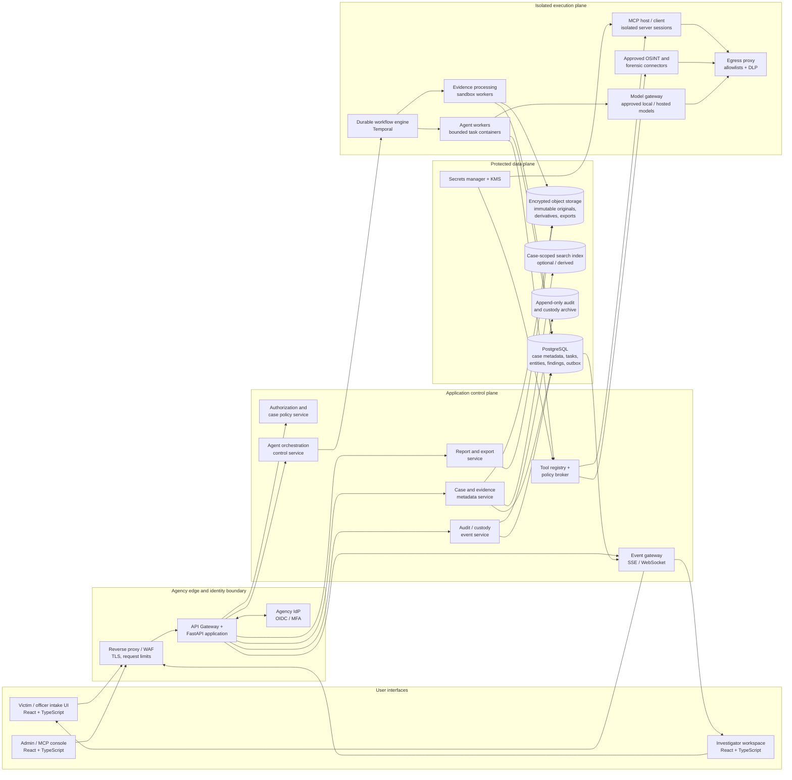
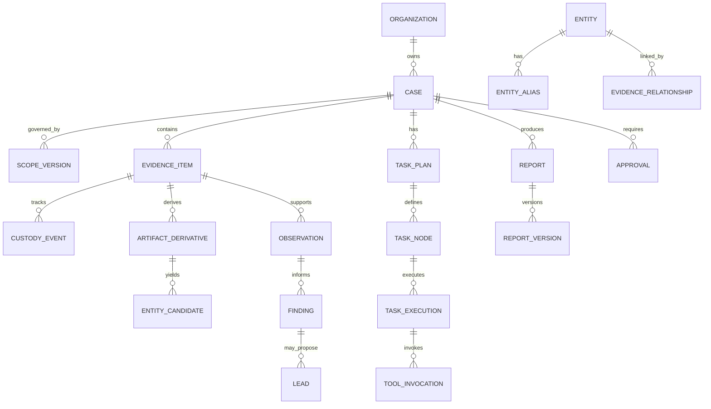
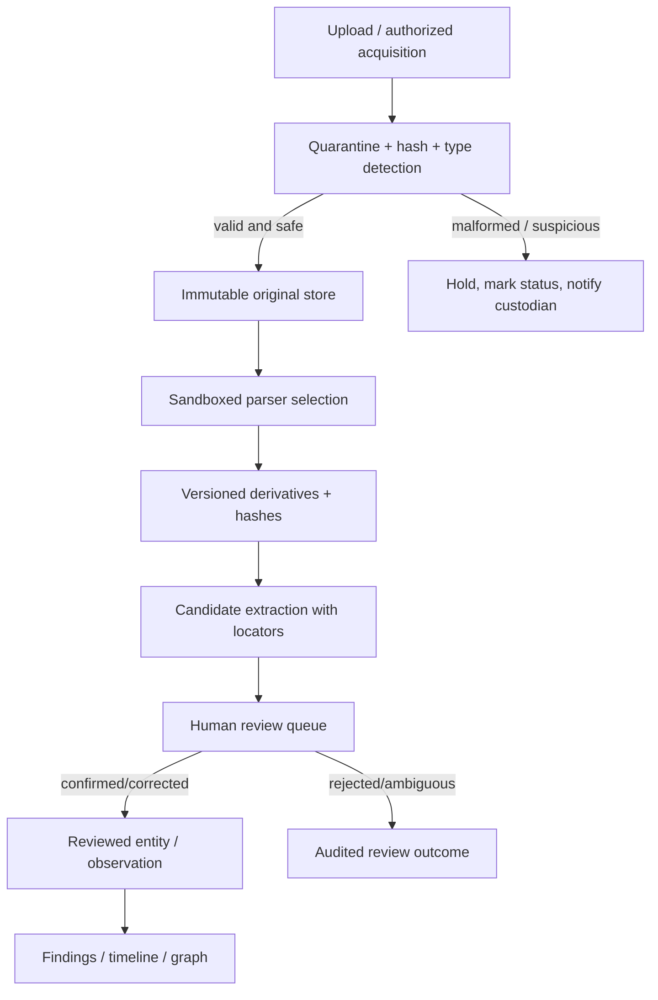
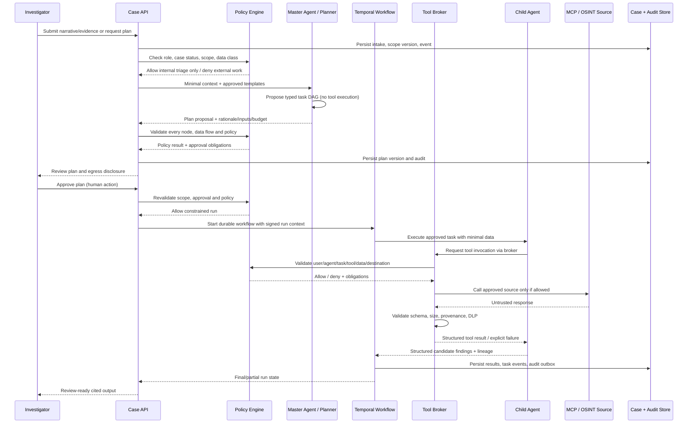

# Technical Architecture — Aegis OSINT & Digital Forensics Platform

**Document status:** Architecture baseline for implementation  
**Version:** 1.0  
**Date:** 25 October 2026  
**Audience:** Backend/frontend engineers, AI/agent engineers, security architects, digital-forensics engineers, SRE, and agency technology owners  
**Requirements:** [`prd.md`](prd.md)  
**UI/UX:** [`design.md`](design.md)

> **System boundary:** Aegis is an authorized investigative decision-support and evidence-management platform. It preserves evidence and assists with scoped OSINT/forensic analysis; it does not prove identity or guilt, obtain legal authority, replace qualified examiners, or execute enforcement actions. All external collection, MCP invocation, and case-data egress are policy-controlled and auditable. Human approval is a system state with backend enforcement, not merely a UI convention.

---

## 1. Architecture Goals and Design Principles

### 1.1 Goals

The architecture must:

1. Preserve originals, provenance, chain-of-custody events, and report lineage in a way that is tamper-evident and independently verifiable.
2. Support natural-language case intake and evidence ingestion while distinguishing raw allegation, direct observation, parsed derivative, analytic finding, and lead.
3. Orchestrate multi-agent work as a bounded, durable, observable task graph with human approval gates, explicit budgets, and source lineage.
4. Treat AI output and all external tool content as untrusted; prevent prompt injection and error cascades from changing policy or becoming unsupported facts.
5. Make MCP and non-MCP tools modular, replaceable, dynamically discoverable, versioned, reviewed, and subject to the same tool policy enforcement.
6. Support secure cloud, agency-hosted, and on-premises deployments, including configurations with no external model or OSINT connectivity.
7. Provide real-time but truthful task/evidence updates without exposing private model chain-of-thought or suggesting unperformed work.
8. Support case-level isolation, data classification, source-specific retention, deletion/legal hold, export control, and auditing.

### 1.2 Non-goals

- Autonomous suspect identification, person-level guilt or risk scores, facial recognition, voice identification, or predictive policing.
- Access-control circumvention, credential use, exploitation, active scanning by default, covert tracking, unauthorized account access, or illicit data acquisition.
- Agents executing external enforcement, provider-contact, payment, account-blocking, or fund-freezing actions.
- Direct agent access to raw production databases, arbitrary file systems, or unmediated internet egress.
- Making every external query or inference reproducible as though sources and model outputs were immutable; instead preserve what was actually observed, when, under which versions and scope.

### 1.3 Architectural principles

- **Evidence-first:** original objects are immutable to normal users; derivatives point to parent hashes; all report claims have lineage.
- **Policy over prompts:** central authorization/policy services decide permissions. A model prompt cannot create authority.
- **Least privilege:** each user, agent, worker, server, connector, and model receives the minimum capability/data needed for its specific task.
- **Smallest sufficient team:** dynamically select the minimum approved agent/tool set for the task; agent count, calls, runtime, and cost are bounded [R01–R05].
- **Observable orchestration:** task DAG and transitions are persisted and queryable; human users can review, pause, cancel, or revise within policy [R04].
- **Source lineage, not consensus:** multiple agents repeating the same source are not independent corroboration; claims retain derivation genealogy and contradictions [R06].
- **Tool adapters, centralized controls:** protocol-specific code is isolated behind a canonical tool interface; all invocation passes through policy, schema validation, egress control, response validation, and audit [R19–R25].
- **MCP is an untrusted integration boundary:** discovery, transport success, or server registration does not equate to trust or permission [R26–R30, R36].
- **Fail visibly:** a missing/blocked source remains missing; never manufacture a fallback finding [R05, R10].
- **Human oversight is meaningful:** reviewers can inspect inputs, sources, limits, and alternatives; the system does not use a confidence badge as a substitute for evidence [R11, R32, R35].

### 1.4 Research basis and scope

References [R01]–[R36] are catalogued in [`prd.md` §15](prd.md#15-research-references-in-the-repository). Principal architectural implications include: adaptive orchestration and task dependency design [R02–R05]; error genealogy [R06]; OSINT source evaluation and legal/operational boundaries [R07–R10]; evidence provenance and modality-aware processing [R12–R18]; long-horizon tool planning and call correctness [R19–R25]; MCP lifecycle, trust, security and operational fault testing [R26–R30, R36]; human alignment [R32]; and adversarial decomposition/prompt injection defenses [R27, R29, R34]. The repository includes papers, preprints, workshop content, industry reporting, and strategy documents; this architecture adopts design concerns but does not treat them as legal authority or product-validation results.

---

## 2. System Overview

### 2.1 Logical architecture

Aegis uses a **modular service architecture with a small number of independently scalable execution boundaries**, not an unrestricted microservice swarm. The API/control plane and data model remain coherent; untrusted file parsing, agent/model execution, and external tool/MCP invocation are isolated into separate workers and network zones.



### 2.2 Trust zones

1. **User client zone:** browser UI; considered untrusted. It receives only data authorized for the current user and case. Browser state is not an authorization boundary.
2. **Edge zone:** reverse proxy/WAF, TLS termination, request limits, session enforcement, and identity federation. Public victim intake is isolated logically and, where required, physically from investigator routes.
3. **Application control plane:** authenticated APIs, case/scope authorization, policy decisions, tool registry, audit, workflow management, and report assembly. No model or MCP server has direct database credentials.
4. **Protected data plane:** PostgreSQL, evidence object store, search/index data, audit archive, secrets and keys. Access is by service identity and narrow permissions.
5. **Execution plane:** parser workers, agent workers, model gateway, MCP clients/host, and connectors run with workload identity, limits, network segmentation, and ephemeral task context. Parser/MCP/connector processes are considered potentially compromised.
6. **External trust zone:** public/licensed APIs, hosted model endpoints, and remote MCP servers. Egress is denied unless a named, reviewed destination and purpose are authorized. No unrestricted internet route.

### 2.3 Deployment topologies

- **Agency-hosted / on-premises:** recommended for highly restricted evidence; local object store, database, model gateway, and approved connectors. Outbound network may be disabled entirely.
- **Private cloud:** isolated tenant network, agency-managed keys, private endpoints, restricted egress proxy, and deployment-specific data residency controls.
- **Hybrid:** evidence and primary case records remain agency-side; approved low-sensitivity identifiers may be sent to licensed providers through a broker when policy permits. The UI previews data categories and destinations.

The product must not assume a cloud provider, jurisdiction, or external AI service. Topology is selected by agency risk and legal review. A deployment without an approved AI model remains functional for evidence cataloging and manual workflows.

---

## 3. Technology Stack Selection

| Layer | Selection | Rationale and constraints |
|---|---|---|
| Investigator / intake UI | React + TypeScript + Vite; component and motion rules in `design.md` | Dense, interactive, authenticated workflow; typed domain states; static agency-hostable bundle; no server rendering of sensitive case content by default. |
| API | Python 3.12+ with FastAPI, Pydantic v2, SQLAlchemy 2.x, Alembic | Strong parser/AI ecosystem, typed validation, asynchronous APIs, OpenAPI generation, and integration with forensic/OSINT libraries. Pin dependencies and validate all untrusted payloads at runtime. |
| Primary relational database | PostgreSQL 16+ (agency-approved supported version) | Transactional case data, constraints, row-level security as defense-in-depth, full-text search for moderate volume, JSONB for versioned event/tool payload metadata. PostgreSQL remains system of record. |
| Durable orchestration | Temporal (self-hosted or approved managed deployment) | Durable, retryable, observable long-running workflows; explicit signals for approve/pause/cancel; task histories separated from evidence. Workflow history must not become a substitute for the legally governed audit/custody archive. |
| Event delivery | PostgreSQL transactional outbox + event gateway using SSE as default; WebSocket only where bidirectional behavior is required | Reconnectable, ordered status updates with database-backed recovery; server state remains authoritative. Keep event content minimal. |
| Evidence/object storage | S3-compatible object storage with encryption, retention/object-lock capability, versioning, and agency-managed keys | Large binary objects, immutable originals and derivatives, streaming access, and portable deployment. Confirm vendor object-lock semantics and legal hold behavior. |
| Search | PostgreSQL full-text initially; optional OpenSearch for scale after risk review | Avoid unnecessary index duplication for pilot; if deployed, index is derived, case-filtered, encrypted, rebuildable, and never authoritative. |
| Secrets and keys | Agency KMS/HSM and secrets manager (e.g., Vault or cloud-native equivalent) | Never store connector secrets in PostgreSQL, MCP configs, prompts, source files, or logs. Support key rotation and separation by environment/tenant. |
| Policy engine | Open Policy Agent (OPA) as a policy decision point, with versioned Rego policies and a fail-closed client | Centralize authorization, scope, data-flow, tool capability, and egress decisions. Application must independently authenticate policy decision responses and log policy version. |
| Model access | Internal Model Gateway; adapters to approved local runtime (e.g. vLLM/Ollama-compatible endpoint) and approved hosted providers | Classification-aware routing, provider isolation, prompt/version controls, cost limits, no-training/retention review, and consistent structured-output validation. No direct model provider call from agents. |
| MCP | Isolated MCP host/client adapter using an approved, pinned MCP SDK; remote Streamable HTTP and sandboxed local stdio where approved | MCP protocol changes stay behind adapter; server registration and capability policy are independent of model provider. Do not expose arbitrary transports or server executables. |
| Background parsing | Containerized Python workers with seccomp/AppArmor or equivalent, read-only base FS, scratch quotas, no network by default | Untrusted file parsing is isolated, resource bounded, observable, and reproducible. Specialized native parsers are pinned and tested. |
| Container runtime | OCI images, rootless containers; Kubernetes or an agency-supported orchestrator for larger deployments | Separate API, workflow, parser, agent, MCP, and connector workloads; enforce quotas, network policies, secrets injection, and image provenance. A smaller deployment may use hardened Compose/VMs only if controls remain equivalent. |
| Monitoring | OpenTelemetry traces/metrics; Prometheus-compatible metrics; agency logging/SIEM integration | Trace IDs across API/workflow/tool events without sending case content into metrics. Audit events remain in the dedicated append-only audit store. |
| Testing | pytest, Playwright, contract tests, property/fuzz tests, MCP server test harness, red-team suites | Validate parser safety, multi-step workflow outcomes, authorization, source lineage, and adversarial cases, not only single tool-call syntax. |

**Version policy:** exact minor versions are pinned per release; security updates are assessed continuously. The version targets above are architectural baselines and must be checked against agency-approved support windows at implementation time. Dependency updates to parsers, models, MCP servers, policies, and tool schemas trigger compatibility/security evaluation and are recorded.

### 3.1 Why a modular monolith at the control plane

The case API, domain policy, and metadata need strong transaction boundaries and consistent authorization. Splitting these into many independently deployed services in the first release would increase network trust boundaries and complicate evidence/audit consistency. Therefore, implement a modular FastAPI application with strict internal module boundaries and separately deployed workers for high-risk or scaling-sensitive tasks. Extract a module into a service only when a measurable scaling, isolation, or ownership need justifies the additional boundary.

---

## 4. Backend Architecture

### 4.1 Application modules

The API/control plane is organized into modules with explicit interfaces:

1. **Identity & session:** OIDC login callback, token/session state, user mapping, MFA/step-up assertions, service identities.
2. **Authorization & policy client:** role, case membership, classification, scope, purpose, legal/approval gates, tool/data-flow decisions.
3. **Case service:** case lifecycle, scope versions, assignments, notes, related-case suggestions.
4. **Intake service:** narrative, victim-facing report reference, upload session, extraction candidate job request; cannot invoke external tools.
5. **Evidence service:** object upload/finalization, hash verification, custody events, derivatives, access/download authorization.
6. **Entity/finding service:** candidate entities, observations, findings, leads, graph edges, conflict/corroboration data, review history.
7. **Workflow service:** plan review, durable run lifecycle, approval signals, pause/cancel/replan, budgets and status query.
8. **Tool registry / invocation broker:** capability catalog, source profiles, MCP/non-MCP adapters, parameter validation, data minimization, egress authorization.
9. **Audit service:** append-only security, administrative, evidence-custody and analytic events, with separate schemas/retention as required.
10. **Report service:** snapshot selection, citations, redaction, manifest generation, review workflow, export and signing integration.
11. **Notification/event service:** outbox to SSE gateway; role-/case-aware event filtering and safe notification payload.
12. **Administration service:** agent templates, MCP server lifecycle, policy config references, retention profiles, model/source registry.

Module boundaries are enforced by imports and tests: for example, agent workers cannot import database repositories directly; they call scoped internal APIs or receive signed task payloads.

### 4.2 API design

- REST/JSON over HTTPS for CRUD and commands; OpenAPI is generated from typed schemas and reviewed for sensitive field leakage.
- SSE is the default for one-way run/evidence updates. Use WebSocket only if a real bidirectional use case is proven. No model token stream is treated as an authoritative task event.
- All write endpoints require idempotency keys for retriable client commands and include actor, case, and expected version where concurrent edits matter.
- Use optimistic concurrency (`ETag`/`If-Match` or record version) for case scope, plan, and report edits. Conflicts return current version and do not overwrite changes.
- Pagination uses stable opaque cursors; filters always bind to case and authorization scope. Search results are not permission evidence.
- Sensitive request/response bodies are not logged by default. Audit payloads contain references, hashes, redacted parameters, and necessary decision facts.
- API errors use consistent problem-detail codes and safe user messages. Internal stack traces and connector secrets never reach clients.

Representative endpoints (exact names can be refined in implementation):

```text
POST   /v1/cases                         Create case/report draft
GET    /v1/cases/{case_id}               Read authorized case summary
PATCH  /v1/cases/{case_id}               Update allowed case fields/version
POST   /v1/cases/{case_id}/scope-versions Create proposed scope version
POST   /v1/cases/{case_id}/scope-versions/{version}/approve
POST   /v1/cases/{case_id}/evidence/upload-sessions
POST   /v1/evidence/{evidence_id}/finalize
GET    /v1/evidence/{evidence_id}         Metadata and lineage
POST   /v1/evidence/{evidence_id}/verify-hash
GET    /v1/cases/{case_id}/entities       Candidate/reviewed entities
POST   /v1/entities/{entity_id}/review    Confirm/correct/reject/ambiguous
GET    /v1/cases/{case_id}/findings       Findings, leads and conflicts
POST   /v1/cases/{case_id}/plans          Create plan proposal
POST   /v1/plans/{plan_id}/approve        Human approval with decision record
POST   /v1/plans/{plan_id}/reject
POST   /v1/plans/{plan_id}/runs           Start approved plan
POST   /v1/runs/{run_id}/pause|cancel     Request safe run control
GET    /v1/runs/{run_id}                 Authoritative workflow state
GET    /v1/runs/{run_id}/events           SSE stream with cursor
GET    /v1/admin/mcp-servers             Admin-only MCP inventory
POST   /v1/admin/mcp-servers             Register draft server
POST   /v1/admin/mcp-servers/{id}/discover Synthetic-data discovery/test only
POST   /v1/admin/mcp-servers/{id}/approve Named review decision
POST   /v1/reports                       Draft from selected reviewed snapshot
POST   /v1/reports/{id}/validate
POST   /v1/reports/{id}/approve
POST   /v1/reports/{id}/exports          Authorized versioned export
```

Every route performs server-side authentication, role and case checks, scope/state checks, and resource-level authorization. The `discover` endpoint is limited to an isolated test environment and cannot receive case data.

### 4.3 Authentication and authorization

- Use agency OIDC identity provider with Authorization Code + PKCE for browser clients. The backend stores a secure server-side session or uses short-lived access tokens with `HttpOnly`, `Secure`, `SameSite` cookies as deployment permits. Avoid long-lived bearer tokens in browser local storage.
- MFA and step-up authentication are agency-enforced for privileged actions. Session revocation and identity disablement propagate promptly.
- API service-to-service communication uses mTLS/workload identity and short-lived credentials. Human identity is propagated as a signed, auditable actor claim; workers do not impersonate users.
- Authorize on every object access by `organization_id`, `case_id`, role, classification, assignment, purpose, and action. PostgreSQL row-level security may provide defense-in-depth, but application policy is also enforced and tested.
- Use separation-of-duty policies for approval, report sign-off, deletion, retention changes, and MCP server activation.
- For victim intake, use abuse controls (rate limits, upload scanning, bot defenses) without exposing case content or silently turning a public submission into an investigation.
- Agent identities are non-human service principals with per-run claims and expiration; all credentials/capabilities are narrower than the initiating user’s case authorization.

### 4.4 Central policy evaluation

OPA is the policy decision point; the application and Tool Broker are policy enforcement points. Decision input includes authenticated actor, case/scope version, task, agent identity/template, tool/server/version, requested data elements/classifications, destination, purpose, approval record, and budgets. OPA returns allow/deny plus obligations (e.g., redaction, field minimization, required approval, expiry, rate limit). Policy errors, timeout, missing fields, or unknown policy version result in deny.

Policies are version-controlled, signed/released, peer-reviewed, tested with positive/negative fixtures, and attached to each decision event. Changes are staged and regression-tested against recorded synthetic scenarios before deployment. Models cannot call OPA with an arbitrary action string to grant themselves permission; only application service code constructs recognized policy inputs.

---

## 5. Data Architecture

### 5.1 Data stores and authority

- **PostgreSQL is authoritative** for case metadata, scope versions, identity references, evidence metadata, custody events, entities, findings, tasks, approvals, MCP registry, report versions, and audit pointers.
- **Object storage is authoritative** for immutable originals, derivatives, source snapshots where permitted, exports, and associated manifests. Database rows point to object IDs and hashes, not inline binary data.
- **Search indexes and vector indexes are derived** and can be rebuilt from authorized source records. They must be case-scoped, classification-aware, access-filtered, encrypted, and subject to deletion/retention policy.
- **Temporal history is workflow execution state**, not the official custody or security audit record. Important transitions are copied to the append-only audit service through a transactional outbox.
- **Secrets manager/KMS** stores credentials and data-encryption keys, separated from case database and application config.

### 5.2 Logical entity model

Core records are tenant-aware and versioned. Primary IDs are random, non-semantic identifiers; case references shown to users are separate. All time fields store UTC and, where known, source offset/timezone and precision.

| Entity | Purpose and important fields |
|---|---|
| `Organization` | Tenant/agency identifier, jurisdiction policy profile, key references, retention defaults. |
| `User` / `ServicePrincipal` | External identity mapping, role claims, status, authentication source; no credential secrets. |
| `Case` | ID, public/internal reference, title, type, status, classification, owner/unit, retention profile, created/updated, current scope version. |
| `CaseMembership` | User/role/case assignment, restrictions, validity interval, authorizer. |
| `ScopeVersion` | Purpose, authority status/reference, included identifiers/sources/time range, geographic limits, data restrictions, approval, version, effective/expiry time. Immutable after approval; changes create a new version. |
| `IntakeReport` | Reporter-facing reference, narrative original, language, contact preference if consented, submission time, consent notice version, access class. Reporter PII can be separately encrypted/restricted. |
| `EvidenceItem` | Case ID, source class, original/derivative type, filename, claimed/detected type, size, hash algorithm/value, object key, uploader/acquisition actor, ingest state, classification, custody state, parent evidence ID. |
| `CustodyEvent` | Append-only evidence event: event type, actor, source/destination custody, purpose, UTC/source time, hash, method/tool/version, acknowledgment, prior-event hash. |
| `ProcessingRun` | Parser job, input evidence hash, parser version/config, sandbox, start/end, state, outputs, warnings, resource usage. |
| `ArtifactDerivative` | Derived text/OCR/transcript/metadata/export; parent evidence ID/hash, output hash, method, coordinates/time offsets, quality, model/parser version. |
| `EntityCandidate` | Type, exact raw span/value, normalization, source locator, extraction method/version, confidence semantics, sensitivity, review status, corrected/rejected history. |
| `Entity` | Reviewed canonical case-level entity record, with explicit identity/role status, identifiers and permitted relationships. Candidate matching does not establish person identity. |
| `EntityAlias` | Exact observed value, normalized form, type, source, locale, match basis, reviewed state; no destructive merge. |
| `EvidenceRelationship` | Typed observed/inferred/analyst-confirmed edge, endpoints, provenance, method, scope, review status, confidence definition. |
| `Observation` | Direct source-grounded statement with locator, source and retrieval/acquisition details, time, method and exact content/hash/reference. |
| `Finding` | Analytic assessment, supporting/contradicting observation IDs, method, limitations, source lineage, review status, confidence semantics, supersession pointer. |
| `Lead` | Reviewable hypothesis, rationale, owner, next step, authority dependency, due/stale state, disposition. |
| `TaskPlan` / `TaskNode` | Plan version, goal, task DAG edges, agent template/version, inputs, tools, data class, approval and limits. |
| `Run` / `TaskExecution` | Workflow ID, initiating user, scope/policy version, task state, budget, trace ID, event sequence, outputs, error/partial status. |
| `Approval` | Subject/action approved or denied, approver, reason, data flow, scope version, policy version, expiration, signature/assertion. |
| `ToolServer` / `ToolDefinition` | MCP or non-MCP endpoint metadata, owner, trust domain, transport, version, reviewed definition hash, approval state, data/side-effect contract. No secrets. |
| `ToolInvocation` | Task/case/scope, tool/server version/hash, redacted request, data categories, policy decision, destination, timings, response hash/reference, validation, error state. |
| `AuditEvent` | Append-only access, admin, policy, agent, tool, report and security event; actor, event, target reference, time, reason, correlation, integrity link. Payload minimized. |
| `Report` / `ReportVersion` | Template, input snapshot IDs/versions, citations, reviewer edits, redactions, approvals, output object/hash, export recipient/purpose. |
| `RetentionHold` | Case/object scope, issuer, legal hold reason, start/release, approval and affected backup/index rules. |

### 5.3 Entity relationship overview



### 5.4 Evidence object lifecycle

1. **Upload session:** API authorizes case and upload category; creates a short-lived upload capability scoped to one object and case. Client may upload directly to object store using multipart/resumable protocol. Capability does not allow list/read/delete.
2. **Quarantine:** incoming bytes enter a quarantine prefix/bucket with restricted service identity and no preview. Object size, checksum, filename, claimed type, uploader, case, and upload-session ID are recorded.
3. **Integrity validation:** server-side checksum is verified and SHA-256 is calculated. Optional SHA-512 is additional evidence, not a replacement. Hash mismatch, incomplete upload, or unexpected size moves item to a failure/quarantine state.
4. **Safety screening:** malware scanning and file-type detection run without executing content. Archives have recursion, path traversal, file count, decompression ratio, and total byte limits. Suspicious objects remain preserved but are not automatically rendered or parsed.
5. **Immutable original:** after validation, the object is moved/promoted into a retention-protected originals area; normal user/service roles have no overwrite/delete permission. Object lock/versioning and retention are configured and verified for the selected storage implementation.
6. **Sandbox processing:** isolated workers receive a read-only object reference and limited scratch space. Network is disabled unless the exact processing service requires a reviewed destination. Parsers have CPU/memory/time/file-count limits.
7. **Derivative commit:** derivative output is hashed and stored separately with a `ProcessingRun` record, parent hash/object ID, parser/model version, configuration, locator metadata, quality/confidence, and warnings.
8. **Review/index:** extracted candidates are indexed as unreviewed. Index entries carry case and classification tags and can be deleted/rebuilt without altering evidence.
9. **Ongoing custody:** access, transfers, verification, report inclusion, redaction, export and deletion/hold actions emit custody/audit events.
10. **Incident handling:** hash mismatch or suspicious storage mutation creates a security event, restricts ordinary use, preserves relevant logs, alerts evidence custodian, and marks dependent findings/reports for review.

A cryptographic hash proves that bytes match a recorded value at a given verification point. It does not prove the source identity, truth, collection legality, or originality before ingest.

### 5.5 Search, indexing, and retrieval

- For initial deployments, PostgreSQL full-text search covers case-visible narratives, approved derivative text, reviewed metadata, and selected finding fields. Evidence bytes are never indexed indiscriminately.
- A separately deployed OpenSearch cluster may be introduced for high-volume document search after a threat/privacy review. Search requests must include tenant, case, user access, classification, retention state, and scope filters; the API post-filters results and hydrates authorization before returning them.
- Vector retrieval, if used for OCR/chat similarity or tool discovery, is a derived aid. It stores embedding model/version, text source ID, classification, and deletion mapping. Vector similarity is not evidence of identity or source corroboration.
- Tool retrieval uses tool descriptions/schema metadata and current task dependencies, then policy filters the candidate set before model exposure [R22, R28].
- Cross-case search or relationship discovery is disabled by default, requires policy authorization, minimum necessary fields, explicit purpose, and an audit event. No agency-wide graph is built from personal identifiers by default.

---

## 6. Evidence Processing and Forensic Pipeline

### 6.1 Processing stages



### 6.2 Parser and modality design

- **Text/email:** deterministic parsers first for RFC email headers, MIME parts, structured exports, and common document formats. LLM extraction is a separate candidate-generation stage against bounded text chunks with offsets.
- **PDF/documents:** inspect text layer and page geometry; OCR scanned content separately with page/region coordinates, engine version, language, quality, and confidence. Keep source page image and OCR derivative separately.
- **Images:** safe decoder, EXIF/XMP/IPTC metadata extraction, perceptual hash for case-scoped deduplication, OCR with regions. No face recognition.
- **Audio/video:** safe format identification and optional approved transcription/transcoding; preserve timecodes, language, model/engine, and confidence; no voice identity inference.
- **Chat/SMS:** parser-specific schema, preserve raw chronology and participant labels, extract candidate entities and keyphrases; do not infer speaker identity beyond the source export.
- **Network/device artifacts:** specialist parser container, pinned version, supported artifact matrix; store exact inputs/output and examiner method. Product must distinguish native acquisition from a report/file supplied by user.
- **Unknown/encrypted formats:** preserve and catalog, record inability, route to qualified examiner; never brute-force, execute, or silently omit.

### 6.3 Reproducible processing manifest

Every processing job emits an immutable manifest containing input IDs/hashes, parser image digest, parser version, configuration hash, supported format status, resource limits, start/end times, worker identity, output IDs/hashes, warnings/errors, and review state. Re-running creates a new `ProcessingRun`, not a replacement. Parser upgrades can mark existing derivatives as potentially stale without rewriting historic outputs.

### 6.4 Evidence view and safe rendering

The API provides a short-lived, permission-checked view/download URL or proxy stream after case, item-level, classification, and purpose checks. Browser preview runs in a sandboxed origin with restrictive CSP and no cookies or privileged API access. HTML/email content is sanitized and rendered as inert text; links are not clickable by default. External links are copied or opened only through an approved safe-browsing path with a warning and no ambient agency credentials.

---

## 7. AI Agent Architecture

### 7.1 Overview: constrained planner, deterministic executor

Aegis uses a **Master Agent planner plus deterministic workflow executor**. The LLM may propose a plan and create structured analytic candidates, but the application/workflow engine validates and executes approved nodes. Model text is never interpreted as an executable workflow without schema, policy, and approval validation.



### 7.2 Master Agent

The Master Agent is implemented as a versioned planner service with no direct database, object store, or network-tool credentials. It receives a task-scoped context assembled by the application:

- authorized case purpose and scope version;
- investigator instruction and approved narrative/evidence references;
- reviewed entities plus unreviewed candidates clearly labeled;
- source/tool/agent templates already filtered to potentially eligible capabilities;
- privacy classification and external data policy;
- budgets, deadline, constraints, and prior task statuses relevant to the plan.

The context builder applies field-level minimization. Full case dumps and raw evidence binaries are not sent to the planner. For evidence review, a task-specific derivative excerpt or secure artifact access token is used. The token expires quickly and grants access only to a named evidence object/region and action.

#### Planner output schema

A plan proposal must validate against a versioned schema with:

- `plan_id`, `case_id`, `scope_version`, `planner_template_version`, `model/provider/version`;
- one-sentence objective aligned to case purpose;
- task node IDs and dependencies (DAG; no cycles); task type and bounded objective;
- required inputs and source locators; data classification; output schema;
- agent template ID/version (not a generated arbitrary executable agent);
- candidate tools/source classes and exact data categories to disclose;
- whether task is local, internal, or external; approval requirements and policy obligations;
- concurrency, retry, timeout, call, token, and cost budgets;
- rationale suitable for investigator review, uncertainty and known gaps;
- validation/check task(s) where analytic risk requires independent review.

The planner cannot set authorization to true, alter case classification, add an unregistered tool, extend scope, change an approved server, or approve its own plan. The schema validator and policy engine reject unknown fields, missing references, cycles, excessive depth, unbounded loops, unsupported data classes, and tool names not in the registry.

#### Planning algorithm

1. Verify current case status, scope, authority status, user permission, and allowed mode.
2. Classify the user request into a supported task family using deterministic rules and/or a model; ambiguous or out-of-scope requests route to human clarification, not broad data collection.
3. Derive candidate tasks and dependencies from approved templates; select smallest sufficient agent/tool set, using task relevance/diversity and cost constraints [R02, R03].
4. Filter sources and tools by jurisdiction, terms, classification, purpose, scope, server health, review/approval state, and user entitlement before exposing them to the model.
5. Construct DAG and budgets. Reject cyclic, redundant, over-broad, non-idempotent parallel or unbounded plans.
6. Generate a human-readable plan and data-egress summary, then run deterministic validation and adversarial policy checks.
7. Persist plan proposal and policy decisions. If any external source or sensitive operation needs approval, pause before execution.
8. After approval, re-evaluate all policy and scope conditions immediately before run creation; approval must still be valid and tied to this exact plan hash.
9. Execute via durable workflow. Recheck policy at each tool call and state transition; stop on expired scope, policy update, server mutation, security alert, or budget exceedance.
10. Aggregate structured findings, detect conflicts and lineage dependence, mark partial/missing information, and publish only to review queues.

### 7.3 Child agent framework and lifecycle

Child agents are immutable, reviewed templates executed as ephemeral task workers. A template defines:

- stable `agent_template_id` and semantic version;
- supported task categories, concise role objective, input/output schemas;
- allowed model profiles and data classifications;
- approved tools, sources, and data flows;
- maximum context, tokens, tool calls, time, concurrency, and cost;
- validation rules, required provenance, uncertainty vocabulary, and safety test suite;
- owner, reviewer, risk class, approval date, and retirement policy.

A run instantiates one template for one task with a scoped context and service identity. Instances cannot retain cross-case conversational memory. Task artifacts persist in case records under their provenance; scratch context is purged according to policy. A template change creates a new version and triggers regression testing; historic task records retain the exact version used.

Lifecycle states: `Proposed → Reviewed → Enabled → Instantiated → Queued → Running → Completed | Partial | Failed | Cancelled | Timed out → Archived`. A retired template remains identifiable for historic reports but cannot run for new tasks.

### 7.4 Agent communication

Agents do not coordinate through unrestricted natural-language peer chat. They exchange typed task messages via a broker/workflow event interface:

```json
{
  "event_id": "opaque-id",
  "case_id": "opaque-id",
  "scope_version": 3,
  "run_id": "opaque-id",
  "task_id": "opaque-id",
  "sender_principal": "agent-template@version",
  "recipient_task_id": "opaque-id",
  "event_type": "task_result",
  "classification": "case-restricted",
  "input_refs": [{"evidence_id": "opaque-id", "locator": "page:2"}],
  "payload_schema": "finding-batch/v1",
  "payload_hash": "sha256:...",
  "created_at": "UTC timestamp"
}
```

Messages carry no authority token that permits another agent to widen scope. A receiving agent validates schema, hashes, case/scope version, sender identity, data class, and allowed dependency. Cross-domain information transfer requires explicit policy evaluation. A task result cannot be treated as trusted just because it came from another internal agent.

### 7.5 Finding aggregation and error governance

- Maintain claim genealogy from source/observation through parser/agent result, entity, finding, report sentence, and export.
- Every cited source has a lineage identity. Republished news pages, mirrored content, or repeated model summaries are not separate corroboration.
- The aggregator detects conflicting values, independent source count, stale source, missing locator, and circular references. Conflict is a first-class state; the model cannot choose one silently.
- A correction to an upstream entity/source/parser marks dependent findings and report snapshots as `Review required`; the original output is preserved and superseded, never overwritten.
- Critic/verification agents may check schema, quote-to-source match, or arithmetic, but are not treated as independent evidence if they use the same model/context/source. Deterministic validation is preferred where possible [R06].
- The final response is a reviewable draft assembled from validated records. Unsupported text is rejected or flagged `uncited`; no model-memory completion of missing facts.

### 7.6 Model Gateway and prompt/data handling

All model calls route through a Model Gateway that:

- maps data classification to approved model/provider endpoints;
- enforces token/context/cost/rate limits and availability circuit breakers;
- applies prompt-template version, safety policy, output schema, timeout and response constraints;
- redacts prohibited personal/authentication fields where required;
- records model/provider/version, request hash, policy decision, usage/cost and output hash/reference without unnecessary raw-case logging;
- disables provider training/retention where contractually supported and records residual limits; denies unapproved providers;
- supports local inference with no egress and deterministic fallback to manual/deterministic workflows.

Prompts include explicit instruction/data separation. Evidence text, retrieved web content, email, OCR and MCP output are quoted/typed as untrusted data and never elevated to system or developer authority. The orchestrator passes task intent and permitted operations through structured policy-controlled inputs. Agent decomposition is checked against the original case goal so seemingly benign sub-tasks cannot compose into an unapproved action [R27, R34].

No requirement or interface exposes raw private chain-of-thought. Store concise task rationale, cited observations, selected tool/action, policy decisions, and reviewer feedback instead.

---

## 8. Tool and OSINT Integration Architecture

### 8.1 Canonical Tool Registry

The Tool Registry is the single canonical catalog for built-in tools, API connectors, local deterministic utilities, and MCP-discovered capabilities. A `ToolDefinition` includes:

- stable ID and immutable version/hash;
- protocol/adapter, server owner/trust domain and environment;
- human-reviewed description, input/output schema, examples and parameter constraints;
- source class, allowed purpose/jurisdiction, permitted data classifications and destination;
- side-effect label (`read-only`, `external communication`, `state mutation`, `unknown`); unknown defaults to disabled;
- required authority/approval; rate, concurrency, timeout, cost and response-size limits;
- provenance/reliability/freshness fields and data retention/terms;
- security/privacy review status, approval expiry, health state, and last verification.

Indexing/retrieval uses lexical and semantic search against reviewed definitions, then the policy engine applies authorization before a candidate is exposed to an agent. Capability changes invalidate the prior approval and tool hash [R23, R28, R29].

### 8.2 Invocation broker

All tool calls go through the Tool Broker; no agent or model has direct network access. The invocation lifecycle is:

1. Agent requests a typed tool ID/version and parameter object for a named task.
2. Broker authenticates service identity and confirms the task is active and within approved plan/scope.
3. Validate tool is enabled/approved, server identity and definition hash match, and approval has not expired.
4. Validate parameters against schema, bounds, conditional requirements, source-specific rules, and data lineage. Validate values as well as structure [R25].
5. Calculate exact data elements to send; enforce minimization/redaction and classification-to-destination policy. Human approval is revalidated if required.
6. Evaluate OPA decision. Deny on timeout, missing obligation, policy uncertainty, changed scope, or server-health/security alert.
7. Egress proxy restricts DNS/host/IP/port, certificate identity, network region if relevant, request rate, and byte limits. Prevent DNS rebinding and unapproved redirects.
8. Execute with bounded timeout/retry and idempotency control. Read-only tools can retry only under provider-specific limits; stateful tools require explicit idempotency semantics and separate approval.
9. Validate response content type, schema, size, encoding, object depth, secrets, case references, and prompt-injection indicators. Treat response as untrusted data; never run instructions/code.
10. Persist invocation metadata, response hash or permitted raw capture, source freshness, retrieval time, errors, policy version, and audit event.
11. Return a normalized result with provenance to the task. Agent may produce candidate findings only from that result and authorized inputs.

### 8.3 OSINT source profiles

Each source profile is versioned and approved independently. It records owner, source type, permitted query/collection method, public/licensed/authorized status, coverage, known limitations, terms, jurisdiction, data transfer, provider retention, freshness behavior, rate limits, reliability review, and incident contact. Source quality labels are contextual (e.g. official registry, provider-reported, public self-claim, commercial enrichment) and are not universal accuracy scores.

Initial connector categories are those in [`prd.md` §7.7]: supplied email/header parsing, passive domain/DNS/TLS/WHOIS and reputation lookups, public/licensed web/social records, user-supplied payment normalization, public blockchain lookups, and approved forensic parsers. Active scanning, private provider records, dark-web access, and person-level geolocation are not enabled by default.

No output from IP geolocation is represented as a person’s exact location. Public blockchain activity is separated from wallet ownership/identity. A public profile match is a lead and not a verified person. These distinctions are encoded in tool output schema and UI source cards, not left to prose conventions.

---

## 9. MCP Server Integration Architecture

### 9.1 MCP control plane and runtime plane

Separate **MCP administration/control plane** from **MCP invocation/runtime plane**:

- Control plane stores server metadata, transport, owner, review documents, allowed capability inventory, version/hash, secret references, policy bindings, approval history, health and expiry.
- Runtime plane creates isolated client sessions for a specific approved server and task. It receives a short-lived scoped invocation token, not a general case credential.
- MCP servers do not connect directly to PostgreSQL, evidence storage, the browser, or the agent orchestrator. The broker mediates calls and response handling.
- No server-to-server invocation is allowed by default. Cross-server workflows are represented as separate broker-authorized tool tasks to prevent implicit capability chaining [R29].

### 9.2 Supported transports and connection types

- Remote **Streamable HTTP** over TLS is the preferred network transport where supported and approved.
- Local **stdio** servers may run only inside isolated containers/VMs with signed/approved image or executable provenance, pinned dependencies, restricted filesystem, limited CPU/memory, and explicitly constrained network egress.
- Legacy SSE or additional transport types are disabled until security review and conformance tests approve them. A transport being supported by an SDK does not make it approved for deployment.
- Remote hostnames must be allowlisted; private/link-local/metadata endpoints and unapproved redirects are blocked. Certificate and endpoint identity are checked.

### 9.3 Server onboarding lifecycle

1. Admin creates a draft registration; no connection is yet trusted.
2. Static configuration, owner, source/terms, data flow, side effects, dependencies, deployment provenance, classifications, and retention are documented.
3. An isolated test client establishes a connection using synthetic data. It performs handshake and capability discovery with strict time/size limits.
4. Tool/resource/prompt schemas are captured, normalized, linted, and assigned cryptographic hashes. Tool names/descriptions are scanned for injection and ambiguous authority language; scan is advisory and does not replace review.
5. Security, privacy/legal, and service owner review capabilities individually. Unknown, write-capable, secret-exposing, or cross-case behavior defaults to deny.
6. Tests exercise malformed schemas, oversized responses, hostile descriptions/returns, error/timeout, mutation, authentication failure, and configuration mismatch [R30].
7. Named approvers set case groups, allowed tools, classifications, egress rules, budgets, expiry and conditions. Approval is version-bound.
8. Separate activation action enables only approved tools. Server is available in eligible task plans but is not automatically selected.
9. Continuous synchronization compares discovered tool hash/version with approved state. Any drift suspends affected tool(s) until reapproval; no silent schema update [R28, R29].
10. Suspension/revocation invalidates runtime tokens, blocks new calls, cancels safe pending work, preserves completed results, and flags dependent findings.

### 9.4 MCP capability authorization

The agent’s requested tool call must reference a registry entry and exact approved definition hash. The Tool Broker verifies at runtime:

- organization/case entitlement, scope version, case status and purpose;
- initiating human’s rights and agent-template/task limits;
- server approval, trust domain, transport identity and capability hash;
- tool action and side-effect class;
- data classification and exact fields sent;
- destination, source terms, and external transfer policy;
- current approval, expiry, rate/cost/time budget;
- schema, parameter validity and dependency lineage.

A connection or `tools/list` result is not proof of authorization. MCP `resources/read` content follows the same untrusted-source flow; MCP prompts are disabled or treated only as reviewed templates, never as privileged instruction. MCP sampling or server-initiated model requests are disabled in initial release unless a separate architecture/security review adds an auditable, policy-mediated pathway.

### 9.5 MCP security and fault handling

Apply defense in depth across:

- **Tool interface:** reviewed descriptions/schema, immutable hash, parameter validation, return schema and content inspection.
- **Transport:** TLS/mTLS where available, session binding, timeout, replay protection where supported, request IDs, host allowlists, and bounded response size.
- **Server:** isolated runtime, dependency/image provenance, least privilege, credential segmentation, patch/rollback process, resource quotas.
- **Composition:** data-flow labels, capability chaining review, no hidden server-to-server calls, per-call policy, cross-case context isolation.
- **Operations:** diagnostics, test harness, health/expiry alerts, manual kill switch, incident response, regression tests and reproducible fault reports [R27, R29, R30].

A malicious or malformed response is quarantined as an untrusted result. It cannot update case scope, approve an action, alter tool policy, or directly create a confirmed finding. If suspected compromise occurs, suspend server, revoke credentials, record affected tool-definition hash and run IDs, assess data egress, and mark dependent outputs for review.

### 9.6 MCP inventory synchronization

A periodic, rate-limited discovery process checks the currently deployed server against approved inventory. Discovery is read-only and isolated. Compare server identity, transport, tool/resource names, schemas, descriptions, versions and hashes. Differences create a review diff and disable changed capabilities. Removed capabilities are marked unavailable; findings previously created remain with source-history and become `Source changed` only if the change could affect interpretation. No automated new capability becomes enabled [R28].

---

## 10. Workflow and Real-Time Architecture

### 10.1 Durable workflow model

Temporal workflows orchestrate `IntakeProcessing`, `ScopeApproval`, `PlanReview`, `InvestigationRun`, `EvidenceProcessing`, `ReportGeneration`, `ExportApproval`, and `RetentionDeletion` as separate workflow types. Workflows contain references and metadata, not raw evidence. Activities retrieve scoped data through application services and use short-lived object access.

- Workflow state transitions are deterministic and versioned; workflow code upgrades preserve in-progress histories.
- Human approval arrives as a signed workflow signal linked to exact plan hash, actor, reason, and policy version. If scope or plan changes, the approval is invalidated.
- Pause/cancel signals are honored at task boundaries and passed to connector cancellation APIs where available. External queries already sent are recorded as non-recallable.
- Retry policies are activity-specific and bounded. Parser retry can be safe/idempotent; external source retry observes provider constraints; non-idempotent operations are blocked unless separately designed.
- Dead-letter or terminal failure state includes diagnostic ID and safe user explanation; no silent drop of evidence or task.
- Budgets are enforced in the workflow and again in the broker/model gateway. A worker cannot extend its own budget.

### 10.2 Event model and transactional outbox

When a case/task/evidence state changes, the service writes the domain row and an outbox record in one PostgreSQL transaction. An event publisher sends the event to the event gateway and marks delivery. Clients reconnect using a cursor (`Last-Event-ID`); missed events are replayed from durable retention or reconciled via current-state fetch.

Canonical event envelope:

```json
{
  "event_id": "opaque-id",
  "sequence": 123,
  "organization_id": "opaque-id",
  "case_id": "opaque-id",
  "run_id": "opaque-id",
  "task_id": "opaque-id-or-null",
  "event_type": "task_state_changed",
  "state": "running",
  "public_summary": "Checking supplied email headers",
  "data_classification": "case-restricted",
  "occurred_at": "UTC timestamp",
  "schema_version": 1
}
```

The public summary is generated from a controlled event template; it does not include raw prompt content, secrets, hidden reasoning, or unreviewed sensitive data. Event gateway verifies user permission and case membership on connection and for each subscription. On role revocation, session expiry, or scope/case access change, the subscription is terminated.

### 10.3 User-visible workflow stage mapping

The frontend maps canonical backend state to the stages defined in [`design.md` §§6.9–6.11 and 7.3]:

`Received → Validate → Analyze → Plan → Approval → Execute → Synthesize → Review-ready`

The stage is a summary, not a strict linear engine. Parallel tasks appear as task rows with dependency links. “Analyze” is a transparent status label for real processing, not a rendered chain-of-thought. “Tool use” appears only as actual broker invocation. If the event stream becomes stale, active animation stops and the UI shows last confirmed timestamp.

### 10.4 Latency and heartbeat behavior

- Run-state heartbeat interval is deployment-configurable (recommended 10–20 seconds while active). Frontend live indicator stops after two missed heartbeats or server-declared stale event.
- SSE reconnect uses exponential backoff with jitter and capped interval; reconnect re-authenticates and rechecks case access.
- When server is unreachable, UI indicates `Updates paused`; it does not pretend tasks stopped. The investigator can fetch authoritative state.
- No client animation changes state, computes a workflow completion percentage from elapsed time, or suggests a successful outcome.

---

## 11. Report and Export Architecture

1. Investigator selects a report template and exact case records. By default, only reviewed findings and evidence are included.
2. Report service creates a versioned snapshot of evidence IDs/hashes, observation/finding versions, scope version, source records, approved plan/run IDs, and report template version.
3. Optional language model drafts text only from supplied structured, reviewed inputs through the Model Gateway. The prompt prohibits unsupported inference and emits citations/claim IDs in a structured response.
4. Deterministic validator checks every material sentence/claim maps to one or more included observation/finding records; uncited claims are rejected or marked `Needs review`. Validator checks citation target exists and is authorized.
5. Report editor records human edits and decisions. A human reviewer sees source evidence and conflicts; signoff is an authorization action, not a model output.
6. Redaction service applies a policy profile to an export copy and emits a redaction manifest (field/region, reason, policy/version, reviewer). Original evidence and internal report are unchanged.
7. Export is rendered in an isolated service; output hash, report version, recipient, purpose, format, approvals, and time are recorded. Secure link or file transfer expires and is audited.
8. A later correction creates a new report version and change log; previously exported artifact remains identified and can be superseded/recalled only through agency process.

Digital signatures, if used, must be generated through approved signing infrastructure and clearly distinguished from a PDF “signature” graphic. The platform must not call a report legally admissible or court-certified.

---

## 12. Security Architecture and Threat Model

### 12.1 Security objectives

- Confidentiality and case isolation for victim, suspect, witness, financial, and restricted evidence.
- Integrity and provenance of originals, derivatives, audit events, task plans, tool definitions, and report exports.
- Availability and recoverability of case records and evidence.
- Least privilege and non-repudiable attribution of human/service actions.
- Contained model, parser, connector, and MCP failure; no unauthorized egress or enforcement action.

### 12.2 Threat actors and assets

Threat actors include external adversaries submitting malicious files or prompt injection; compromised public/licensed sources; malicious or compromised MCP servers/dependencies; insiders with excessive access; compromised investigator accounts; model/provider misuse or retention; and accidental operational error.

High-value assets: evidence originals, victim identity/contact, credentials/secrets, case scope/authority, investigative hypotheses, source queries/results, model prompts/output, MCP credentials and endpoints, audit/custody history, and report/export packages.

### 12.3 Principal threat controls

| Threat | Controls |
|---|---|
| Prompt injection in evidence/web/MCP result | Typed untrusted-data boundaries; no instruction execution from evidence; strict task/agent policies; source-content sanitization; structured outputs; original-goal checks across decomposition; adversarial regression tests [R27, R34]. |
| Multi-agent error cascade / false consensus | Claim genealogy; source-dependence analysis; contradiction-first aggregation; bounded task DAG; validation at message boundary; corrections invalidate downstream outputs [R06]. |
| Tool poisoning / schema or description change | Reviewed tool definition hash; pinned versions; capability diff; changed schema disabled pending approval; registry-controlled retrieval [R28, R29]. |
| Cross-case data leakage / context bleed | Tenant/case authorization; scoped artifact tokens; per-task context construction; no global agent memory; vector/search partition; response DLP; integration tests for isolation [R29]. |
| MCP server compromise / SSRF / egress | Isolated network zone; host allowlist; DNS/IP validation; no metadata/private-network routes; egress proxy; per-server credentials; timeout/size limits; kill switch [R27, R29, R30]. |
| Malicious upload / parser exploit | Quarantine; type detection; no execution; sandboxed parser; resource quotas; patch/pin; malware scan; archive limits; no parser internet access. |
| Unauthorized or excessive collection | Scope-version binding; source profiles; policy engine per call; approval with exact plan hash; no active scanning/private data by default; egress budget and audit. |
| Credential or secret leakage | Secrets manager; redacted logs; credential-scoped tool tokens; output scanning; never place secrets in prompts, case records or client state. |
| Account compromise / insider abuse | OIDC/MFA, step-up, case-scoped RBAC, separation of duties, just-in-time privilege, immutable audit, anomaly alert and revocation. |
| Evidence tampering / mistaken “verified” label | SHA-256 at ingest and reverify; object lock/versioning; chain-of-custody events; role-separated storage; incident escalation; claims explicitly limited to byte matching. |
| Model hallucination / unsupported report | Retrieval only from bounded reviewed records; citation schema; claim validation; human sign-off; missing/unknown state preserved; model output labeled as draft [R05, R10, R12, R35]. |
| Denial of service / cost abuse | Upload and request limits; per-user/case/source/model budgets; queue backpressure; bounded retries; circuit breakers; provider rate policies. |
| Supply-chain mutation | Signed/pinned images and dependencies; SBOM; image scan; provenance checks; controlled release; MCP/server/tool version attestations; rollback and incident process. |

### 12.4 Data classification and flow control

Minimum classification model is configurable, with a baseline such as `Public`, `Agency Internal`, `Case Restricted`, `Highly Restricted`, and `Authentication Secret`. Classification can be applied at case, evidence, field, derivative, task and report levels; lower-classification context does not downgrade a higher-classified input. Derived records inherit the highest relevant class unless a documented, reviewed declassification/redaction operation occurs.

A policy decision must check the destination’s authorized maximum classification and purpose. Sensitive values are minimized or redacted before model/source transfer. Egress is denied if classification, jurisdiction, contractual terms, or source retention behavior is unknown. Logs use opaque IDs and redacted parameters; metrics avoid direct identifiers.

### 12.5 Audit and tamper evidence

- Separate **security audit**, **evidence custody**, **case activity**, and **model/tool diagnostic** streams with distinct access and retention rules.
- Audit events are append-only and exported to a WORM/immutable archive where supported. Event payloads include actor, case/object reference, action, reason, time, authorization/policy version, result and trace ID, but minimize evidence content.
- Optionally hash-chain audit events by partition/day and periodically sign checkpoints with an agency-controlled key. Verification tooling validates sequence and checkpoints. Hash chains detect modification but do not replace secure access control, time synchronization, independent storage, or forensic process.
- Clock synchronization uses agency time service; events retain UTC and source time, with drift/uncertainty monitoring.
- Routine application roles cannot alter or delete audit records. Emergency break-glass access is time-bound, reasoned, notified, and reviewed.

### 12.6 Security operations

Maintain a threat model and incident playbooks for account compromise, evidence integrity mismatch, data egress, MCP compromise, model/provider incident, parser vulnerability, data breach, and erroneous report export. Include credential revocation, server/tool suspension, scope pause, affected-record identification through lineage, notification, recovery, and evidence-preservation steps. Perform penetration testing and tabletop exercises before production and after major integration changes.

---

## 13. Privacy, Legal, Retention, and Governance

- Privacy/legal decisions are deployment-specific. The product provides policy and audit mechanisms but does not certify compliance with any statute by itself.
- For India deployment, agency counsel determines applicable procedural, electronic-evidence, cybercrime, data-protection, and disclosure requirements. Store UTC plus `Asia/Kolkata` display where configured; preserve original source timezone. Support Indian financial identifiers as formats but do not imply direct bank access.
- Consent/authority reference is attached to scope version; it is not validated solely by an LLM. No external query until the required status and approvals pass backend policy.
- Retention is policy-driven by object class/case/disposition. Legal hold suspends deletion. Backups, caches, search indexes, vector stores, exports and vendor-held data are addressed in retention design.
- Victim PII can be kept in a restricted partition or separately encrypted fields; agent context excludes it unless explicitly necessary and approved.
- External provider contracts must state data use/training, retention, data region, subprocessors, security notifications, and deletion. Where terms are unknown or changed, data transfer is blocked pending review.
- Case data is not used for model training or cross-case learning by default. Operational feedback/quality labels are separately authorized, minimized, and de-identified when possible.
- A redaction/declassification action requires a reviewer and records the source-to-output lineage; removing a name alone does not guarantee anonymization.

---

## 14. Scalability, Deployment, and Operations

### 14.1 Scaling strategy

- Scale FastAPI stateless replicas horizontally; session state is externalized or cryptographically secured.
- Scale Temporal workers independently by task queue: evidence parser, OCR/media, agent/model, connectors, MCP, reports. Use per-queue concurrency and resource limits.
- Scale object storage independently for large originals and derivatives. Use streaming and multipart transfers; no API memory buffering for large files.
- Scale PostgreSQL via tested vertical capacity/read replicas/partitioning as needed. Keep writes for case authority and audit transactional. Partition high-volume event/audit tables by organization/time while preserving retention and legal-hold semantics.
- Add OpenSearch only when measured query volume/latency justifies its additional security, retention, reindexing, and operational footprint.
- Rate-limit external providers and maintain separate per-case and per-provider concurrency budgets. Circuit breakers stop load amplification and expose provider failure.
- Graph construction and search operate on the authorized case slice; no unbounded whole-database graph computation.

### 14.2 Container and network segmentation

Recommended workload groups:

- `web-static` (or agency static host);
- `api-control-plane`;
- `workflow-frontend` and `workflow-workers`;
- `evidence-parser` with no network by default;
- `agent-worker` with no direct internet/database; reaches Model Gateway and Tool Broker only;
- `model-gateway` with approved model destinations;
- `mcp-runtime` isolated per server or trust domain;
- `connector-workers` with per-source allowlisted egress;
- `report-renderer` isolated, no arbitrary URLs or active content;
- `audit-publisher`/archive writer with append-only credentials.

Apply network policies that deny by default, separate secrets per workload, rootless/non-privileged containers, read-only image filesystem, resource quotas, seccomp/AppArmor, signed image provenance, and restricted service accounts. Never mount host Docker socket into an agent/MCP/parser container.

### 14.3 Configuration and environment separation

- Separate development, test, staging and production identity, database, object store, keys, model providers, MCP servers and audit archives.
- Synthetic/de-identified test data only in lower environments. Production evidence must not be copied to developer laptops or unapproved QA systems.
- Config changes are version-controlled, reviewed, signed/released, and audited. Secrets are injected at runtime from secret management.
- Feature flags cannot bypass security policy or activate an unreviewed tool. Production policy defaults deny.

### 14.4 Reliability, backup, and recovery

- Define deployment-specific availability, RPO/RTO, evidence immutability, and restore procedures with agency owners.
- Encrypt backups and test restore, including object metadata, hashes, audit checkpoints, retention holds, and task state.
- On restore, reconcile deleted/held objects and pending workflow states; revalidate tool-server versions before resuming any external task.
- Database backup restore does not automatically re-run workflows or send external calls. In-flight workflow recovery requires state reconciliation and policy re-evaluation.
- Maintain runbooks for degraded modes: AI offline, external sources unavailable, MCP service suspended, search index unavailable, object store degraded, event gateway down, and identity provider outage.
- Core evidence metadata and manual case review remain available when AI/source services are down if authorization and data stores remain safe.

---

## 15. Observability and Service-Level Objectives

### 15.1 Metrics

Capture operational metrics without personal or evidence content:

- API availability, latency, errors, auth/policy denials;
- queue depth/age and workflow/task duration/state by task type;
- parser completion/error/timeout and file size/type class (aggregated);
- model/provider latency, token/cost totals by organization and task category, blocked routes;
- MCP handshake/discovery/call success, schema rejection, changed hash, latency, timeout, response-size rejection;
- egress denials, source health, rate limit and circuit breaker state;
- hash verification mismatch count and audit archive delivery/verification status;
- SSE reconnect/stale events and report/export success/failure.

Do not place case IDs, names, URLs, narrative text, wallet addresses, phone/email, raw MCP payloads or secrets in metric labels.

### 15.2 Tracing and logs

- OpenTelemetry trace IDs link API request → scope/policy check → workflow/run → agent task → broker call → connector/MCP → result persistence → report.
- Logs use pseudonymous IDs and structured redaction. Raw prompt/model/tool content is stored only in governed case records when required, not copied into general app logs.
- Sampling excludes privileged evidence export, policy denial, integrity failure, MCP mutation, and security events from sampling loss; these are separately audited.
- Logging access is role-controlled and audited; support bundle creation masks sensitive data by default.

### 15.3 Baseline SLO proposals

These targets inherit the PRD and must be validated in pilot:

- Core application monthly availability: 99.9% in production deployment, excluding declared planned maintenance and external provider failures.
- p95 ordinary case metadata reads ≤2 seconds at the reference 100-concurrent-investigator test load.
- 100% of external calls have policy decision and audit record; 100% of material report claims have a citation or explicit unverified classification.
- Evidence pipeline and agent queue report status within event heartbeat objective; stale status is visibly indicated.
- No SLO can trade away authorization, evidence integrity, privacy, or audit completeness.

---

## 16. Testing and Validation Strategy

### 16.1 Test layers

1. **Unit tests:** schema validators, normalizers, policy adapters, state machines, provenance/lineage, report citation checks, redaction, budgets.
2. **Property and fuzz tests:** malformed email/PDF/archive/image, Unicode, timestamps/timezones, nested tool schemas, oversized/deep JSON, MIME confusion, URL/IP edge cases, graph cycles.
3. **Parser isolation tests:** resource exhaustion, archive bombs, path traversal, active content, malformed codecs, timeout, no-network assertions, output provenance.
4. **API contract tests:** role/case/field permissions, idempotency, stale versions, object access, export restrictions, error schema.
5. **Workflow tests:** approve/reject/expire/pause/cancel/replan, retries, partial failure, worker restart, duplicate event, task dependency, budget exhaustion, scope update during run.
6. **MCP conformance/security tests:** transport identity, unauthorized tool, tool definition mutation/rug pull, response poisoning, malformed schema, huge response, session replay, host/endpoint spoofing, dependency/runtime mismatch, stale health, disable propagation [R27–R30].
7. **Agent adversarial tests:** hostile instructions embedded in victim narrative, HTML, email, screenshots/OCR, external source and MCP response; decomposition attacks; cross-agent false consensus; source dependency; prompt template drift [R06, R34].
8. **Tool benchmark:** tool selection, exact parameter values, dependency retrieval, end-to-end multi-step success, cost/latency, invalid/unsafe action rate; use task-based test sets, not only single-call syntax [R19, R22, R24, R25].
9. **Forensic validation:** known-answer test data, examiner review, hash correctness, transformation repeatability, locator correctness, metadata preservation, chain-of-custody tamper tests.
10. **Human factors/accessibility:** investigator and victim task tests, WCAG 2.2 AA evaluation, keyboard/screen reader, reduced motion, color perception, low bandwidth, stress and partial-information scenarios.
11. **End-to-end exercises:** phishing, BEC, romance/investment, marketplace, tech support, recovery scam, mixed-language and low-quality evidence, source outage, MCP compromise, report redaction.
12. **Operational/security exercises:** penetration test, tabletop for data breach/evidence integrity/MCP incident, backup restore, key rotation, disaster recovery, and audit verification.

### 16.2 Evaluation guardrails

- Use lawfully acquired, synthetic, or appropriately de-identified datasets; document representativeness and exclusions.
- Report precision, recall, false positive/negative, coverage, calibration (if used), latency, cost, analyst correction burden, and source missingness by artifact type/language.
- Do not report a single “scammer detection accuracy” score or use benchmark performance as proof of guilt or operational suitability.
- Evaluate reviewer performance with and without AI to detect automation bias; track cases where users accepted incorrect suggestions.
- Re-evaluate after any model/provider, prompt, agent template, parser, MCP server/tool definition, source, policy, or classification change.
- Production rollout begins with shadow or human-approved mode, measured pilot, and accountable sign-off. No autonomous external collection until the approval gates in this architecture are demonstrated.

---

## 17. Integration Points and Contracts

### 17.1 External systems

- **Identity provider:** OIDC/SAML federation as agency supports; SSO group/role mapping is reviewed and least-privilege.
- **KMS/secrets manager:** workload identity, key rotation, scoped secret access, no key material in application logs.
- **Object storage:** S3-compatible or agency-approved API, immutability/retention features, checksum verification, versioning, signed access URLs with short expiry.
- **Model provider/runtime:** Model Gateway adapters with deployment-specific contracts, no-training/retention settings, data residency, rate/cost, failure and deletion behavior documented.
- **Public/licensed OSINT sources:** source profiles, terms, legal basis, timestamps, query reference, response provenance, and rate policies.
- **Forensic utilities:** versioned parser worker contracts; external forensic suites may supply signed/exported manifests but are not trusted solely because they are commercial.
- **MCP servers:** reviewed, version-pinned capabilities via MCP host/broker, not direct agent network access.
- **SIEM/SOC:** minimized security events and system health; case content excluded unless expressly authorized.
- **Report signing/secure transfer:** agency-approved signing key and document exchange endpoint; each export version is attributable and audited.

### 17.2 Canonical connector result schema

All connectors normalize results into:

```json
{
  "connector_id": "stable-id",
  "connector_version": "semver-or-image-digest",
  "source_name": "source label",
  "source_class": "public|licensed|user_supplied|authorized_provider|unknown",
  "retrieved_at_utc": "timestamp",
  "source_time": "timestamp-or-null",
  "query_reference": "opaque or permissible reference",
  "input_refs": ["case-scoped source identifiers"],
  "result_schema": "source-result/v1",
  "observations": [],
  "limitations": [],
  "freshness_state": "current|stale|unknown|not_applicable",
  "response_hash": "sha256:...",
  "raw_capture_ref": "authorized object reference or null",
  "status": "success|partial|empty|blocked|unavailable|invalid"
}
```

`empty`, `blocked`, `unavailable`, and `invalid` are distinct. The result schema does not contain a generic `person_identity_confirmed` boolean.

---

## 18. Architecture Decisions and Rationale (ADR Summary)

| ADR | Decision | Consequence |
|---|---|---|
| ADR-01 | PostgreSQL is the authoritative relational store; object storage holds binary evidence. | Transactional metadata and immutable object retention are separate but linked by IDs/hashes. |
| ADR-02 | Use durable workflows and deterministic state transitions; LLM proposes, workflow executes. | Human approval/cancel/retry and long-running jobs are reliable and observable. |
| ADR-03 | Modular monolith control plane plus isolated workers. | Strong initial consistency without expanding every boundary into a service; high-risk tasks can scale/isolate separately. |
| ADR-04 | Central Tool Broker and OPA policy enforcement for all tools, MCP and non-MCP. | No agent has direct source credentials/egress; policy is independently enforced on every call. |
| ADR-05 | MCP capability discovery is separate from approval/activation. | New or changed server tools are never trusted by discovery alone. |
| ADR-06 | Originals immutable, derivatives versioned, custody/audit append-only. | Correction and reprocessing create new records and traceable lineage. |
| ADR-07 | Agent memory is task-scoped and ephemeral by default. | No cross-case memory leakage; shared knowledge requires separately approved governance. |
| ADR-08 | No raw chain-of-thought; preserve structured rationale, source inputs, action events and outputs. | Transparency is evidence- and action-based rather than private model reasoning disclosure. |
| ADR-09 | No active scanning, person-level biometric identification, or autonomous enforcement in baseline. | Product stays within investigative support and authorized evidence review scope. |
| ADR-10 | Local/on-prem model and no-AI mode supported. | Agencies can keep restricted evidence inside their boundary and use manual workflows when AI is unavailable. |

---

## 19. Implementation Dependencies and Delivery Order

The implementation roadmap in `tasks.md` should respect the following dependencies:

1. Establish identity, tenant/case authorization, policy interfaces, audit event model, secure storage, and deployment environments.
2. Implement case/scope lifecycle and immutable evidence ingestion before AI analysis.
3. Build deterministic parsers, derivatives, provenance, candidate review, and forensic test corpus.
4. Add durable workflow model and event/outbox streaming; validate pause/cancel/expiry behavior.
5. Implement agent template registry, Master Agent plan schema, validation, and policy gates; test no-AI mode.
6. Implement tool registry and broker for first-party deterministic tools; then add individually approved external connectors.
7. Add MCP onboarding/control/runtime plane after policy and broker boundaries exist; run fault and security test suite before enabling any live server.
8. Add findings/graph/timeline, reports, redaction, approval/export, and custody manifest.
9. Complete load, accessibility, privacy, adversarial, chain-of-custody, incident-response, and recovery exercises before controlled pilot.

No agent spawning or MCP integration should precede server-side authorization, source/evidence provenance, and audit foundations.

---

## 20. Change Control and Versioning

Architecture changes affecting evidence integrity, data classification, external model/data flow, MCP transports or trust, agent autonomy, legal approvals, identity, retention, or audit require an architecture decision record (ADR), threat-model update, privacy/legal review where applicable, security approval, and regression tests. Every ADR names context, decision, alternatives, risks, migration/rollback, owners, and affected PRD/design sections.

Use semantic versions for APIs, agent templates, connector definitions, MCP server/tool definitions, parser containers, policy bundles, and report templates. Historic case records persist the exact versions used. Version upgrades are staged, evaluated on known-answer and adversarial test sets, and never silently rewrite existing findings or evidence derivatives.
