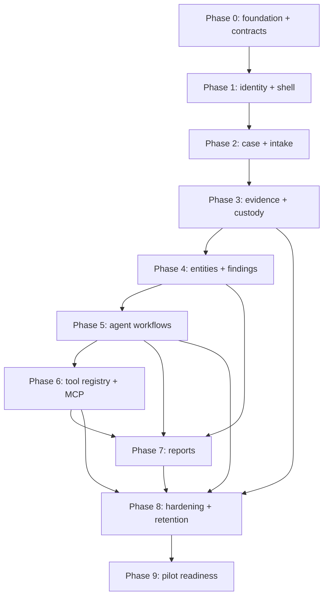

# Implementation Roadmap — Aegis OSINT & Digital Forensics Platform

**Document status:** Build roadmap  
**Version:** 1.0  
**Date:** 25 October 2026  
**Audience:** Engineering team, product/design, digital-forensics, security, QA, and AI coding assistants  
**Requirements:** [`prd.md`](prd.md)  
**UI/UX:** [`design.md`](design.md)  
**Architecture:** [`architecture.md`](architecture.md)

> **Filename note:** The architecture document is named `architecture.md` as specified in the original document plan.

---

## 1. How to Use This Roadmap

Tasks are ordered by dependency and grouped into phases. Each task is intentionally scoped to a focused work session and has an explicit build description, dependencies, acceptance criteria, and **individual references to all three source documents**. Do not treat the references as interchangeable: the PRD defines required behavior, the design document defines user interaction and presentation, and the architecture document defines the implementation boundary.

### 1.1 Mandatory UI/backend pairing method

The product must be built as paired vertical slices, not as a backend-only project followed by a frontend-only project:

1. **Contract first:** define the request/response/event schema and state model for a slice.
2. **Backend and UI in the same iteration:** build the API, persistence, authorization, and service behavior alongside the screen/component that consumes it. Tasks marked `Backend`, `UI`, and `Integration` with the same slice prefix are one cohesive delivery unit. Backend and UI tasks may proceed in parallel after their shared contract task is accepted.
3. **Integrate before expanding:** complete the integration task and design/behavior review before beginning the next dependent slice.
4. **Use the real contract:** UI work must use the published API/event schema and representative fixtures; mock data is allowed only for local component development and is removed from production paths.
5. **Keep states aligned:** loading, empty, partial, stale, blocked, failed, cancelled, permission-denied, and success states must exist in both API and UI acceptance tests where applicable.
6. **Joint review:** each slice is reviewed by a backend engineer, frontend engineer, designer or product owner, and security/forensic reviewer when the slice touches evidence, scope, external sources, MCP, or reports.

The pairings deliberately place corresponding UI and backend tasks near one another. A later task must not begin merely because one side is complete; its integration/acceptance task is the gate.

### 1.2 Task status and Definition of Done

Suggested task states: `Not started`, `Ready`, `In progress`, `Blocked`, `In review`, `Done`. A task is **Done** only when:

- all listed acceptance criteria pass;
- required automated tests and static checks pass;
- the UI is checked against the referenced design section and responsive/accessibility states;
- API/data behavior is checked against the referenced PRD and architecture sections;
- audit, authorization, privacy, and evidence lineage behaviors are covered where relevant;
- documentation/contracts are updated; and
- a reviewer confirms there is no unreviewed scope expansion, unapproved external data flow, hidden placeholder state, or test-only behavior in production.

### 1.3 How to follow each task’s references

Every task has three separate reference lines—one for each controlling document. Each line names the exact file, section number, section heading, and how that section should be applied to the task. The task title is repeated as the cross-document focus so a coding assistant can connect the requirement, UI behavior, and implementation.

- **PRD reference:** use the named requirement sections for what the product must do, constraints, priorities, user roles, safety boundaries, and acceptance conditions. Treat “must” requirements as normative unless an approved change is recorded.
- **Design reference:** use the named screen/component and interaction sections for layout, copy, status states, animations, accessibility, and responsive behavior. Do not invent a conflicting interaction because the backend endpoint is convenient.
- **Architecture reference:** use the named service/data/workflow/security sections for API boundaries, schemas, authorization, persistence, execution, and operational controls. UI controls are not a security boundary.
- If a requirement sub-number does not have its own heading in a source document, the reference points to its parent heading and records the exact requirement number in parentheses. Read only the relevant subpart but keep the parent section’s constraints in view.
- If any referenced sections disagree, stop the affected task, follow the Change Control rule in §4, and update the controlling document before proceeding. Do not guess at legal authority, data scope, or evidence semantics.

### 1.4 Global non-negotiable build constraints

- No task may bypass authentication, case scope, role authorization, policy evaluation, evidence provenance, or audit requirements for convenience.
- Evidence originals are immutable; all transformations create separately identified derivatives.
- Agents propose/execute only bounded, policy-approved tasks. There is no guilt score, face recognition, covert tracking, or automated enforcement action.
- MCP discovery does not enable or trust a server. Unknown/changed capabilities remain disabled pending review.
- No external query occurs before the required scope and approvals are satisfied. Denied/unavailable sources remain visibly unavailable, not fabricated.
- Every prompt/evidence-derived claim remains source-linked and appropriately marked as unreviewed, observed, inferred, or human-reviewed.
- Agent progress animation is bound to real backend events; no fake percentages, simulated typing/thought, or chain-of-thought exposure. Respect reduced-motion preferences.
- Use synthetic or properly de-identified test cases outside approved production investigation environments.

---

## Phase 0 — Planning, Contracts, and Project Foundation

### T0.1 — Establish repository conventions and project skeleton

- **Build:** Create backend, frontend, shared API schema, worker, and test package boundaries. Add formatter, lint, type-check, test commands, pre-commit hooks, environment examples with no secrets, and a documented local development workflow. Keep evidence/model/MCP credentials out of repository files.
- **Depends on:** None.
- **References — PRD:** [`prd.md`](prd.md), §6 “Scope and Product Modules”; §13.3 “Dependencies”. **Use for:** required behavior, constraints, and acceptance criteria for **Establish repository conventions and project skeleton**.
- **References — Design:** [`design.md`](design.md), §5 “Information Architecture and Navigation”; §12.1 “Recommended stack”; §12.2 “Why React + Vite”; §12.3 “Frontend engineering constraints”. **Use for:** the matching UI/component, interaction states, accessibility, and copy for **Establish repository conventions and project skeleton**.
- **References — Architecture:** [`architecture.md`](architecture.md), §2.1 “Logical architecture”; §2.2 “Trust zones”; §2.3 “Deployment topologies”; §3 “Technology Stack Selection”; §3.1 “Why a modular monolith at the control plane”. **Use for:** the matching data/API/service boundary, security controls, and runtime behavior for **Establish repository conventions and project skeleton**.
- **Acceptance:** A new developer can run the documented setup and start empty UI/API shells; lint/type-check/test commands pass; secrets scanning passes; directory boundaries are documented; no credentials or real case data are committed.

### T0.2 — Create API, event, and state contract conventions

- **Build:** Define versioning, error shape, pagination, idempotency-key, correlation-ID, timestamp/timezone, classification, and optimistic-concurrency conventions. Define JSON Schema/OpenAPI ownership and runtime validation rules for API and event messages.
- **Depends on:** T0.1.
- **References — PRD:** [`prd.md`](prd.md), §7.1 “Identity, authentication, and access (P0)”; §7.6 “Master Agent, child agents, and workflow orchestration (P0)”; §7.8 “MCP server management and integration (P0)”; §10 “Evidence Integrity, Provenance, and Legal Readiness”; §11 “Non-Functional Requirements”. **Use for:** required behavior, constraints, and acceptance criteria for **Create API, event, and state contract conventions**.
- **References — Design:** [`design.md`](design.md), §6.9 “Agent run header and stage rail”; §6.10 “Agent task row and tool-call card”; §6.11 “Agent activity motion and feedback”; §8.1 “Loading and progressive processing”; §8.2 “Real-time agent and system updates”; §8.3 “Approval and consent”; §8.4 “Error states”. **Use for:** the matching UI/component, interaction states, accessibility, and copy for **Create API, event, and state contract conventions**.
- **References — Architecture:** [`architecture.md`](architecture.md), §4.2 “API design”; §4.4 “Central policy evaluation”; §10.2 “Event model and transactional outbox”; §17.2 “Canonical connector result schema”. **Use for:** the matching data/API/service boundary, security controls, and runtime behavior for **Create API, event, and state contract conventions**.
- **Acceptance:** Shared schemas validate representative success/error/event fixtures; unknown fields and invalid versions fail safely; UTC and original/source timezone are distinct; every API operation can carry request/correlation IDs.

### T0.3 — Build the design-token and component foundation

- **Build:** Implement the Ink Plum, Oxidized Jade, Aged Brass palette, neutrals, semantic states, type scale, spacing, focus rings, reduced-motion behavior, and motion tokens from `design.md`. Build accessible buttons, inputs, badges, alerts, dialogs, tables, status indicators, source cards, and approval summaries.
- **Depends on:** T0.1; T0.2 for status/state contract alignment.
- **References — PRD:** [`prd.md`](prd.md), §7.11 “Case workspace, dashboard, and visualization (P0)”; §11.5 “Usability and accessibility”; §14 “Acceptance Criteria and Product Release Gates”. **Use for:** required behavior, constraints, and acceptance criteria for **Build the design-token and component foundation**.
- **References — Design:** [`design.md`](design.md), §2 “Design Philosophy”; §3 “Color System”; §4 “Typography and Content Density”; §6.1 “Buttons”; §6.2 “Inputs and form controls”; §6.3 “Status chips and evidence-state labels”; §6.4 “Tables”; §6.5 “Provenance / source card”; §6.6 “Approval summary card”; §6.7 “Evidence provenance strip”; §6.8 “Notifications”; §6.9 “Agent run header and stage rail”; §6.10 “Agent task row and tool-call card”; §6.11 “Agent activity motion and feedback”; §10 “Accessibility and High-Stress Use”; §14 “Design Acceptance Checklist”. **Use for:** the matching UI/component, interaction states, accessibility, and copy for **Build the design-token and component foundation**.
- **References — Architecture:** [`architecture.md`](architecture.md), §3 “Technology Stack Selection”; §10.3 “User-visible workflow stage mapping”; §10.4 “Latency and heartbeat behavior”. **Use for:** the matching data/API/service boundary, security controls, and runtime behavior for **Build the design-token and component foundation**.
- **Acceptance:** Components pass keyboard, screen-reader, contrast, grayscale, zoom, and reduced-motion checks; status components show icon plus text; animation timing uses shared tokens and cannot communicate a backend state that has not occurred.

### T0.4 — Establish CI, quality gates, and test data policy

- **Build:** Add CI for frontend/backend lint, typing, unit tests, schema checks, dependency scanning, secret scanning, container scanning, and test-data safeguards. Establish synthetic fixtures for case, evidence, entities, agent events, and MCP servers.
- **Depends on:** T0.1–T0.3.
- **References — PRD:** [`prd.md`](prd.md), §11 “Non-Functional Requirements”; §14 “Acceptance Criteria and Product Release Gates”. **Use for:** required behavior, constraints, and acceptance criteria for **Establish CI, quality gates, and test data policy**.
- **References — Design:** [`design.md`](design.md), §14 “Design Acceptance Checklist”; §17 “Change Control”. **Use for:** the matching UI/component, interaction states, accessibility, and copy for **Establish CI, quality gates, and test data policy**.
- **References — Architecture:** [`architecture.md`](architecture.md), §3 “Technology Stack Selection”; §12 “Security Architecture and Threat Model”; §16 “Testing and Validation Strategy”. **Use for:** the matching data/API/service boundary, security controls, and runtime behavior for **Establish CI, quality gates, and test data policy**.
- **Acceptance:** CI blocks merge on failing required checks; fixtures are synthetic and labeled; automated checks reject known secret patterns and production evidence files; test policy is documented.

---

## Phase 1 — Identity, Access Control, and Application Shell

**Slice 1 contract:** authenticated session, role/case capabilities, app shell navigation, environment identity, and safe denied/expired states.

### T1.1 — Implement OIDC identity and session backend

- **Build (Backend):** Implement OIDC Authorization Code + PKCE, agency identity mapping, session lifecycle, logout/revocation, MFA/step-up claims, service identity validation, and non-enumerating authentication errors. Keep browser credentials out of local storage.
- **Depends on:** T0.2, T0.4.
- **References — PRD:** [`prd.md`](prd.md), §3.2 “Role and access rules”; §7.1 “Identity, authentication, and access (P0)”; §11.1 “Security”. **Use for:** required behavior, constraints, and acceptance criteria for **Implement OIDC identity and session backend**.
- **References — Design:** [`design.md`](design.md), §5.1 “Investigator application shell”; §7.1 “Login and authentication”. **Use for:** the matching UI/component, interaction states, accessibility, and copy for **Implement OIDC identity and session backend**.
- **References — Architecture:** [`architecture.md`](architecture.md), §4.3 “Authentication and authorization”; §12.3 “Principal threat controls”. **Use for:** the matching data/API/service boundary, security controls, and runtime behavior for **Implement OIDC identity and session backend**.
- **Acceptance:** Valid/invalid login, MFA, expiry, revocation, and logout are integration-tested; invalid responses do not disclose account existence; privileged actions can require step-up; tokens cannot be used after revocation within the defined policy window.

### T1.2 — Implement authorization and case-scoped policy client

- **Build (Backend):** Add role/organization/case membership checks, classification and action checks, default-deny behavior, policy decision logging, and OPA client with signed/versioned policy metadata. Define test policy fixtures for victim, investigator, examiner, admin, auditor, and service identities.
- **Depends on:** T1.1, T0.2.
- **References — PRD:** [`prd.md`](prd.md), §3.2 “Role and access rules”; §7.1 “Identity, authentication, and access (P0)”; §11.1 “Security”; §12 “Legal, Ethical, and Governance Requirements”. **Use for:** required behavior, constraints, and acceptance criteria for **Implement authorization and case-scoped policy client**.
- **References — Design:** [`design.md`](design.md), §5.1 “Investigator application shell”; §5.2 “Navigation rules”; §7.9 “Settings and configuration”. **Use for:** the matching UI/component, interaction states, accessibility, and copy for **Implement authorization and case-scoped policy client**.
- **References — Architecture:** [`architecture.md`](architecture.md), §4.3 “Authentication and authorization”; §4.4 “Central policy evaluation”; §12.4 “Data classification and flow control”. **Use for:** the matching data/API/service boundary, security controls, and runtime behavior for **Implement authorization and case-scoped policy client**.
- **Acceptance:** Every protected API test demonstrates allow and deny cases; policy timeout/missing input fails closed; UI route guards are not treated as authorization; access denials do not reveal protected object metadata.

### T1.3 — Build authenticated app shell and login UI

- **Build (UI):** Create the investigator/admin shell, sidebar, top bar, environment badge, user/role menu, case-context banner, responsive behavior, and login/MFA/expired-session screens. Hide links by permission for usability while preserving server-side enforcement.
- **Depends on:** T0.3 and API contract from T0.2; may proceed alongside T1.1.
- **References — PRD:** [`prd.md`](prd.md), §3 “Users, Roles, and Stakeholders”; §7.1 “Identity, authentication, and access (P0)”; §11.5 “Usability and accessibility”. **Use for:** required behavior, constraints, and acceptance criteria for **Build authenticated app shell and login UI**.
- **References — Design:** [`design.md`](design.md), §5.1 “Investigator application shell”; §5.2 “Navigation rules”; §5.3 “Global interaction conventions”; §7.1 “Login and authentication”; §9 “Responsive Design”; §10 “Accessibility and High-Stress Use”. **Use for:** the matching UI/component, interaction states, accessibility, and copy for **Build authenticated app shell and login UI**.
- **References — Architecture:** [`architecture.md`](architecture.md), §2.2 “Trust zones”; §3 “Technology Stack Selection”; §4.2 “API design”; §4.3 “Authentication and authorization”. **Use for:** the matching data/API/service boundary, security controls, and runtime behavior for **Build authenticated app shell and login UI**.
- **Acceptance:** Login, MFA, generic failure, expiry, restricted role, and narrow viewport states match design; environment is always visible; no case data is rendered before session authorization; focus management and keyboard paths pass.

### T1.4 — Integrate identity, authorization, and app-shell states

- **Build (Integration):** Connect real API session/role responses to frontend navigation and route access; verify permission downgrade, logout cache clearing, session timeout, and step-up for privileged action examples.
- **Depends on:** T1.1–T1.3.
- **References — PRD:** [`prd.md`](prd.md), §7.1 “Identity, authentication, and access (P0)”; §14.1 “P0 release acceptance”. **Use for:** required behavior, constraints, and acceptance criteria for **Integrate identity, authorization, and app-shell states**.
- **References — Design:** [`design.md`](design.md), §5.1 “Investigator application shell”; §5.2 “Navigation rules”; §5.3 “Global interaction conventions”; §7.1 “Login and authentication”; §14 “Design Acceptance Checklist”. **Use for:** the matching UI/component, interaction states, accessibility, and copy for **Integrate identity, authorization, and app-shell states**.
- **References — Architecture:** [`architecture.md`](architecture.md), §4.2 “API design”; §4.3 “Authentication and authorization”; §4.4 “Central policy evaluation”; §12 “Security Architecture and Threat Model”. **Use for:** the matching data/API/service boundary, security controls, and runtime behavior for **Integrate identity, authorization, and app-shell states**.
- **Acceptance:** End-to-end tests prove a user cannot access a route or API by URL manipulation; role changes update the UI and revoke data; session expiry clears sensitive in-memory/query state; test environment cannot be mistaken for production.

---

## Phase 2 — Case Lifecycle and Humane Intake

**Slice 2 contract:** case/report draft, scope version, narrative submission, victim reference, and investigator intake-review state. External collection is unavailable until authorization and approval.

### T2.1 — Define case, scope, membership, and intake data model

- **Build (Backend):** Add PostgreSQL migrations and domain models for organization, case, case membership, scope versions, intake report, authority status, retention profile, status transitions, and audit references. Make approved scope versions immutable.
- **Depends on:** T1.2, T0.2.
- **References — PRD:** [`prd.md`](prd.md), §7.2 “Case creation and lifecycle (P0)”; §7.3 “Victim narrative intake (P0)”; §8.10 “Investigative and procedural context”; §10 “Evidence Integrity, Provenance, and Legal Readiness”; §13 “Constraints, Assumptions, and Dependencies”. **Use for:** required behavior, constraints, and acceptance criteria for **Define case, scope, membership, and intake data model**.
- **References — Design:** [`design.md`](design.md), §5.2 “Navigation rules”; §7.3 “New case creation and victim narrative intake”; §7.4 “Case detail / investigation workspace”. **Use for:** the matching UI/component, interaction states, accessibility, and copy for **Define case, scope, membership, and intake data model**.
- **References — Architecture:** [`architecture.md`](architecture.md), §4.1 “Application modules”; §5.2 “Logical entity model”; §13 “Privacy, Legal, Retention, and Governance”. **Use for:** the matching data/API/service boundary, security controls, and runtime behavior for **Define case, scope, membership, and intake data model**.
- **Acceptance:** Migrations enforce unique case references and valid states; scope changes create new versions; test records preserve UTC/source timezone and authority status; deletion cannot bypass retention/legal hold rules.

### T2.2 — Implement case lifecycle and scope APIs

- **Build (Backend):** Implement create/read/update/status transitions, assignments, related-case suggestions (human-confirmed only), scope proposal/approval, expiry/review date, and audit events. Prevent external task creation for draft/unauthorized cases.
- **Depends on:** T2.1, T1.2.
- **References — PRD:** [`prd.md`](prd.md), §7.2 “Case creation and lifecycle (P0)”; §7.6 “Master Agent, child agents, and workflow orchestration (P0)”; §12 “Legal, Ethical, and Governance Requirements”; §14 “Acceptance Criteria and Product Release Gates”. **Use for:** required behavior, constraints, and acceptance criteria for **Implement case lifecycle and scope APIs**.
- **References — Design:** [`design.md`](design.md), §5.2 “Navigation rules”; §7.3 “New case creation and victim narrative intake”; §7.4 “Case detail / investigation workspace”; §8.3 “Approval and consent”. **Use for:** the matching UI/component, interaction states, accessibility, and copy for **Implement case lifecycle and scope APIs**.
- **References — Architecture:** [`architecture.md`](architecture.md), §4.2 “API design”; §4.3 “Authentication and authorization”; §4.4 “Central policy evaluation”; §5.2 “Logical entity model”; §10.1 “Durable workflow model”. **Use for:** the matching data/API/service boundary, security controls, and runtime behavior for **Implement case lifecycle and scope APIs**.
- **Acceptance:** Case CRUD tests cover create, read, update, assign, pause, close, archive, reopen, and retention/disposition transitions; invalid transitions fail; close/reopen records reason and actor; stale scope or missing authority denies collection; each change is versioned/audited; related-case link requires explicit human confirmation.

### T2.3 — Build victim-facing narrative and evidence-area UI

- **Build (UI):** Implement mobile-first one-box narrative input, optional collapsible “Details that may help,” one evidence drop/pick area, privacy/safety copy, save draft, submit, upload list, and humane confirmation. Avoid technical fields and promise language.
- **Depends on:** T0.3; agree with T2.1/T2.2 contract before wiring.
- **References — PRD:** [`prd.md`](prd.md), §7.3 “Victim narrative intake (P0)”; §7.4 “Digital evidence upload and local folder connection (P0)”; §8 “Complete Input Data Taxonomy”; §9 “Core User Journeys and Use Cases”; §11.5 “Usability and accessibility”. **Use for:** required behavior, constraints, and acceptance criteria for **Build victim-facing narrative and evidence-area UI**.
- **References — Design:** [`design.md`](design.md), §2.2 “Tone and language”; §7.3 “New case creation and victim narrative intake”; §9.2 “Victim-facing intake”; §10 “Accessibility and High-Stress Use”; §13 “Content and Localization Rules”. **Use for:** the matching UI/component, interaction states, accessibility, and copy for **Build victim-facing narrative and evidence-area UI**.
- **References — Architecture:** [`architecture.md`](architecture.md), §2.2 “Trust zones”; §4.1 “Application modules”; §5.2 “Logical entity model”; §6.4 “Evidence view and safe rendering”. **Use for:** the matching data/API/service boundary, security controls, and runtime behavior for **Build victim-facing narrative and evidence-area UI**.
- **Acceptance:** Reporter can submit incomplete narrative, skip unknowns, attach supported/unsupported files, see privacy notice before submit, and recover from upload failure; mobile 390 px and keyboard/screen reader work; no hidden technical form is required.

### T2.4 — Implement narrative intake and extraction job request

- **Build (Backend):** Persist original narrative with source/language/notice version; create reporter-facing reference; invoke only internal deterministic/approved candidate extraction; store extracted candidates as unreviewed with source spans. Do not dispatch external sources or agent investigation runs from public intake.
- **Depends on:** T2.1, T2.2, T1.2.
- **References — PRD:** [`prd.md`](prd.md), §7.3 “Victim narrative intake (P0)”; §7.5 “Entity extraction, normalization, and review (P0)”; §8 “Complete Input Data Taxonomy”; §10 “Evidence Integrity, Provenance, and Legal Readiness”. **Use for:** required behavior, constraints, and acceptance criteria for **Implement narrative intake and extraction job request**.
- **References — Design:** [`design.md`](design.md), §7.3 “New case creation and victim narrative intake”; §8.1 “Loading and progressive processing”; §8.2 “Real-time agent and system updates”. **Use for:** the matching UI/component, interaction states, accessibility, and copy for **Implement narrative intake and extraction job request**.
- **References — Architecture:** [`architecture.md`](architecture.md), §4.1 “Application modules”; §5.2 “Logical entity model”; §7.2 “Master Agent”; §7.6 “Model Gateway and prompt/data handling”; §10.1 “Durable workflow model”. **Use for:** the matching data/API/service boundary, security controls, and runtime behavior for **Implement narrative intake and extraction job request**.
- **Acceptance:** Narrative, language, timestamps, and notice version persist; candidate extraction records exact offsets/method/version and remains unreviewed; hostile instructions in narrative cannot change system behavior; unauthorised intake never causes network calls.

### T2.5 — Build staff intake-review and authorization UI

- **Build (UI):** Implement intake review split view with original narrative, source/language label, candidate details, source highlighting, Confirm/Correct/Reject/Ambiguous controls, and separate scope/authority accordion. Display that no external search has started.
- **Depends on:** T2.3, T2.4; can begin with schema fixtures after T2.1.
- **References — PRD:** [`prd.md`](prd.md), §7.3 “Victim narrative intake (P0)”; §7.5 “Entity extraction, normalization, and review (P0)”; §7.2 “Case creation and lifecycle (P0)”. **Use for:** required behavior, constraints, and acceptance criteria for **Build staff intake-review and authorization UI**.
- **References — Design:** [`design.md`](design.md), §6.5 “Provenance / source card”; §7.3 “New case creation and victim narrative intake”; §7.4 “Case detail / investigation workspace”; §8.3 “Approval and consent”. **Use for:** the matching UI/component, interaction states, accessibility, and copy for **Build staff intake-review and authorization UI**.
- **References — Architecture:** [`architecture.md`](architecture.md), §5.2 “Logical entity model”; §7.2 “Master Agent”; §10.3 “User-visible workflow stage mapping”. **Use for:** the matching data/API/service boundary, security controls, and runtime behavior for **Build staff intake-review and authorization UI**.
- **Acceptance:** Candidate actions update only review state and preserve prior values; untranslated source is always available; scope approval is explicit and separate from intake submission; screen reader announces review state and validation errors.

### T2.6 — Complete case-intake vertical slice

- **Build (Integration):** Connect victim submission, upload placeholders/session, intake parsing, staff candidate review, scope creation/approval, and case banner. Validate API/UI state mapping for draft, intake review, unauthorized, authorized, and expired states.
- **Depends on:** T2.1–T2.5.
- **References — PRD:** [`prd.md`](prd.md), §7.2 “Case creation and lifecycle (P0)”; §7.3 “Victim narrative intake (P0)”; §7.4 “Digital evidence upload and local folder connection (P0)”; §7.5 “Entity extraction, normalization, and review (P0)”; §9.1 “Phishing email with payment diversion”; §14.1 “P0 release acceptance”. **Use for:** required behavior, constraints, and acceptance criteria for **Complete case-intake vertical slice**.
- **References — Design:** [`design.md`](design.md), §7.3 “New case creation and victim narrative intake”; §7.4 “Case detail / investigation workspace”; §8 “Interaction Patterns and State Models”; §14 “Design Acceptance Checklist”. **Use for:** the matching UI/component, interaction states, accessibility, and copy for **Complete case-intake vertical slice**.
- **References — Architecture:** [`architecture.md`](architecture.md), §4 “Backend Architecture”; §5 “Data Architecture”; §6 “Evidence Processing and Forensic Pipeline”; §10.1 “Durable workflow model”; §10.2 “Event model and transactional outbox”; §10.3 “User-visible workflow stage mapping”. **Use for:** the matching data/API/service boundary, security controls, and runtime behavior for **Complete case-intake vertical slice**.
- **Acceptance:** End-to-end case test can submit an incomplete report, review extraction candidates, authorize a scope, and verify no external call occurs before approval; upload/process failures remain visible and do not erase the narrative.

---

## Phase 3 — Evidence Storage, Chain of Custody, and Safe Processing

**Slice 3 contract:** upload sessions, immutable original object, hash/ingest state, custody events, derivatives, and evidence viewer status.

### T3.1 — Configure encrypted object storage and key boundary

- **Build (Backend/Platform):** Provision development and test S3-compatible storage with separate quarantine/original/derivative/export areas, encryption, short-lived upload capabilities, versioning/object-lock test configuration, and KMS/secrets-manager integration.
- **Depends on:** T0.4, T1.2.
- **References — PRD:** [`prd.md`](prd.md), §7.4 “Digital evidence upload and local folder connection (P0)”; §7.14 “Retention, legal hold, and deletion (P0)”; §10 “Evidence Integrity, Provenance, and Legal Readiness”; §11.1 “Security”. **Use for:** required behavior, constraints, and acceptance criteria for **Configure encrypted object storage and key boundary**.
- **References — Design:** [`design.md`](design.md), §7.3 “New case creation and victim narrative intake”; §7.4 “Case detail / investigation workspace”; §7.5 “Evidence library and evidence detail”; §7.9 “Settings and configuration”. **Use for:** the matching UI/component, interaction states, accessibility, and copy for **Configure encrypted object storage and key boundary**.
- **References — Architecture:** [`architecture.md`](architecture.md), §3 “Technology Stack Selection”; §5.1 “Data stores and authority”; §5.4 “Evidence object lifecycle”; §6.4 “Evidence view and safe rendering”; §14.2 “Container and network segmentation”. **Use for:** the matching data/API/service boundary, security controls, and runtime behavior for **Configure encrypted object storage and key boundary**.
- **Acceptance:** Service identities cannot overwrite originals or list unrelated cases; upload URLs are short-lived and object-scoped; encryption and retention configuration are verified by automated tests; no credentials appear in config exports.

### T3.2 — Implement evidence metadata, upload sessions, and finalization API

- **Build (Backend):** Implement evidence item model, resumable/multipart upload session, checksum verification, content-signature detection, SHA-256 ingest hash, quarantine states, duplicate candidate detection, and finalization audit/custody event.
- **Depends on:** T3.1, T2.1–T2.2.
- **References — PRD:** [`prd.md`](prd.md), §7.4.1 “Ingest behavior”; §7.4.2 “Initial format support”; §10 “Evidence Integrity, Provenance, and Legal Readiness”. **Use for:** required behavior, constraints, and acceptance criteria for **Implement evidence metadata, upload sessions, and finalization API**.
- **References — Design:** [`design.md`](design.md), §6.7 “Evidence provenance strip”; §7.3 “New case creation and victim narrative intake”; §7.5 “Evidence library and evidence detail”; §8.1 “Loading and progressive processing”. **Use for:** the matching UI/component, interaction states, accessibility, and copy for **Implement evidence metadata, upload sessions, and finalization API**.
- **References — Architecture:** [`architecture.md`](architecture.md), §5.2 “Logical entity model”; §5.4 “Evidence object lifecycle”; §6.1 “Processing stages”; §6.4 “Evidence view and safe rendering”. **Use for:** the matching data/API/service boundary, security controls, and runtime behavior for **Implement evidence metadata, upload sessions, and finalization API**.
- **Acceptance:** Complete/interrupted/retried upload tests verify byte count and checksum; file-extension mismatch is flagged; hash mismatch enters restricted state; original cannot be overwritten; duplicate detection does not silently discard a submission.

### T3.3 — Connect evidence upload UI to upload-session contract

- **Build (UI):** Wire the file/folder picker and drag/drop component to upload sessions, progress, resumable retry, remove-before-upload, file status, size/type warnings, and case context. Implement truthful progress for measured bytes only.
- **Depends on:** T2.3 and T3.2 contract; may proceed in parallel once schema is agreed.
- **References — PRD:** [`prd.md`](prd.md), §7.4.1 “Ingest behavior”; §7.4.3 “Ingestion outcome and user communication”; §11.5 “Usability and accessibility”. **Use for:** required behavior, constraints, and acceptance criteria for **Connect evidence upload UI to upload-session contract**.
- **References — Design:** [`design.md`](design.md), §6.2 “Inputs and form controls”; §6.11 “Agent activity motion and feedback”; §7.3 “New case creation and victim narrative intake”; §9.2 “Victim-facing intake”; §10 “Accessibility and High-Stress Use”. **Use for:** the matching UI/component, interaction states, accessibility, and copy for **Connect evidence upload UI to upload-session contract**.
- **References — Architecture:** [`architecture.md`](architecture.md), §4.2 “API design”; §5.4 “Evidence object lifecycle”; §6.1 “Processing stages”; §10.3 “User-visible workflow stage mapping”. **Use for:** the matching data/API/service boundary, security controls, and runtime behavior for **Connect evidence upload UI to upload-session contract**.
- **Acceptance:** UI distinguishes queued/transferring/received/quarantined/failed; upload retry does not duplicate evidence; `folder` capability falls back to file selection where unsupported; reduced-motion and screen-reader progress states are verified.

### T3.4 — Implement append-only custody and audit event service

- **Build (Backend):** Create custody and audit event schemas, event sequencing/hash links, actor/service identity, reason/purpose fields, UTC/source time, object/hash references, and append-only write path. Separate operational activity from security/custody logs.
- **Depends on:** T3.2, T1.2.
- **References — PRD:** [`prd.md`](prd.md), §7.4 “Digital evidence upload and local folder connection (P0)”; §10 “Evidence Integrity, Provenance, and Legal Readiness”; §11.1 “Security”. **Use for:** required behavior, constraints, and acceptance criteria for **Implement append-only custody and audit event service**.
- **References — Design:** [`design.md`](design.md), §6.5 “Provenance / source card”; §6.7 “Evidence provenance strip”; §7.5 “Evidence library and evidence detail”; §14 “Design Acceptance Checklist”. **Use for:** the matching UI/component, interaction states, accessibility, and copy for **Implement append-only custody and audit event service**.
- **References — Architecture:** [`architecture.md`](architecture.md), §4.1 “Application modules”; §5.2 “Logical entity model”; §5.4 “Evidence object lifecycle”; §12.5 “Audit and tamper evidence”. **Use for:** the matching data/API/service boundary, security controls, and runtime behavior for **Implement append-only custody and audit event service**.
- **Acceptance:** Events cannot be edited/deleted through normal APIs; every upload/finalize/access/hash verification emits attributable event; chain verification detects modified/reordered records; event payloads do not contain secrets or unnecessary evidence content.

### T3.5 — Build evidence library, detail inspector, and safe preview UI

- **Build (UI):** Implement case-scoped evidence table, filters, integrity/provenance strip, evidence detail viewer, metadata/custody panels, original/derivative indicator, parent/child lineage, unsupported/encrypted/error states, and safe preview rendering.
- **Depends on:** T3.2 and T3.4 contracts.
- **References — PRD:** [`prd.md`](prd.md), §7.4 “Digital evidence upload and local folder connection (P0)”; §7.10 “Findings, leads, and evidence relationships (P0)”; §10 “Evidence Integrity, Provenance, and Legal Readiness”; §11.5 “Usability and accessibility”. **Use for:** required behavior, constraints, and acceptance criteria for **Build evidence library, detail inspector, and safe preview UI**.
- **References — Design:** [`design.md`](design.md), §6.4 “Tables”; §6.5 “Provenance / source card”; §6.6 “Approval summary card”; §6.7 “Evidence provenance strip”; §7.5 “Evidence library and evidence detail”; §8.4 “Error states”; §10 “Accessibility and High-Stress Use”. **Use for:** the matching UI/component, interaction states, accessibility, and copy for **Build evidence library, detail inspector, and safe preview UI**.
- **References — Architecture:** [`architecture.md`](architecture.md), §5.2 “Logical entity model”; §5.4 “Evidence object lifecycle”; §6.4 “Evidence view and safe rendering”; §12.2 “Threat actors and assets”. **Use for:** the matching data/API/service boundary, security controls, and runtime behavior for **Build evidence library, detail inspector, and safe preview UI**.
- **Acceptance:** User can trace a derivative to its original and custody history; “hash verified” text states its exact meaning; unsafe HTML is inert; permission-denied and integrity-failed states are distinct; equivalent table/detail information is keyboard-accessible.

### T3.6 — Build isolated parser worker and processing manifest

- **Build (Backend/Worker):** Implement worker sandbox, allowlisted parser dispatch, malware/type scanning, archive limits, resource/time limits, parser version/config manifest, derivative object creation, OCR text/page locators, and processing warnings. Start with TXT, CSV, JSON, EML, and text-based PDF; expand only through test matrix.
- **Depends on:** T3.1–T3.4.
- **References — PRD:** [`prd.md`](prd.md), §7.4.1 “Ingest behavior”; §7.4.2 “Initial format support”; §7.4.3 “Ingestion outcome and user communication”; §7.5 “Entity extraction, normalization, and review (P0)”; §10 “Evidence Integrity, Provenance, and Legal Readiness”. **Use for:** required behavior, constraints, and acceptance criteria for **Build isolated parser worker and processing manifest**.
- **References — Design:** [`design.md`](design.md), §6.5 “Provenance / source card”; §7.5 “Evidence library and evidence detail”; §8.1 “Loading and progressive processing”. **Use for:** the matching UI/component, interaction states, accessibility, and copy for **Build isolated parser worker and processing manifest**.
- **References — Architecture:** [`architecture.md`](architecture.md), §5.2 “Logical entity model”; §5.4 “Evidence object lifecycle”; §6.1 “Processing stages”; §6.2 “Parser and modality design”; §6.3 “Reproducible processing manifest”; §12.2 “Threat actors and assets”. **Use for:** the matching data/API/service boundary, security controls, and runtime behavior for **Build isolated parser worker and processing manifest**.
- **Acceptance:** Parser runs without network and with quotas; malicious/malformed/archive-bomb cases are contained; originals remain intact; each derivative has parent/output hashes and parser manifest; unsupported/encrypted content returns explicit status.

### T3.7 — Integrate evidence processing status and custody end-to-end

- **Build (Integration):** Connect upload finalization, parser workflow, derivative creation, UI status updates, custody history, and hash verification. Add known-answer fixtures and safe-preview tests.
- **Depends on:** T3.1–T3.6.
- **References — PRD:** [`prd.md`](prd.md), §7.4 “Digital evidence upload and local folder connection (P0)”; §10 “Evidence Integrity, Provenance, and Legal Readiness”; §14.1 “P0 release acceptance”. **Use for:** required behavior, constraints, and acceptance criteria for **Integrate evidence processing status and custody end-to-end**.
- **References — Design:** [`design.md`](design.md), §7.5 “Evidence library and evidence detail”; §8.1 “Loading and progressive processing”; §8.2 “Real-time agent and system updates”; §14 “Design Acceptance Checklist”. **Use for:** the matching UI/component, interaction states, accessibility, and copy for **Integrate evidence processing status and custody end-to-end**.
- **References — Architecture:** [`architecture.md`](architecture.md), §5.4 “Evidence object lifecycle”; §6 “Evidence Processing and Forensic Pipeline”; §10 “Workflow and Real-Time Architecture”; §16.1 “Test layers”. **Use for:** the matching data/API/service boundary, security controls, and runtime behavior for **Integrate evidence processing status and custody end-to-end**.
- **Acceptance:** One test case uploads supported and unsupported files, verifies hashes, creates derivatives, displays failures, and checks custody; any hash mismatch raises a visible high-priority incident and marks dependent content for review.

### T3.8 — Add office-document and scanned-PDF parser support

- **Build (Backend):** Extend the parser matrix to DOCX, XLSX, PPTX, RTF and image/scanned PDF. Extract text, tables and page/region locators where supported; OCR must be a separate derivative with engine/language/quality metadata. Keep macros inert and never execute embedded content.
- **Depends on:** T3.6–T3.7.
- **References — PRD:** [`prd.md`](prd.md), §7.4 “Digital evidence upload and local folder connection (P0)” (specific requirement 7.4.2, 7.4.1); §10 “Evidence Integrity, Provenance, and Legal Readiness”. **Use for:** required behavior, constraints, and acceptance criteria for **Add office-document and scanned-PDF parser support**.
- **References — Design:** [`design.md`](design.md), §7.5 “Evidence library and evidence detail”; §8.1 “Loading and progressive processing”; §14 “Design Acceptance Checklist”. **Use for:** the matching UI/component, interaction states, accessibility, and copy for **Add office-document and scanned-PDF parser support**.
- **References — Architecture:** [`architecture.md`](architecture.md), §5.4 “Evidence object lifecycle”; §6.2 “Parser and modality design”; §6.3 “Reproducible processing manifest”; §12.2 “Threat actors and assets”. **Use for:** the matching data/API/service boundary, security controls, and runtime behavior for **Add office-document and scanned-PDF parser support**.
- **Acceptance:** Known-answer fixtures cover text and scanned files; OCR output has page/region locators and quality; office macros are not executed; encrypted/corrupt files remain preserved with explicit status; parser versions are recorded.

### T3.9 — Add image, audio, and video metadata processing

- **Build (Backend):** Add safe image metadata extraction (EXIF/XMP/IPTC), image dimensions and perceptual hashes; add media type detection and safe catalog/preview; allow only separately approved speech transcription as a derivative with timecodes, language, engine and quality. Do not add face or speaker identification.
- **Depends on:** T3.6–T3.7.
- **References — PRD:** [`prd.md`](prd.md), §7.4 “Digital evidence upload and local folder connection (P0)” (specific requirement 7.4.2); §7.7.4 “Images, video, metadata, and multimodal evidence”; §8.7 “Media, documents, and physical-world context”; §10 “Evidence Integrity, Provenance, and Legal Readiness”. **Use for:** required behavior, constraints, and acceptance criteria for **Add image, audio, and video metadata processing**.
- **References — Design:** [`design.md`](design.md), §6.5 “Provenance / source card”; §7.5 “Evidence library and evidence detail”; §8.1 “Loading and progressive processing”; §10 “Accessibility and High-Stress Use”. **Use for:** the matching UI/component, interaction states, accessibility, and copy for **Add image, audio, and video metadata processing**.
- **References — Architecture:** [`architecture.md`](architecture.md), §5.2 “Logical entity model”; §5.4 “Evidence object lifecycle”; §6.2 “Parser and modality design”; §6.3 “Reproducible processing manifest”. **Use for:** the matching data/API/service boundary, security controls, and runtime behavior for **Add image, audio, and video metadata processing**.
- **Acceptance:** Original media remains immutable; metadata is a derivative with exact source link; transcription is off unless approved; no biometric identity field or face/speaker recognition call exists; unsupported codec is cataloged, not silently discarded.

### T3.10 — Add email, chat, SMS, and call-log parsers

- **Build (Backend):** Add safe parsing for EML/MBOX, approved MSG support, documented chat/SMS exports and supplied call-log formats. Preserve headers, message IDs, participant labels, sequence, source timezone, gaps, and exact locators; represent participant identity only as supplied.
- **Depends on:** T3.6–T3.7.
- **References — PRD:** [`prd.md`](prd.md), §7.4 “Digital evidence upload and local folder connection (P0)” (specific requirement 7.4.2); §7.7.1 “Email and communication”; §8.3 “Contact and account identifiers”; §8.6 “Messages, calls, and communication content”. **Use for:** required behavior, constraints, and acceptance criteria for **Add email, chat, SMS, and call-log parsers**.
- **References — Design:** [`design.md`](design.md), §6.5 “Provenance / source card”; §7.4 “Case detail / investigation workspace”; §7.5 “Evidence library and evidence detail”; §8.1 “Loading and progressive processing”. **Use for:** the matching UI/component, interaction states, accessibility, and copy for **Add email, chat, SMS, and call-log parsers**.
- **References — Architecture:** [`architecture.md`](architecture.md), §5.2 “Logical entity model”; §5.4 “Evidence object lifecycle”; §6.2 “Parser and modality design”. **Use for:** the matching data/API/service boundary, security controls, and runtime behavior for **Add email, chat, SMS, and call-log parsers**.
- **Acceptance:** Fixtures test forwarded emails, missing headers, reordered/edited messages, mixed timezones, unknown speakers, and malformed exports; original content is preserved; extracted text and headers map to exact source locators.

### T3.11 — Add bounded archive and forensic-log import support

- **Build (Backend):** Add safe bounded archive catalog/extraction plus approved parsers for PCAP/PCAPNG, EVTX, browser history/bookmark exports, and structured DNS/proxy/firewall logs. Large disk images and memory dumps may be preserved/cataloged but are not deeply parsed by this task.
- **Depends on:** T3.6–T3.7.
- **References — PRD:** [`prd.md`](prd.md), §7.4.1 “Ingest behavior”; §7.4.2 “Initial format support”; §7.4.3 “Ingestion outcome and user communication”; §7.7.7 “Browser and device artifacts”; §8.8 “Device, browser, and application artifacts”. **Use for:** required behavior, constraints, and acceptance criteria for **Add bounded archive and forensic-log import support**.
- **References — Design:** [`design.md`](design.md), §7.5 “Evidence library and evidence detail”; §8.1 “Loading and progressive processing”; §8.4 “Error states”. **Use for:** the matching UI/component, interaction states, accessibility, and copy for **Add bounded archive and forensic-log import support**.
- **References — Architecture:** [`architecture.md`](architecture.md), §5.4 “Evidence object lifecycle”; §6.1 “Processing stages”; §6.2 “Parser and modality design”; §6.3 “Reproducible processing manifest”; §12.2 “Threat actors and assets”. **Use for:** the matching data/API/service boundary, security controls, and runtime behavior for **Add bounded archive and forensic-log import support**.
- **Acceptance:** Archive traversal/decompression-bomb tests are contained; parsed records retain source offsets/times; browser secrets/cookies are restricted and omitted from agent context by default; unrecognized forensic formats remain cataloged for examiner handling.

### T3.12 — Publish and enforce the supported-parser matrix

- **Build (Backend/UI/QA):** Create a versioned support matrix listing each file type, detection status, parser/preview capability, size limits, restrictions, and known limitations. Display supported/unsupported states in upload preflight and evidence details; test against all parser classes.
- **Depends on:** T3.8–T3.11.
- **References — PRD:** [`prd.md`](prd.md), §7.4.2 “Initial format support”; §7.4.3 “Ingestion outcome and user communication”; §14 “Acceptance Criteria and Product Release Gates”. **Use for:** required behavior, constraints, and acceptance criteria for **Publish and enforce the supported-parser matrix**.
- **References — Design:** [`design.md`](design.md), §7.3 “New case creation and victim narrative intake”; §7.5 “Evidence library and evidence detail”; §8.1 “Loading and progressive processing”; §14 “Design Acceptance Checklist”. **Use for:** the matching UI/component, interaction states, accessibility, and copy for **Publish and enforce the supported-parser matrix**.
- **References — Architecture:** [`architecture.md`](architecture.md), §6.1 “Processing stages”; §6.2 “Parser and modality design”; §6.3 “Reproducible processing manifest”; §6.4 “Evidence view and safe rendering”; §16.1 “Test layers”. **Use for:** the matching data/API/service boundary, security controls, and runtime behavior for **Publish and enforce the supported-parser matrix**.
- **Acceptance:** Matrix matches actual server behavior; no format is called supported without tested parser behavior; UI explains preserved-but-unprocessed cases; all supported classes have benign, malformed, and resource-limit tests.

---

## Phase 4 — Entity Review, Findings, Timeline, and Relationships

**Slice 4 contract:** candidate entity/finding schema, exact provenance locators, review actions, source-aware relations, and accessible timeline/graph representation.

### T4.1 — Implement extraction candidate and normalization services

- **Build (Backend):** Add entity-candidate schemas, raw/normalized forms, locale-aware normalizers, source spans, method/version, uncertainty, data class, and review state. Use deterministic extraction first; optional model-generated candidates are stored separately as unreviewed.
- **Depends on:** T3.6, T2.4.
- **References — PRD:** [`prd.md`](prd.md), §7.5 “Entity extraction, normalization, and review (P0)”; §8 “Complete Input Data Taxonomy”; §10 “Evidence Integrity, Provenance, and Legal Readiness”. **Use for:** required behavior, constraints, and acceptance criteria for **Implement extraction candidate and normalization services**.
- **References — Design:** [`design.md`](design.md), §6.3 “Status chips and evidence-state labels”; §6.5 “Provenance / source card”; §7.4 “Case detail / investigation workspace”; §7.5 “Evidence library and evidence detail”. **Use for:** the matching UI/component, interaction states, accessibility, and copy for **Implement extraction candidate and normalization services**.
- **References — Architecture:** [`architecture.md`](architecture.md), §5.2 “Logical entity model”; §6.2 “Parser and modality design”; §7.6 “Model Gateway and prompt/data handling”. **Use for:** the matching data/API/service boundary, security controls, and runtime behavior for **Implement extraction candidate and normalization services**.
- **Acceptance:** Phone/email/URL/payment/date candidate fixtures preserve raw values and offsets; timezone and locale assumptions are explicit; ambiguous values remain alternatives; no candidate defaults to confirmed.

### T4.2 — Implement candidate review and entity APIs

- **Build (Backend):** Implement confirm/correct/reject/ambiguous transitions, canonical entity and alias records, append-only correction history, deduplication suggestions, source independence, and downstream invalidation hooks.
- **Depends on:** T4.1, T3.4.
- **References — PRD:** [`prd.md`](prd.md), §7.5 “Entity extraction, normalization, and review (P0)”; §7.10 “Findings, leads, and evidence relationships (P0)”; §10 “Evidence Integrity, Provenance, and Legal Readiness”. **Use for:** required behavior, constraints, and acceptance criteria for **Implement candidate review and entity APIs**.
- **References — Design:** [`design.md`](design.md), §6.3 “Status chips and evidence-state labels”; §6.5 “Provenance / source card”; §7.4 “Case detail / investigation workspace”; §8.5 “Confirmations and destructive actions”. **Use for:** the matching UI/component, interaction states, accessibility, and copy for **Implement candidate review and entity APIs**.
- **References — Architecture:** [`architecture.md`](architecture.md), §5.2 “Logical entity model”; §7.5 “Finding aggregation and error governance”; §12.5 “Audit and tamper evidence”. **Use for:** the matching data/API/service boundary, security controls, and runtime behavior for **Implement candidate review and entity APIs**.
- **Acceptance:** Fuzzy match cannot merge entities automatically; review decisions retain actor/reason/time; correction marks linked findings/reports for review; every canonical entity has provenance.

### T4.3 — Build entity extraction review UI

- **Build (UI):** Implement candidate queue with type filters, source-highlighted values, raw vs normalized display, uncertainty, provenance cards, and Confirm/Correct/Reject/Ambiguous actions. Include bulk review only for safe, clearly identical deterministic values if approved.
- **Depends on:** T4.1–T4.2 API contract.
- **References — PRD:** [`prd.md`](prd.md), §7.5 “Entity extraction, normalization, and review (P0)”; §7.10 “Findings, leads, and evidence relationships (P0)”. **Use for:** required behavior, constraints, and acceptance criteria for **Build entity extraction review UI**.
- **References — Design:** [`design.md`](design.md), §6.3 “Status chips and evidence-state labels”; §6.5 “Provenance / source card”; §7.4 “Case detail / investigation workspace”; §8.3 “Approval and consent”; §10 “Accessibility and High-Stress Use”. **Use for:** the matching UI/component, interaction states, accessibility, and copy for **Build entity extraction review UI**.
- **References — Architecture:** [`architecture.md`](architecture.md), §5.2 “Logical entity model”; §7.4 “Agent communication”; §7.5 “Finding aggregation and error governance”; §10.3 “User-visible workflow stage mapping”. **Use for:** the matching data/API/service boundary, security controls, and runtime behavior for **Build entity extraction review UI**.
- **Acceptance:** Candidate state and source locator remain visible; user can inspect original evidence; keyboard-only review and screen-reader status work; no “AI confirmed” or person-level score appears.

### T4.4 — Implement observation, finding, lead, and relationship APIs

- **Build (Backend):** Define separate observation/finding/lead records and typed evidence relationships. Implement support/contradiction links, source lineage, method, limitations, confidence semantics, freshness, review state, and lead workflow.
- **Depends on:** T4.2, T3.4.
- **References — PRD:** [`prd.md`](prd.md), §7.10 “Findings, leads, and evidence relationships (P0)”; §8.11 “Data quality, uncertainty, and sensitivity annotations”; §10 “Evidence Integrity, Provenance, and Legal Readiness”. **Use for:** required behavior, constraints, and acceptance criteria for **Implement observation, finding, lead, and relationship APIs**.
- **References — Design:** [`design.md`](design.md), §6.3 “Status chips and evidence-state labels”; §6.5 “Provenance / source card”; §7.4 “Case detail / investigation workspace”. **Use for:** the matching UI/component, interaction states, accessibility, and copy for **Implement observation, finding, lead, and relationship APIs**.
- **References — Architecture:** [`architecture.md`](architecture.md), §5.2 “Logical entity model”; §5.3 “Entity relationship overview”; §7.5 “Finding aggregation and error governance”; §8.3 “OSINT source profiles”. **Use for:** the matching data/API/service boundary, security controls, and runtime behavior for **Implement observation, finding, lead, and relationship APIs**.
- **Acceptance:** Observation, inference, and lead cannot be represented as one undifferentiated type; every inferred edge has provenance and reviewer state; repeated syndicated source does not count as independent corroboration; stale/unknown are valid statuses.

### T4.5 — Build case timeline UI and time normalization behavior

- **Build (UI):** Implement timeline list with filters, time-basis labels, source timezone/original timestamp, conflict and uncertainty presentation, exact evidence links, and accessible chronological alternative.
- **Depends on:** T4.4 contract.
- **References — PRD:** [`prd.md`](prd.md), §7.10 “Findings, leads, and evidence relationships (P0)”; §7.11 “Case workspace, dashboard, and visualization (P0)”; §8.1 “Narrative and event context”; §10 “Evidence Integrity, Provenance, and Legal Readiness”. **Use for:** required behavior, constraints, and acceptance criteria for **Build case timeline UI and time normalization behavior**.
- **References — Design:** [`design.md`](design.md), §6.5 “Provenance / source card”; §7.4 “Case detail / investigation workspace”; §8.1 “Loading and progressive processing”; §10 “Accessibility and High-Stress Use”; §13 “Content and Localization Rules”. **Use for:** the matching UI/component, interaction states, accessibility, and copy for **Build case timeline UI and time normalization behavior**.
- **References — Architecture:** [`architecture.md`](architecture.md), §5.2 “Logical entity model”; §5.3 “Entity relationship overview”; §10.2 “Event model and transactional outbox”. **Use for:** the matching data/API/service boundary, security controls, and runtime behavior for **Build case timeline UI and time normalization behavior**.
- **Acceptance:** Timeline distinguishes reported, artifact, metadata, source-retrieval, and analyst-entered times; unknown timezone is not silently inferred; conflicts remain visible; list works without graph/canvas.

### T4.6 — Build relationship graph and equivalent table view

- **Build (UI/Backend):** Add case-scoped graph query and visualization for evidence, entities, events, findings, and typed edges with filters and an accessible table/list alternative. Enforce authorization before graph generation and data retrieval.
- **Depends on:** T4.4, T1.2.
- **References — PRD:** [`prd.md`](prd.md), §7.10 “Findings, leads, and evidence relationships (P0)”; §7.11 “Case workspace, dashboard, and visualization (P0)”; §11.5 “Usability and accessibility”. **Use for:** required behavior, constraints, and acceptance criteria for **Build relationship graph and equivalent table view**.
- **References — Design:** [`design.md`](design.md), §6.4 “Tables”; §6.5 “Provenance / source card”; §7.4 “Case detail / investigation workspace”; §9.1 “Investigator application”; §10 “Accessibility and High-Stress Use”. **Use for:** the matching UI/component, interaction states, accessibility, and copy for **Build relationship graph and equivalent table view**.
- **References — Architecture:** [`architecture.md`](architecture.md), §5.2 “Logical entity model”; §5.3 “Entity relationship overview”; §5.4 “Evidence object lifecycle”; §5.5 “Search, indexing, and retrieval”; §8.3 “OSINT source profiles”; §12.4 “Data classification and flow control”. **Use for:** the matching data/API/service boundary, security controls, and runtime behavior for **Build relationship graph and equivalent table view**.
- **Acceptance:** Observed and inferred edges have distinct labels/styles; visual proximity does not imply causality; graph is strictly case-scoped; every edge opens its source/reason; table alternative provides equivalent access.

### T4.7 — Complete findings and timeline vertical slice

- **Build (Integration):** Connect parsed evidence, candidate review, confirmed entity, observation/finding/lead records, case timeline, graph filters, and downstream invalidation.
- **Depends on:** T4.1–T4.6.
- **References — PRD:** [`prd.md`](prd.md), §7.5 “Entity extraction, normalization, and review (P0)”; §7.10 “Findings, leads, and evidence relationships (P0)”; §7.11 “Case workspace, dashboard, and visualization (P0)”; §14 “Acceptance Criteria and Product Release Gates”. **Use for:** required behavior, constraints, and acceptance criteria for **Complete findings and timeline vertical slice**.
- **References — Design:** [`design.md`](design.md), §7.4 “Case detail / investigation workspace”; §7.5 “Evidence library and evidence detail”; §8 “Interaction Patterns and State Models”; §14 “Design Acceptance Checklist”; §15 “Traceability to PRD and Research”. **Use for:** the matching UI/component, interaction states, accessibility, and copy for **Complete findings and timeline vertical slice**.
- **References — Architecture:** [`architecture.md`](architecture.md), §5 “Data Architecture”; §6 “Evidence Processing and Forensic Pipeline”; §7.5 “Finding aggregation and error governance”; §10 “Workflow and Real-Time Architecture”; §16.1 “Test layers”. **Use for:** the matching data/API/service boundary, security controls, and runtime behavior for **Complete findings and timeline vertical slice**.
- **Acceptance:** End-to-end case shows a source-located candidate becoming reviewed entity/finding only through human action; correction updates review flags without rewriting source records; all views reconcile from the same API records.

### T4.8 — Add provenance-aware location map view

- **Build (Backend/UI):** Add case-scoped location records and map view for evidence-backed coordinates or approved public geodata. Show source, precision, event/capture time, and review status. IP geolocation must remain coarse and labeled as network-location approximation, never a person or home location.
- **Depends on:** T4.4, T4.5, T1.2; map provider/security review before enabling tiles.
- **References — PRD:** [`prd.md`](prd.md), §7.7.3 “Domains, URLs, IP addresses, and network indicators”; §7.10 “Findings, leads, and evidence relationships (P0)”; §7.11 “Case workspace, dashboard, and visualization (P0)”; §8.1 “Narrative and event context”; §8.7 “Media, documents, and physical-world context”; §11.2 “Privacy and data protection”. **Use for:** required behavior, constraints, and acceptance criteria for **Add provenance-aware location map view**.
- **References — Design:** [`design.md`](design.md), §6.5 “Provenance / source card”; §7.4 “Case detail / investigation workspace”; §9.1 “Investigator application”; §10 “Accessibility and High-Stress Use”. **Use for:** the matching UI/component, interaction states, accessibility, and copy for **Add provenance-aware location map view**.
- **References — Architecture:** [`architecture.md`](architecture.md), §5.2 “Logical entity model”; §5.3 “Entity relationship overview”; §5.4 “Evidence object lifecycle”; §5.5 “Search, indexing, and retrieval”; §8.3 “OSINT source profiles”; §12.4 “Data classification and flow control”. **Use for:** the matching data/API/service boundary, security controls, and runtime behavior for **Add provenance-aware location map view**.
- **Acceptance:** Map query and data are case-scoped; each plotted item exposes source and precision; IP-derived locations cannot zoom to residential precision; unknown or conflicting coordinates are not silently plotted as exact; accessible list/table provides equivalent information.

### T4.9 — Add multilingual derivative records and payment-reference normalization

- **Build (Backend/UI):** Add language-detection metadata and a reviewable translation-derivative record/view that preserves original text and fields for translator/model/version/uncertainty. Implement deterministic normalization/format validation for amounts, currency, bank/payment references and UPI/VPA identifiers; do not query banks or imply transaction ownership. Actual model-based translation is added only after the Model Gateway is available in T5.14.
- **Depends on:** T3.10, T4.1–T4.3.
- **References — PRD:** [`prd.md`](prd.md), §7.3 “Victim narrative intake (P0)”; §7.5 “Entity extraction, normalization, and review (P0)”; §7.7.5 “Cryptocurrency and payment-related evidence”; §8.5 “Financial and transaction data”; §9.8 “Multilingual, low-quality, or incomplete evidence”. **Use for:** required behavior, constraints, and acceptance criteria for **Add multilingual derivative records and payment-reference normalization**.
- **References — Design:** [`design.md`](design.md), §6.5 “Provenance / source card”; §7.3 “New case creation and victim narrative intake”; §7.4 “Case detail / investigation workspace”; §7.5 “Evidence library and evidence detail”; §8.1 “Loading and progressive processing”; §13 “Content and Localization Rules”. **Use for:** the matching UI/component, interaction states, accessibility, and copy for **Add multilingual derivative records and payment-reference normalization**.
- **References — Architecture:** [`architecture.md`](architecture.md), §5.2 “Logical entity model”; §6.2 “Parser and modality design”; §7.6 “Model Gateway and prompt/data handling”; §13 “Privacy, Legal, Retention, and Governance”. **Use for:** the matching data/API/service boundary, security controls, and runtime behavior for **Add multilingual derivative records and payment-reference normalization**.
- **Acceptance:** Original text is immutable and always reachable; a translation record is clearly labeled and cannot be marked verified by default; UPI/payment normalization preserves raw value and locale assumptions; no credentials or direct bank access are introduced.

---

## Phase 5 — Durable Agent Orchestration and Live Activity

**Slice 5 contract:** typed plan DAG, policy validation, approval binding, bounded durable run, event stream, truthful UI stage mapping, and cited review-ready output.

### T5.1 — Define workflow, task, budget, and event state machines

- **Build (Backend):** Implement versioned schemas for plan, task node, dependency edge, run, task execution, budget, approval obligation, and canonical state event. Define transition table and invalid-transition behavior before LLM integration.
- **Depends on:** T0.2, T2.1, T4.4.
- **References — PRD:** [`prd.md`](prd.md), §7.6 “Master Agent, child agents, and workflow orchestration (P0)”; §7.11 “Case workspace, dashboard, and visualization (P0)”; §11 “Non-Functional Requirements”. **Use for:** required behavior, constraints, and acceptance criteria for **Define workflow, task, budget, and event state machines**.
- **References — Design:** [`design.md`](design.md), §6.9 “Agent run header and stage rail”; §6.10 “Agent task row and tool-call card”; §6.11 “Agent activity motion and feedback”; §7.6 “Agent monitoring and control panel”; §8.1 “Loading and progressive processing”; §8.2 “Real-time agent and system updates”. **Use for:** the matching UI/component, interaction states, accessibility, and copy for **Define workflow, task, budget, and event state machines**.
- **References — Architecture:** [`architecture.md`](architecture.md), §5.2 “Logical entity model”; §7.1 “Overview: constrained planner, deterministic executor”; §7.2 “Master Agent”; §7.3 “Child agent framework and lifecycle”; §7.4 “Agent communication”; §10.1 “Durable workflow model”; §10.2 “Event model and transactional outbox”; §10.3 “User-visible workflow stage mapping”. **Use for:** the matching data/API/service boundary, security controls, and runtime behavior for **Define workflow, task, budget, and event state machines**.
- **Acceptance:** State schema covers queued/running/waiting/completed/partial/blocked/failed/cancelled/timed-out; DAG validator rejects cycles and unknown nodes; every task is tied to case/scope version and budget.

### T5.2 — Add durable workflow engine and outbox/event delivery

- **Build (Backend):** Deploy Temporal workflow/worker baseline; implement PostgreSQL transactional outbox, event publisher, SSE gateway, event cursor/replay, access checks, and sequence reconciliation.
- **Depends on:** T5.1, T1.2, T3.4.
- **References — PRD:** [`prd.md`](prd.md), §7.6 “Master Agent, child agents, and workflow orchestration (P0)”; §7.11 “Case workspace, dashboard, and visualization (P0)”; §7.12 “Notifications and collaboration (P0)”; §11.3 “Performance and scale (initial reference targets; validate in pilot)”; §11.4 “Reliability and availability”. **Use for:** required behavior, constraints, and acceptance criteria for **Add durable workflow engine and outbox/event delivery**.
- **References — Design:** [`design.md`](design.md), §6.9 “Agent run header and stage rail”; §6.10 “Agent task row and tool-call card”; §6.11 “Agent activity motion and feedback”; §8.1 “Loading and progressive processing”; §8.2 “Real-time agent and system updates”. **Use for:** the matching UI/component, interaction states, accessibility, and copy for **Add durable workflow engine and outbox/event delivery**.
- **References — Architecture:** [`architecture.md`](architecture.md), §3 “Technology Stack Selection”; §4.1 “Application modules”; §4.2 “API design”; §10.1 “Durable workflow model”; §10.2 “Event model and transactional outbox”; §10.3 “User-visible workflow stage mapping”; §10.4 “Latency and heartbeat behavior”. **Use for:** the matching data/API/service boundary, security controls, and runtime behavior for **Add durable workflow engine and outbox/event delivery**.
- **Acceptance:** Worker restart and client reconnect recover authoritative state; event order/duplicates are handled; unauthorized case subscription denied; event bodies contain no prompt/raw evidence/secrets; outbox event exists atomically with domain state change.

### T5.3 — Implement bounded Master Agent planner and plan validator

- **Build (Backend/AI):** Build model-gateway client and Master Agent planner that receives minimal authorized context and emits typed DAG proposals. Add deterministic schema, cycle, tool-registry, scope, budget, and policy validation; no direct tools or database access for planner.
- **Depends on:** T5.1, T1.2, T4.1; approved Model Gateway test profile.
- **References — PRD:** [`prd.md`](prd.md), §7.6.1 “Master Agent responsibilities”; §7.6.2 “Child-agent registry and lifecycle”; §11 “Non-Functional Requirements”. **Use for:** required behavior, constraints, and acceptance criteria for **Implement bounded Master Agent planner and plan validator**.
- **References — Design:** [`design.md`](design.md), §6.9 “Agent run header and stage rail”; §7.6 “Agent monitoring and control panel”; §8.3 “Approval and consent”. **Use for:** the matching UI/component, interaction states, accessibility, and copy for **Implement bounded Master Agent planner and plan validator**.
- **References — Architecture:** [`architecture.md`](architecture.md), §7.1 “Overview: constrained planner, deterministic executor”; §7.2 “Master Agent”; §7.6 “Model Gateway and prompt/data handling”; §10.1 “Durable workflow model”. **Use for:** the matching data/API/service boundary, security controls, and runtime behavior for **Implement bounded Master Agent planner and plan validator**.
- **Acceptance:** Planner cannot emit executable arbitrary code or grant permission; malicious prompt/evidence directives do not change scope/tools; budgets/depth/concurrency are enforced; no-model mode returns a manual workflow path.

### T5.4 — Build investigation plan review UI

- **Build (UI):** Implement task list/graph preview with purpose, inputs, dependencies, proposed agents/tools, data classification, external destination/data egress, estimated resource band, approval requirements, and `Approve`, `Edit plan`, `Reject`, `Save draft` controls.
- **Depends on:** T5.1 and plan API contract from T5.3.
- **References — PRD:** [`prd.md`](prd.md), §7.6.1 “Master Agent responsibilities”; §7.6.4 “Inter-agent communication and output contract”; §12 “Legal, Ethical, and Governance Requirements”. **Use for:** required behavior, constraints, and acceptance criteria for **Build investigation plan review UI**.
- **References — Design:** [`design.md`](design.md), §6.6 “Approval summary card”; §6.9 “Agent run header and stage rail”; §6.10 “Agent task row and tool-call card”; §6.11 “Agent activity motion and feedback”; §7.6 “Agent monitoring and control panel”; §8.3 “Approval and consent”. **Use for:** the matching UI/component, interaction states, accessibility, and copy for **Build investigation plan review UI**.
- **References — Architecture:** [`architecture.md`](architecture.md), §7.1 “Overview: constrained planner, deterministic executor”; §7.2 “Master Agent”; §8.2 “Invocation broker”; §10.3 “User-visible workflow stage mapping”. **Use for:** the matching data/API/service boundary, security controls, and runtime behavior for **Build investigation plan review UI**.
- **Acceptance:** User can inspect exact proposed data categories/destinations and dependencies; no approval checkbox is preselected; policy-blocked items state why; graph has a readable list equivalent and handles small viewport.

### T5.5 — Implement approval, plan-hash binding, and scope revalidation

- **Build (Backend):** Add plan approval/rejection records tied to exact plan hash, scope version, actor, reason, data flows, policy version, and expiry. Revalidate authorization immediately before execution; invalidate approval on plan/scope/policy changes.
- **Depends on:** T5.3–T5.4, T2.2.
- **References — PRD:** [`prd.md`](prd.md), §7.2 “Case creation and lifecycle (P0)”; §7.6 “Master Agent, child agents, and workflow orchestration (P0)”; §7.8 “MCP server management and integration (P0)”; §12 “Legal, Ethical, and Governance Requirements”. **Use for:** required behavior, constraints, and acceptance criteria for **Implement approval, plan-hash binding, and scope revalidation**.
- **References — Design:** [`design.md`](design.md), §6.6 “Approval summary card”; §6.9 “Agent run header and stage rail”; §7.6 “Agent monitoring and control panel”; §8.3 “Approval and consent”. **Use for:** the matching UI/component, interaction states, accessibility, and copy for **Implement approval, plan-hash binding, and scope revalidation**.
- **References — Architecture:** [`architecture.md`](architecture.md), §4.4 “Central policy evaluation”; §7.2 “Master Agent”; §10.1 “Durable workflow model”; §12.4 “Data classification and flow control”. **Use for:** the matching data/API/service boundary, security controls, and runtime behavior for **Implement approval, plan-hash binding, and scope revalidation**.
- **Acceptance:** Only an authorized human can approve; approval cannot be reused for changed plan; expired/changed scope blocks run; denied plan cannot start; all decision facts are audited.

### T5.6 — Build live agent monitor UI and event animations

- **Build (UI):** Implement AgentRunHeader, AgentStageRail, AgentTaskRow, activity feed, tool-call placeholder state, elapsed time/budgets, pause/cancel controls, status-stale/reconnect handling, and reduced-motion behavior using event-bound motion tokens.
- **Depends on:** T5.2, T5.4, T5.5.
- **References — PRD:** [`prd.md`](prd.md), §7.6 “Master Agent, child agents, and workflow orchestration (P0)”; §7.11 “Case workspace, dashboard, and visualization (P0)”; §7.12 “Notifications and collaboration (P0)”; §11.5 “Usability and accessibility”. **Use for:** required behavior, constraints, and acceptance criteria for **Build live agent monitor UI and event animations**.
- **References — Design:** [`design.md`](design.md), §6.9 “Agent run header and stage rail”; §6.10 “Agent task row and tool-call card”; §6.11 “Agent activity motion and feedback”; §7.6 “Agent monitoring and control panel”; §8.1 “Loading and progressive processing”; §8.2 “Real-time agent and system updates”; §10 “Accessibility and High-Stress Use”. **Use for:** the matching UI/component, interaction states, accessibility, and copy for **Build live agent monitor UI and event animations**.
- **References — Architecture:** [`architecture.md`](architecture.md), §10.2 “Event model and transactional outbox”; §10.3 “User-visible workflow stage mapping”; §10.4 “Latency and heartbeat behavior”; §12.1 “Security objectives”. **Use for:** the matching data/API/service boundary, security controls, and runtime behavior for **Build live agent monitor UI and event animations**.
- **Acceptance:** UI displays only canonical backend states; “Analyzing” communicates observable work without chain-of-thought; stale stream stops live animation; blocked tools do not animate as running; pause/cancel remain operable during transitions and under reduced motion.

### T5.7 — Implement child-agent registry and isolated worker lifecycle

- **Build (Backend/Worker):** Create reviewed agent-template registry, version lifecycle, per-task ephemeral context, workload identity, scoped evidence references, resource quotas, task startup/teardown, and safe failure handling. Start with narrative/entity extraction and timeline review templates.
- **Depends on:** T5.1–T5.3, T5.5.
- **References — PRD:** [`prd.md`](prd.md), §7.6.2 “Child-agent registry and lifecycle”; §7.6.3 “Initial specialist-agent catalog”; §7.6.4 “Inter-agent communication and output contract”; §11 “Non-Functional Requirements”. **Use for:** required behavior, constraints, and acceptance criteria for **Implement child-agent registry and isolated worker lifecycle**.
- **References — Design:** [`design.md`](design.md), §6.9 “Agent run header and stage rail”; §6.10 “Agent task row and tool-call card”; §7.6 “Agent monitoring and control panel”; §8.1 “Loading and progressive processing”. **Use for:** the matching UI/component, interaction states, accessibility, and copy for **Implement child-agent registry and isolated worker lifecycle**.
- **References — Architecture:** [`architecture.md`](architecture.md), §7.3 “Child agent framework and lifecycle”; §7.4 “Agent communication”; §7.5 “Finding aggregation and error governance”; §7.6 “Model Gateway and prompt/data handling”; §14.2 “Container and network segmentation”. **Use for:** the matching data/API/service boundary, security controls, and runtime behavior for **Implement child-agent registry and isolated worker lifecycle**.
- **Acceptance:** Only enabled reviewed template can instantiate; instances have expiring task-scoped permissions and no cross-case memory; worker resource/time limits terminate runaway work; historic task records retain template version.

### T5.8 — Implement finding aggregation, lineage, and conflict governance

- **Build (Backend):** Aggregate schema-valid candidate findings, preserve source genealogy and independent-source identity, detect conflicts/circular dependencies, mark partial/unsupported outputs, and propagate upstream corrections to downstream review states.
- **Depends on:** T4.4, T5.1, T5.7.
- **References — PRD:** [`prd.md`](prd.md), §7.6.4 “Inter-agent communication and output contract”; §7.10 “Findings, leads, and evidence relationships (P0)”; §10 “Evidence Integrity, Provenance, and Legal Readiness”. **Use for:** required behavior, constraints, and acceptance criteria for **Implement finding aggregation, lineage, and conflict governance**.
- **References — Design:** [`design.md`](design.md), §6.3 “Status chips and evidence-state labels”; §6.5 “Provenance / source card”; §7.4 “Case detail / investigation workspace”; §7.6 “Agent monitoring and control panel”. **Use for:** the matching UI/component, interaction states, accessibility, and copy for **Implement finding aggregation, lineage, and conflict governance**.
- **References — Architecture:** [`architecture.md`](architecture.md), §5.2 “Logical entity model”; §5.3 “Entity relationship overview”; §7.4 “Agent communication”; §7.5 “Finding aggregation and error governance”; §12.3 “Principal threat controls”. **Use for:** the matching data/API/service boundary, security controls, and runtime behavior for **Implement finding aggregation, lineage, and conflict governance**.
- **Acceptance:** Repeated references to the same source do not count as independent corroboration; contradictions are retained; unsupported claim is rejected/flagged; source correction marks linked report/finding `Review required` without rewriting original.

### T5.9 — Complete agent planning and execution vertical slice

- **Build (Integration):** Connect investigator request, plan proposal, policy/approval, durable execution, child-agent task, event stream, finding aggregation, and review-ready screen. Exercise partial failure, cancellation, expiry, and budget exhaustion.
- **Depends on:** T5.1–T5.8.
- **References — PRD:** [`prd.md`](prd.md), §7.6 “Master Agent, child agents, and workflow orchestration (P0)”; §7.10 “Findings, leads, and evidence relationships (P0)”; §7.11 “Case workspace, dashboard, and visualization (P0)”; §7.12 “Notifications and collaboration (P0)”; §14 “Acceptance Criteria and Product Release Gates”. **Use for:** required behavior, constraints, and acceptance criteria for **Complete agent planning and execution vertical slice**.
- **References — Design:** [`design.md`](design.md), §7.3 “New case creation and victim narrative intake”; §7.4 “Case detail / investigation workspace”; §7.6 “Agent monitoring and control panel”; §8 “Interaction Patterns and State Models”; §14 “Design Acceptance Checklist”. **Use for:** the matching UI/component, interaction states, accessibility, and copy for **Complete agent planning and execution vertical slice**.
- **References — Architecture:** [`architecture.md`](architecture.md), §7 “AI Agent Architecture”; §10 “Workflow and Real-Time Architecture”; §12 “Security Architecture and Threat Model”; §16.1 “Test layers”. **Use for:** the matching data/API/service boundary, security controls, and runtime behavior for **Complete agent planning and execution vertical slice**.
- **Acceptance:** A fully synthetic case completes a bounded internal-only analysis; run state/events/findings reconcile; no external call occurs before required approval; cancel/expired scope/budget stops work visibly and preserves partial outputs.

### T5.10 — Harden structured inter-agent communication and trace propagation

- **Build (Backend):** Implement typed task-result/event envelopes with sender/recipient identity, case/scope version, classification, schema version, input references, payload hash, trace ID, and allowed dependency checks. Reject free-form messages as executable instructions and prevent cross-case forwarding.
- **Depends on:** T5.1, T5.7–T5.9.
- **References — PRD:** [`prd.md`](prd.md), §7.6.4 “Inter-agent communication and output contract”; §7.10 “Findings, leads, and evidence relationships (P0)”; §10.3 “Auditability and reproducibility”. **Use for:** required behavior, constraints, and acceptance criteria for **Harden structured inter-agent communication and trace propagation**.
- **References — Design:** [`design.md`](design.md), §6.9 “Agent run header and stage rail”; §6.10 “Agent task row and tool-call card”; §7.6 “Agent monitoring and control panel”; §8.2 “Real-time agent and system updates”. **Use for:** the matching UI/component, interaction states, accessibility, and copy for **Harden structured inter-agent communication and trace propagation**.
- **References — Architecture:** [`architecture.md`](architecture.md), §7.4 “Agent communication”; §7.5 “Finding aggregation and error governance”; §10.2 “Event model and transactional outbox”; §12.3 “Principal threat controls”. **Use for:** the matching data/API/service boundary, security controls, and runtime behavior for **Harden structured inter-agent communication and trace propagation**.
- **Acceptance:** Invalid sender, case/scope mismatch, schema mismatch, or dependency fails closed; an agent cannot grant another agent permissions; lineage propagates to findings and audit; multi-agent prompt-injection/error-cascade tests pass.

### T5.11 — Implement dashboard read model and work-queue API

- **Build (Backend):** Provide permission-filtered dashboard aggregates for assigned active cases, review tasks, evidence processing exceptions, approval queue, conflicts, report review, scope expiry, and system notices. Counts must have a defined case/user scope and last-updated time.
- **Depends on:** T2.2, T3.2, T4.4, T5.2, T5.5.
- **References — PRD:** [`prd.md`](prd.md), §3 “Users, Roles, and Stakeholders”; §7.11 “Case workspace, dashboard, and visualization (P0)”; §7.12 “Notifications and collaboration (P0)”; §11.7 “Observability and support”. **Use for:** required behavior, constraints, and acceptance criteria for **Implement dashboard read model and work-queue API**.
- **References — Design:** [`design.md`](design.md), §7.2 “Main dashboard / investigator overview”; §8.1 “Loading and progressive processing”; §8.2 “Real-time agent and system updates”; §8.6 “Notifications and alert prioritization”. **Use for:** the matching UI/component, interaction states, accessibility, and copy for **Implement dashboard read model and work-queue API**.
- **References — Architecture:** [`architecture.md`](architecture.md), §4.1 “Application modules”; §4.2 “API design”; §5.2 “Logical entity model”; §10.2 “Event model and transactional outbox”; §15 “Observability and Service-Level Objectives”. **Use for:** the matching data/API/service boundary, security controls, and runtime behavior for **Implement dashboard read model and work-queue API**.
- **Acceptance:** Aggregates respect case membership and classification; no victim names or sensitive case facts appear by default; every metric states scope and freshness; unavailable subquery renders partial status rather than fabricated zero.

### T5.12 — Build investigator dashboard and review queue UI

- **Build (UI):** Implement overview cards, My Work Queue, Recent Cases table, System Notices, empty/loading/partial/stale states, filters and links to case/task pages. Keep metrics operational, not predictive or guilt-oriented.
- **Depends on:** T5.11 API contract; may begin using typed synthetic fixtures after contract approval.
- **References — PRD:** [`prd.md`](prd.md), §7.11 “Case workspace, dashboard, and visualization (P0)”; §7.12 “Notifications and collaboration (P0)”; §11.5 “Usability and accessibility”. **Use for:** required behavior, constraints, and acceptance criteria for **Build investigator dashboard and review queue UI**.
- **References — Design:** [`design.md`](design.md), §5.1 “Investigator application shell”; §5.2 “Navigation rules”; §5.3 “Global interaction conventions”; §7.2 “Main dashboard / investigator overview”; §8.1 “Loading and progressive processing”; §8.2 “Real-time agent and system updates”; §8.6 “Notifications and alert prioritization”; §9.1 “Investigator application”. **Use for:** the matching UI/component, interaction states, accessibility, and copy for **Build investigator dashboard and review queue UI**.
- **References — Architecture:** [`architecture.md`](architecture.md), §2.2 “Trust zones”; §4.2 “API design”; §10.2 “Event model and transactional outbox”; §15 “Observability and Service-Level Objectives”. **Use for:** the matching data/API/service boundary, security controls, and runtime behavior for **Build investigator dashboard and review queue UI**.
- **Acceptance:** Counts link to scoped lists; no unapproved cross-case content is exposed; filters persist appropriately; no fake activity/ETA; layout works at desktop/tablet and keyboard/screen reader.

### T5.13 — Integrate dashboard with live case/task events

- **Build (Integration):** Connect dashboard read model to case, evidence, agent, approval, conflict, report, and notification events. Validate refresh/reconnect and role changes.
- **Depends on:** T5.2, T5.10–T5.12.
- **References — PRD:** [`prd.md`](prd.md), §7.11 “Case workspace, dashboard, and visualization (P0)”; §7.12 “Notifications and collaboration (P0)”; §14 “Acceptance Criteria and Product Release Gates”. **Use for:** required behavior, constraints, and acceptance criteria for **Integrate dashboard with live case/task events**.
- **References — Design:** [`design.md`](design.md), §7.2 “Main dashboard / investigator overview”; §8.1 “Loading and progressive processing”; §8.2 “Real-time agent and system updates”; §8.6 “Notifications and alert prioritization”; §14 “Design Acceptance Checklist”. **Use for:** the matching UI/component, interaction states, accessibility, and copy for **Integrate dashboard with live case/task events**.
- **References — Architecture:** [`architecture.md`](architecture.md), §4.1 “Application modules”; §10.2 “Event model and transactional outbox”; §10.3 “User-visible workflow stage mapping”; §10.4 “Latency and heartbeat behavior”; §15 “Observability and Service-Level Objectives”; §16 “Testing and Validation Strategy”. **Use for:** the matching data/API/service boundary, security controls, and runtime behavior for **Integrate dashboard with live case/task events**.
- **Acceptance:** Event updates are eventually consistent and show last-update time; reconnect reconciles state; stale connection shows `Updates paused`; role/case access revocation removes affected cards and links.

### T5.14 — Enable approved multilingual translation through Model Gateway

- **Build (Backend/UI):** Connect translation derivatives from T4.9 to the approved Model Gateway. Route by classification, preserve source-language text, store model/provider/version and output hash, expose translation uncertainty, and prevent provider use when the classification or retention policy is not approved.
- **Depends on:** T4.9, T5.3. Use the Model Gateway's classification/retention policy; report integration is separate.
- **References — PRD:** [`prd.md`](prd.md), §7.3 “Victim narrative intake (P0)”; §7.5 “Entity extraction, normalization, and review (P0)”; §11.2 “Privacy and data protection”; §12 “Legal, Ethical, and Governance Requirements”. **Use for:** required behavior, constraints, and acceptance criteria for **Enable approved multilingual translation through Model Gateway**.
- **References — Design:** [`design.md`](design.md), §7.3 “New case creation and victim narrative intake”; §7.4 “Case detail / investigation workspace”; §7.5 “Evidence library and evidence detail”; §8.1 “Loading and progressive processing”; §10 “Accessibility and High-Stress Use”; §13 “Content and Localization Rules”. **Use for:** the matching UI/component, interaction states, accessibility, and copy for **Enable approved multilingual translation through Model Gateway**.
- **References — Architecture:** [`architecture.md`](architecture.md), §5.2 “Logical entity model”; §7.6 “Model Gateway and prompt/data handling”; §13 “Privacy, Legal, Retention, and Governance”; §16.2 “Evaluation guardrails”. **Use for:** the matching data/API/service boundary, security controls, and runtime behavior for **Enable approved multilingual translation through Model Gateway**.
- **Acceptance:** Original is never overwritten; translation is marked machine-generated and cannot be used as a direct quotation without source verification; unapproved provider/classification is denied; audit records model/version and data-flow decision without leaking source text into operational logs.

---

## Phase 6 — Tool Registry, OSINT Connectors, and MCP

**Slice 6 contract:** one tool registry and invocation broker for built-in, API, and MCP tools; source profile, policy check, parameter/result validation, egress control, and auditable UI.

### T6.1 — Implement canonical tool and source registry

- **Build (Backend):** Add tool definition/version/hash, source profile, owner/trust domain, schema, side effects, data class, destination, terms, jurisdictions, limits, approval/review/health state, and retrieval metadata. Support MCP and non-MCP adapters without a shared permission bypass.
- **Depends on:** T5.1, T1.2, T0.2.
- **References — PRD:** [`prd.md`](prd.md), §7.7 “OSINT and forensic capability catalog (P0 framework; source enablement is jurisdiction- and agency-dependent)”; §7.8 “MCP server management and integration (P0)”; §7.9 “Tool registry and source governance (P0)”; §11 “Non-Functional Requirements”; §12 “Legal, Ethical, and Governance Requirements”. **Use for:** required behavior, constraints, and acceptance criteria for **Implement canonical tool and source registry**.
- **References — Design:** [`design.md`](design.md), §6.5 “Provenance / source card”; §6.6 “Approval summary card”; §7.7 “MCP server management panel (administrator)”; §7.9 “Settings and configuration”. **Use for:** the matching UI/component, interaction states, accessibility, and copy for **Implement canonical tool and source registry**.
- **References — Architecture:** [`architecture.md`](architecture.md), §8.1 “Canonical Tool Registry”; §8.3 “OSINT source profiles”; §9.1 “MCP control plane and runtime plane”. **Use for:** the matching data/API/service boundary, security controls, and runtime behavior for **Implement canonical tool and source registry**.
- **Acceptance:** Unknown side effect defaults disabled; every definition is versioned and hashed; expired/unapproved source cannot be retrieved by agents; search/retrieval returns only policy-filtered candidates.

### T6.2 — Build Tool Broker and policy-mediated invocation

- **Build (Backend):** Implement invocation lifecycle: authenticate caller, check case/scope/task, validate exact tool hash and parameters, minimize/redact data, run OPA decision, enforce rate/time/size limits, call adapter through egress proxy, validate response, and persist provenance/audit.
- **Depends on:** T6.1, T5.5, T3.4.
- **References — PRD:** [`prd.md`](prd.md), §7.8 “MCP server management and integration (P0)”; §7.9 “Tool registry and source governance (P0)”; §11.1 “Security”. **Use for:** required behavior, constraints, and acceptance criteria for **Build Tool Broker and policy-mediated invocation**.
- **References — Design:** [`design.md`](design.md), §6.6 “Approval summary card”; §6.10 “Agent task row and tool-call card”; §7.6 “Agent monitoring and control panel”; §7.7 “MCP server management panel (administrator)”. **Use for:** the matching UI/component, interaction states, accessibility, and copy for **Build Tool Broker and policy-mediated invocation**.
- **References — Architecture:** [`architecture.md`](architecture.md), §4.4 “Central policy evaluation”; §8.1 “Canonical Tool Registry”; §8.2 “Invocation broker”; §12.2 “Threat actors and assets”. **Use for:** the matching data/API/service boundary, security controls, and runtime behavior for **Build Tool Broker and policy-mediated invocation**.
- **Acceptance:** All tool calls pass broker; policy timeout/unknown destination denies; parameter values and schemas validate; result size/content/type checks are enforced; secret-bearing parameters are redacted in general logs; retries are bounded and idempotency-aware.

### T6.3 — Build connector administration and source inventory UI

- **Build (UI):** Implement admin-only tool/source inventory table, filters, tool detail, review state, owner, trust domain, permissions, terms/freshness, health, version/hash, and data-flow summary. Separate enabled capability from case eligibility.
- **Depends on:** T6.1 API contract; can begin concurrently after contract approval.
- **References — PRD:** [`prd.md`](prd.md), §7.7 “OSINT and forensic capability catalog (P0 framework; source enablement is jurisdiction- and agency-dependent)”; §7.8 “MCP server management and integration (P0)”; §7.9 “Tool registry and source governance (P0)”; §12 “Legal, Ethical, and Governance Requirements”. **Use for:** required behavior, constraints, and acceptance criteria for **Build connector administration and source inventory UI**.
- **References — Design:** [`design.md`](design.md), §5.1 “Investigator application shell”; §5.2 “Navigation rules”; §6.5 “Provenance / source card”; §6.6 “Approval summary card”; §7.7 “MCP server management panel (administrator)”; §7.9 “Settings and configuration”. **Use for:** the matching UI/component, interaction states, accessibility, and copy for **Build connector administration and source inventory UI**.
- **References — Architecture:** [`architecture.md`](architecture.md), §8.1 “Canonical Tool Registry”; §8.2 “Invocation broker”; §8.3 “OSINT source profiles”; §9.1 “MCP control plane and runtime plane”. **Use for:** the matching data/API/service boundary, security controls, and runtime behavior for **Build connector administration and source inventory UI**.
- **Acceptance:** User sees review/expiry/health and source limitations; unapproved/changed tools cannot appear as selectable; admin views do not expose case contents or secret values; screen supports keyboard and filters.

### T6.4 — Implement MCP server registration and safe discovery backend

- **Build (Backend):** Add draft MCP server registration, transport config, secret references, isolated synthetic-data connection test, capability discovery, schema normalization/hash, review workflow, approvals, activation, suspension, and mutation detection. Start with approved Streamable HTTP and isolated stdio patterns only.
- **Depends on:** T6.1–T6.2, T3.1, T1.2.
- **References — PRD:** [`prd.md`](prd.md), §7.8 “MCP server management and integration (P0)”. **Use for:** required behavior, constraints, and acceptance criteria for **Implement MCP server registration and safe discovery backend**.
- **References — Design:** [`design.md`](design.md), §6.10 “Agent task row and tool-call card”; §7.7 “MCP server management panel (administrator)”; §8.3 “Approval and consent”. **Use for:** the matching UI/component, interaction states, accessibility, and copy for **Implement MCP server registration and safe discovery backend**.
- **References — Architecture:** [`architecture.md`](architecture.md), §9.1 “MCP control plane and runtime plane”; §9.2 “Supported transports and connection types”; §9.3 “Server onboarding lifecycle”; §9.4 “MCP capability authorization”; §9.5 “MCP security and fault handling”; §9.6 “MCP inventory synchronization”; §12.2 “Threat actors and assets”. **Use for:** the matching data/API/service boundary, security controls, and runtime behavior for **Implement MCP server registration and safe discovery backend**.
- **Acceptance:** Discovery uses synthetic data and cannot accept case evidence; server is disabled until approval; definition change blocks affected tool and creates review diff; secrets reside only in secret manager; host allowlist and transport identity tests pass.

### T6.5 — Build MCP server onboarding and capability-review UI

- **Build (UI):** Implement add-server wizard, server list/detail, connection-test state, discovered capability table, schema/version diff, per-tool allow/deny, data-flow review, security/privacy/legal approval, activation, suspension, health, audit, and safe diagnostics.
- **Depends on:** T6.4 API and discovery contract.
- **References — PRD:** [`prd.md`](prd.md), §7.8 “MCP server management and integration (P0)”. **Use for:** required behavior, constraints, and acceptance criteria for **Build MCP server onboarding and capability-review UI**.
- **References — Design:** [`design.md`](design.md), §6.6 “Approval summary card”; §7.7 “MCP server management panel (administrator)”; §7.9 “Settings and configuration”; §8.3 “Approval and consent”; §8.4 “Error states”; §8.5 “Confirmations and destructive actions”; §14 “Design Acceptance Checklist”. **Use for:** the matching UI/component, interaction states, accessibility, and copy for **Build MCP server onboarding and capability-review UI**.
- **References — Architecture:** [`architecture.md`](architecture.md), §9.2 “Supported transports and connection types”; §9.3 “Server onboarding lifecycle”; §9.4 “MCP capability authorization”; §9.5 “MCP security and fault handling”; §9.6 “MCP inventory synchronization”; §12.2 “Threat actors and assets”. **Use for:** the matching data/API/service boundary, security controls, and runtime behavior for **Build MCP server onboarding and capability-review UI**.
- **Acceptance:** No “connect all/enable all” shortcut; approval names reviewers and expiry; changed hash warning is persistent; test-mode label is clear; secret cannot be read back; suspension explains affected runs.

### T6.6 — Implement isolated MCP runtime and response validation

- **Build (Backend/Worker):** Run MCP clients in isolated runtime; pass short-lived task-scoped invocation identity; enforce server/tool hash, policy, egress, timeout, response schema/size/encoding, content scanning, and structured errors. Disable server-initiated sampling in baseline.
- **Depends on:** T6.2, T6.4, T6.5.
- **References — PRD:** [`prd.md`](prd.md), §7.8.1 “Add and review a server”; §7.8 “MCP server management and integration (P0)” (specific requirement 7.8.2, 7.8.3); §11.1 “Security”. **Use for:** required behavior, constraints, and acceptance criteria for **Implement isolated MCP runtime and response validation**.
- **References — Design:** [`design.md`](design.md), §6.10 “Agent task row and tool-call card”; §6.11 “Agent activity motion and feedback”; §7.7 “MCP server management panel (administrator)”; §8.4 “Error states”. **Use for:** the matching UI/component, interaction states, accessibility, and copy for **Implement isolated MCP runtime and response validation**.
- **References — Architecture:** [`architecture.md`](architecture.md), §9.2 “Supported transports and connection types”; §9.3 “Server onboarding lifecycle”; §9.4 “MCP capability authorization”; §9.5 “MCP security and fault handling”; §12.2 “Threat actors and assets”; §16.1 “Test layers”. **Use for:** the matching data/API/service boundary, security controls, and runtime behavior for **Implement isolated MCP runtime and response validation**.
- **Acceptance:** Hostile tool descriptions/returns cannot change policy or invoke another server; malformed/oversized result is quarantined; server disable/revoke stops new work; fault-injection suite covers host/server/tool boundaries.

### T6.7 — Implement first approved read-only connector vertical slice

- **Build (Backend):** Select one low-risk, legally reviewed source (e.g. passive domain/DNS metadata) and build source profile, connector adapter, normalization, freshness, response hash/reference, rate limits, and failure states. Do not enable live use until agency source approval.
- **Depends on:** T6.1–T6.2, T5.5, T6.6 if MCP-backed.
- **References — PRD:** [`prd.md`](prd.md), §7.7.2 “Phone, email, username, and public social identity”; §7.7.3 “Domains, URLs, IP addresses, and network indicators”; §7.9 “Tool registry and source governance (P0)”; §12 “Legal, Ethical, and Governance Requirements”. **Use for:** required behavior, constraints, and acceptance criteria for **Implement first approved read-only connector vertical slice**.
- **References — Design:** [`design.md`](design.md), §6.5 “Provenance / source card”; §6.10 “Agent task row and tool-call card”; §7.6 “Agent monitoring and control panel”; §7.7 “MCP server management panel (administrator)”. **Use for:** the matching UI/component, interaction states, accessibility, and copy for **Implement first approved read-only connector vertical slice**.
- **References — Architecture:** [`architecture.md`](architecture.md), §8.2 “Invocation broker”; §8.3 “OSINT source profiles”; §17.1 “External systems”; §17.2 “Canonical connector result schema”. **Use for:** the matching data/API/service boundary, security controls, and runtime behavior for **Implement first approved read-only connector vertical slice**.
- **Acceptance:** Contract tests cover success/empty/stale/blocked/unavailable/invalid; no active scanning; each result has retrieval time, source name, limitations, query reference, and policy/audit link.

### T6.8 — Build tool-call detail and external-data disclosure UI

- **Build (UI):** Add ToolCallCard and source-result detail to run monitor and finding inspector. Display local vs external execution, tool/server/version, purpose, data categories sent, destination, status, result validation, source freshness, and limitations.
- **Depends on:** T6.2, T6.7; use event/result contract from T5.2.
- **References — PRD:** [`prd.md`](prd.md), §7.7 “OSINT and forensic capability catalog (P0 framework; source enablement is jurisdiction- and agency-dependent)”; §7.8 “MCP server management and integration (P0)”; §7.9 “Tool registry and source governance (P0)”; §7.10 “Findings, leads, and evidence relationships (P0)”. **Use for:** required behavior, constraints, and acceptance criteria for **Build tool-call detail and external-data disclosure UI**.
- **References — Design:** [`design.md`](design.md), §6.5 “Provenance / source card”; §6.10 “Agent task row and tool-call card”; §7.6 “Agent monitoring and control panel”; §7.7 “MCP server management panel (administrator)”; §8.4 “Error states”. **Use for:** the matching UI/component, interaction states, accessibility, and copy for **Build tool-call detail and external-data disclosure UI**.
- **References — Architecture:** [`architecture.md`](architecture.md), §8.2 “Invocation broker”; §8.3 “OSINT source profiles”; §9.4 “MCP capability authorization”; §10.2 “Event model and transactional outbox”. **Use for:** the matching data/API/service boundary, security controls, and runtime behavior for **Build tool-call detail and external-data disclosure UI**.
- **Acceptance:** Blocked call says `No request sent`; unavailable does not look like empty result; sensitive args are masked; users can inspect provenance and limitations; external disclosure is visible before approval and after execution.

### T6.9 — Complete tool/MCP vertical slice and security tests

- **Build (Integration):** Connect task plan, case approval, registry retrieval, broker, connector/MCP runtime, result validation, source card, finding lineage, admin mutation alert, and server kill switch.
- **Depends on:** T6.1–T6.8.
- **References — PRD:** [`prd.md`](prd.md), §7.8 “MCP server management and integration (P0)”; §7.9 “Tool registry and source governance (P0)”; §11.1 “Security”; §14 “Acceptance Criteria and Product Release Gates”. **Use for:** required behavior, constraints, and acceptance criteria for **Complete tool/MCP vertical slice and security tests**.
- **References — Design:** [`design.md`](design.md), §7.6 “Agent monitoring and control panel”; §7.7 “MCP server management panel (administrator)”; §8 “Interaction Patterns and State Models”; §14 “Design Acceptance Checklist”. **Use for:** the matching UI/component, interaction states, accessibility, and copy for **Complete tool/MCP vertical slice and security tests**.
- **References — Architecture:** [`architecture.md`](architecture.md), §8 “Tool and OSINT Integration Architecture”; §9 “MCP Server Integration Architecture”; §12 “Security Architecture and Threat Model”; §16.1 “Test layers”; §17 “Integration Points and Contracts”. **Use for:** the matching data/API/service boundary, security controls, and runtime behavior for **Complete tool/MCP vertical slice and security tests**.
- **Acceptance:** Synthetic end-to-end run makes a single approved read-only call only after approval; altered tool hash blocks invocation; response injection/malformed data is quarantined; admin suspension propagates to runtime and dependent findings are flagged.

### T6.10 — Build supplied-email header analysis agent

- **Build (Backend/AI):** Add a local-only specialist template that parses supplied email/header derivatives, reports routing/authentication fields and inconsistencies, and emits claims with exact field locators and caveats. It cannot query mailboxes or claim sender identity from a header alone.
- **Depends on:** T3.10, T5.7–T5.8, T6.1–T6.2.
- **References — PRD:** [`prd.md`](prd.md), §7.6 “Master Agent, child agents, and workflow orchestration (P0)” (specific requirement 7.6.3); §7.7.1 “Email and communication”; §8.3 “Contact and account identifiers”; §8.6 “Messages, calls, and communication content”; §9.1 “Phishing email with payment diversion”; §9.5 “Business email compromise / executive impersonation”. **Use for:** required behavior, constraints, and acceptance criteria for **Build supplied-email header analysis agent**.
- **References — Design:** [`design.md`](design.md), §6.5 “Provenance / source card”; §7.4 “Case detail / investigation workspace”; §7.5 “Evidence library and evidence detail”; §7.6 “Agent monitoring and control panel”. **Use for:** the matching UI/component, interaction states, accessibility, and copy for **Build supplied-email header analysis agent**.
- **References — Architecture:** [`architecture.md`](architecture.md), §6.2 “Parser and modality design”; §7.3 “Child agent framework and lifecycle”; §7.4 “Agent communication”; §7.5 “Finding aggregation and error governance”; §7.6 “Model Gateway and prompt/data handling”; §8.2 “Invocation broker”. **Use for:** the matching data/API/service boundary, security controls, and runtime behavior for **Build supplied-email header analysis agent**.
- **Acceptance:** Known-answer emails produce field-cited observations; forwarding/spoofing/missing-header cases surface limitations; no outbound email or account access occurs; results are candidate findings until reviewed.

### T6.11 — Build contact and phone enrichment connector contract

- **Build (Backend):** Add a reviewed adapter contract for exact user-supplied phone/email/handle lookup against approved public/licensed sources, including normalization, source profile, provider restrictions, rate limits, freshness, and unavailable states. No subscriber/private provider records or account enumeration.
- **Depends on:** T6.1–T6.2, T4.1, T5.5.
- **References — PRD:** [`prd.md`](prd.md), §7.7.2 “Phone, email, username, and public social identity”; §8.2 “People, organizations, and aliases”; §8.3 “Contact and account identifiers”; §12 “Legal, Ethical, and Governance Requirements”. **Use for:** required behavior, constraints, and acceptance criteria for **Build contact and phone enrichment connector contract**.
- **References — Design:** [`design.md`](design.md), §6.5 “Provenance / source card”; §6.10 “Agent task row and tool-call card”; §7.6 “Agent monitoring and control panel”; §7.7 “MCP server management panel (administrator)”. **Use for:** the matching UI/component, interaction states, accessibility, and copy for **Build contact and phone enrichment connector contract**.
- **References — Architecture:** [`architecture.md`](architecture.md), §8.1 “Canonical Tool Registry”; §8.2 “Invocation broker”; §8.3 “OSINT source profiles”; §17.1 “External systems”; §17.2 “Canonical connector result schema”. **Use for:** the matching data/API/service boundary, security controls, and runtime behavior for **Build contact and phone enrichment connector contract**.
- **Acceptance:** Connector requires source-specific approval and exact case scope; supports success/empty/stale/blocked/unavailable; does not enumerate accounts or expose subscriber data; results distinguish exact identifier match from fuzzy similarity.

### T6.12 — Add contact-enrichment plan, result, and UI integration

- **Build (UI/Integration):** Add plan item and result rendering for approved phone/email/handle enrichment, including source, query time, match basis, data disclosed, uncertainty, and human review action.
- **Depends on:** T6.11, T6.8.
- **References — PRD:** [`prd.md`](prd.md), §7.5 “Entity extraction, normalization, and review (P0)”; §7.7.2 “Phone, email, username, and public social identity”; §7.10 “Findings, leads, and evidence relationships (P0)”. **Use for:** required behavior, constraints, and acceptance criteria for **Add contact-enrichment plan, result, and UI integration**.
- **References — Design:** [`design.md`](design.md), §6.5 “Provenance / source card”; §6.10 “Agent task row and tool-call card”; §7.4 “Case detail / investigation workspace”; §7.6 “Agent monitoring and control panel”. **Use for:** the matching UI/component, interaction states, accessibility, and copy for **Add contact-enrichment plan, result, and UI integration**.
- **References — Architecture:** [`architecture.md`](architecture.md), §7.2 “Master Agent”; §8.2 “Invocation broker”; §8.3 “OSINT source profiles”; §10.3 “User-visible workflow stage mapping”. **Use for:** the matching data/API/service boundary, security controls, and runtime behavior for **Add contact-enrichment plan, result, and UI integration**.
- **Acceptance:** No request is sent before approval; results appear as source-backed candidate observations; non-match and no-result states are distinct; user can reject/correct without erasing source history.

### T6.13 — Build approved public-web and social-source adapter

- **Build (Backend):** Implement an adapter for agency-approved public endpoints or licensed providers only. Capture source URL/reference, query, retrieval time, terms/version, context, pagination/coverage limits, and source lineage. Deny private-account access, login scraping, rate-limit evasion, or deceptive access.
- **Depends on:** T6.1–T6.2, T5.5.
- **References — PRD:** [`prd.md`](prd.md), §7.7.2 “Phone, email, username, and public social identity”; §7.7.6 “Dark-web and threat-intelligence sources (P1 and explicitly controlled)”; §8.2 “People, organizations, and aliases”; §8.9 “Public-source and provider records”; §12 “Legal, Ethical, and Governance Requirements”. **Use for:** required behavior, constraints, and acceptance criteria for **Build approved public-web and social-source adapter**.
- **References — Design:** [`design.md`](design.md), §6.5 “Provenance / source card”; §6.10 “Agent task row and tool-call card”; §7.6 “Agent monitoring and control panel”; §7.7 “MCP server management panel (administrator)”. **Use for:** the matching UI/component, interaction states, accessibility, and copy for **Build approved public-web and social-source adapter**.
- **References — Architecture:** [`architecture.md`](architecture.md), §8.1 “Canonical Tool Registry”; §8.2 “Invocation broker”; §8.3 “OSINT source profiles”; §9.4 “MCP capability authorization”; §17 “Integration Points and Contracts”. **Use for:** the matching data/API/service boundary, security controls, and runtime behavior for **Build approved public-web and social-source adapter**.
- **Acceptance:** Source is disabled absent approval/terms; exact handle/profile URL search is bounded; profile similarity is not identity proof; unsupported/private/blocked result returns an explicit status; all retrievals are auditable.

### T6.14 — Add public-web/social review experience

- **Build (UI/Integration):** Render source result cards with public/licensed status, retrieved time, source content reference, source context, freshness, similarity basis, limitations, and a human-reviewed relationship action.
- **Depends on:** T6.13, T4.4, T6.8.
- **References — PRD:** [`prd.md`](prd.md), §7.7.2 “Phone, email, username, and public social identity”; §7.10 “Findings, leads, and evidence relationships (P0)”; §8.9 “Public-source and provider records”. **Use for:** required behavior, constraints, and acceptance criteria for **Add public-web/social review experience**.
- **References — Design:** [`design.md`](design.md), §6.5 “Provenance / source card”; §7.4 “Case detail / investigation workspace”; §7.6 “Agent monitoring and control panel”; §8.4 “Error states”. **Use for:** the matching UI/component, interaction states, accessibility, and copy for **Add public-web/social review experience**.
- **References — Architecture:** [`architecture.md`](architecture.md), §5.2 “Logical entity model”; §8.3 “OSINT source profiles”; §10.2 “Event model and transactional outbox”. **Use for:** the matching data/API/service boundary, security controls, and runtime behavior for **Add public-web/social review experience**.
- **Acceptance:** UI does not say a profile “belongs to” a person from name/photo similarity; each result links to exact source record and query event; access/terms limitations remain visible; no private-account scraping action is present.

### T6.15 — Extend passive URL, domain, DNS, WHOIS, TLS, and coarse IP enrichment

- **Build (Backend):** Extend the approved passive enrichment adapters to URL normalization, domain registration, DNS/history, TLS certificate, reputation, and IP-geolocation metadata. Normalize punycode and shared infrastructure indicators; prevent active scans by default.
- **Depends on:** T6.7, T6.1–T6.2, T5.5.
- **References — PRD:** [`prd.md`](prd.md), §7.7.3 “Domains, URLs, IP addresses, and network indicators”; §8.4 “Web, domain, and network indicators”; §9.1 “Phishing email with payment diversion”; §11.2 “Privacy and data protection”. **Use for:** required behavior, constraints, and acceptance criteria for **Extend passive URL, domain, DNS, WHOIS, TLS, and coarse IP enrichment**.
- **References — Design:** [`design.md`](design.md), §6.5 “Provenance / source card”; §6.10 “Agent task row and tool-call card”; §7.6 “Agent monitoring and control panel”; §7.7 “MCP server management panel (administrator)”; §8.4 “Error states”. **Use for:** the matching UI/component, interaction states, accessibility, and copy for **Extend passive URL, domain, DNS, WHOIS, TLS, and coarse IP enrichment**.
- **References — Architecture:** [`architecture.md`](architecture.md), §8.2 “Invocation broker”; §8.3 “OSINT source profiles”; §12.2 “Threat actors and assets”; §17 “Integration Points and Contracts”. **Use for:** the matching data/API/service boundary, security controls, and runtime behavior for **Extend passive URL, domain, DNS, WHOIS, TLS, and coarse IP enrichment**.
- **Acceptance:** All output has retrieval time/provider/type; IP geography is coarse and cannot represent a person’s home; CDN/VPN/proxy/shared hosting caveats are retained; active network probing is not callable; redirects cannot bypass egress policy.

### T6.16 — Add domain/network enrichment UI and source-aware map links

- **Build (UI/Integration):** Show URL/domain/IP observations with current-vs-historical status, source and time, shared-infrastructure caveats, and safe links to timeline/map where location is legitimately supported.
- **Depends on:** T6.15, T4.5, T4.8, T6.8.
- **References — PRD:** [`prd.md`](prd.md), §7.7.3 “Domains, URLs, IP addresses, and network indicators”; §7.10 “Findings, leads, and evidence relationships (P0)”; §7.11 “Case workspace, dashboard, and visualization (P0)”. **Use for:** required behavior, constraints, and acceptance criteria for **Add domain/network enrichment UI and source-aware map links**.
- **References — Design:** [`design.md`](design.md), §6.5 “Provenance / source card”; §7.4 “Case detail / investigation workspace”; §7.6 “Agent monitoring and control panel”; §8.4 “Error states”; §9.1 “Investigator application”. **Use for:** the matching UI/component, interaction states, accessibility, and copy for **Add domain/network enrichment UI and source-aware map links**.
- **References — Architecture:** [`architecture.md`](architecture.md), §5.2 “Logical entity model”; §5.3 “Entity relationship overview”; §5.4 “Evidence object lifecycle”; §5.5 “Search, indexing, and retrieval”; §8.3 “OSINT source profiles”; §10.3 “User-visible workflow stage mapping”. **Use for:** the matching data/API/service boundary, security controls, and runtime behavior for **Add domain/network enrichment UI and source-aware map links**.
- **Acceptance:** An IP lookup is labeled as network geolocation, not person location; stale, shared, and empty responses differ; map link preserves uncertainty and source precision; all network activity is read-only/approved.

### T6.17 — Build privacy-gated reverse-image similarity connector

- **Build (Backend):** Implement a disabled-by-default adapter contract for approved reverse-image services. Require explicit case purpose, approved provider/terms, image-specific egress disclosure, minimization, response capture/hash and rate limits. Prefer case-local perceptual-hash matching first.
- **Depends on:** T3.9, T6.1–T6.2, T5.5.
- **References — PRD:** [`prd.md`](prd.md), §7.7.4 “Images, video, metadata, and multimodal evidence”; §8.7 “Media, documents, and physical-world context”; §11.2 “Privacy and data protection”; §12 “Legal, Ethical, and Governance Requirements”. **Use for:** required behavior, constraints, and acceptance criteria for **Build privacy-gated reverse-image similarity connector**.
- **References — Design:** [`design.md`](design.md), §6.5 “Provenance / source card”; §6.6 “Approval summary card”; §7.5 “Evidence library and evidence detail”; §7.6 “Agent monitoring and control panel”; §8.3 “Approval and consent”. **Use for:** the matching UI/component, interaction states, accessibility, and copy for **Build privacy-gated reverse-image similarity connector**.
- **References — Architecture:** [`architecture.md`](architecture.md), §5.4 “Evidence object lifecycle”; §5.5 “Search, indexing, and retrieval”; §8.2 “Invocation broker”; §8.3 “OSINT source profiles”; §12.4 “Data classification and flow control”. **Use for:** the matching data/API/service boundary, security controls, and runtime behavior for **Build privacy-gated reverse-image similarity connector**.
- **Acceptance:** Local case matching requires no external transfer; provider call is denied unless separately approved and disclosed; no facial recognition or identity matching is implemented; results are labeled visual similarity leads with source/time.

### T6.18 — Add reverse-image review and disclosure UI

- **Build (UI/Integration):** Implement side-by-side image/source review, similarity basis and limitations, provider/data-egress disclosure, source links, and reviewer actions; make a local-only comparison visually distinct from an external query.
- **Depends on:** T6.17, T6.8.
- **References — PRD:** [`prd.md`](prd.md), §7.7.4 “Images, video, metadata, and multimodal evidence”; §7.10 “Findings, leads, and evidence relationships (P0)”. **Use for:** required behavior, constraints, and acceptance criteria for **Add reverse-image review and disclosure UI**.
- **References — Design:** [`design.md`](design.md), §6.5 “Provenance / source card”; §6.6 “Approval summary card”; §7.5 “Evidence library and evidence detail”; §7.6 “Agent monitoring and control panel”; §8.3 “Approval and consent”; §10 “Accessibility and High-Stress Use”. **Use for:** the matching UI/component, interaction states, accessibility, and copy for **Add reverse-image review and disclosure UI**.
- **References — Architecture:** [`architecture.md`](architecture.md), §8.2 “Invocation broker”; §8.3 “OSINT source profiles”; §10.3 “User-visible workflow stage mapping”; §12.4 “Data classification and flow control”. **Use for:** the matching data/API/service boundary, security controls, and runtime behavior for **Add reverse-image review and disclosure UI**.
- **Acceptance:** No image is sent externally without the approved workflow; no UI claims the depicted person is identified; image derivative and source lineage are inspectable; keyboard and nonvisual alternatives are available.

### T6.19 — Build public-blockchain transaction analysis connector

- **Build (Backend):** Add a read-only connector for supplied chain/address/transaction identifiers using approved public-chain or licensed sources. Parse network, transaction hash, token/amount, block time, confirmation and provider labels; keep raw on-chain facts separate from clustering/attribution heuristics.
- **Depends on:** T6.1–T6.2, T4.1, T5.5.
- **References — PRD:** [`prd.md`](prd.md), §7.7.5 “Cryptocurrency and payment-related evidence”; §8.5 “Financial and transaction data”; §9.2 “Romance / investment scam with reused accounts”; §12 “Legal, Ethical, and Governance Requirements”. **Use for:** required behavior, constraints, and acceptance criteria for **Build public-blockchain transaction analysis connector**.
- **References — Design:** [`design.md`](design.md), §6.5 “Provenance / source card”; §6.10 “Agent task row and tool-call card”; §7.6 “Agent monitoring and control panel”; §7.7 “MCP server management panel (administrator)”; §7.8 “Report generation, review, and export”. **Use for:** the matching UI/component, interaction states, accessibility, and copy for **Build public-blockchain transaction analysis connector**.
- **References — Architecture:** [`architecture.md`](architecture.md), §8.2 “Invocation broker”; §8.3 “OSINT source profiles”; §17.1 “External systems”; §17.2 “Canonical connector result schema”. **Use for:** the matching data/API/service boundary, security controls, and runtime behavior for **Build public-blockchain transaction analysis connector**.
- **Acceptance:** Format/network validation and source provenance pass; wallet control/real-world identity remain unknown absent independent authorized evidence; no exchange KYC/private records are accessed; stale or unsupported chain states are explicit.

### T6.20 — Add transaction flow review and visualization UI

- **Build (UI/Integration):** Present transaction observations in a structured table/timeline and optional graph with source labels, chain/network, block time, provider attribution, and uncertainty. Avoid presenting transaction clustering as verified ownership.
- **Depends on:** T6.19, T4.4, T4.5, T6.8.
- **References — PRD:** [`prd.md`](prd.md), §7.7.5 “Cryptocurrency and payment-related evidence”; §7.10 “Findings, leads, and evidence relationships (P0)”; §7.11 “Case workspace, dashboard, and visualization (P0)”; §8.5 “Financial and transaction data”. **Use for:** required behavior, constraints, and acceptance criteria for **Add transaction flow review and visualization UI**.
- **References — Design:** [`design.md`](design.md), §6.5 “Provenance / source card”; §7.4 “Case detail / investigation workspace”; §7.6 “Agent monitoring and control panel”; §7.8 “Report generation, review, and export”. **Use for:** the matching UI/component, interaction states, accessibility, and copy for **Add transaction flow review and visualization UI**.
- **References — Architecture:** [`architecture.md`](architecture.md), §5.2 “Logical entity model”; §5.3 “Entity relationship overview”; §8.3 “OSINT source profiles”; §10.3 “User-visible workflow stage mapping”. **Use for:** the matching data/API/service boundary, security controls, and runtime behavior for **Add transaction flow review and visualization UI**.
- **Acceptance:** Every transaction/edge links to provider observation; unconfirmed ownership is explicit; user-supplied and provider-enriched values are differentiated; report citations use reviewed observations only.

### T6.21 — Implement authorized browser/device artifact correlation

- **Build (Backend):** Add case-scoped correlation over supplied browser/device forensic artifacts only. Keep cookies/session secrets out of ordinary agent context; browser fingerprint fields are derived only from authorized captures/consented telemetry and are not used for covert tracking or deanonymization.
- **Depends on:** T3.11, T4.1–T4.4, T5.8.
- **References — PRD:** [`prd.md`](prd.md), §7.7.7 “Browser and device artifacts”; §8.8 “Device, browser, and application artifacts”; §11.2 “Privacy and data protection”; §12 “Legal, Ethical, and Governance Requirements”. **Use for:** required behavior, constraints, and acceptance criteria for **Implement authorized browser/device artifact correlation**.
- **References — Design:** [`design.md`](design.md), §6.5 “Provenance / source card”; §7.4 “Case detail / investigation workspace”; §7.5 “Evidence library and evidence detail”; §8.4 “Error states”. **Use for:** the matching UI/component, interaction states, accessibility, and copy for **Implement authorized browser/device artifact correlation**.
- **References — Architecture:** [`architecture.md`](architecture.md), §5.2 “Logical entity model”; §6.2 “Parser and modality design”; §7.6 “Model Gateway and prompt/data handling”; §12.4 “Data classification and flow control”. **Use for:** the matching data/API/service boundary, security controls, and runtime behavior for **Implement authorized browser/device artifact correlation**.
- **Acceptance:** No remote tracking or fingerprint collection is performed; secrets are restricted and excluded from prompts; every proposed correlation has alternatives and source lineage; inference remains a lead until human review.

### T6.22 — Add browser/device correlation review UI

- **Build (UI/Integration):** Display device/browser artifact observations, method and limits, linked evidence, candidate correlation status, restricted fields, and reviewer choices. Prevent a fingerprint similarity from rendering as identity confirmation.
- **Depends on:** T6.21, T6.8.
- **References — PRD:** [`prd.md`](prd.md), §7.7.7 “Browser and device artifacts”; §7.10 “Findings, leads, and evidence relationships (P0)”; §8.8 “Device, browser, and application artifacts”. **Use for:** required behavior, constraints, and acceptance criteria for **Add browser/device correlation review UI**.
- **References — Design:** [`design.md`](design.md), §6.3 “Status chips and evidence-state labels”; §6.5 “Provenance / source card”; §7.4 “Case detail / investigation workspace”; §7.5 “Evidence library and evidence detail”; §8.4 “Error states”. **Use for:** the matching UI/component, interaction states, accessibility, and copy for **Add browser/device correlation review UI**.
- **References — Architecture:** [`architecture.md`](architecture.md), §5.2 “Logical entity model”; §7.5 “Finding aggregation and error governance”; §10.3 “User-visible workflow stage mapping”; §12.4 “Data classification and flow control”. **Use for:** the matching data/API/service boundary, security controls, and runtime behavior for **Add browser/device correlation review UI**.
- **Acceptance:** Unreviewed/candidate state remains visible; restricted fields are masked for unauthorized roles; source evidence and method are one action away; no covert tracking action exists.

### T6.23 — Build controlled threat-intelligence feed adapter (P1)

- **Build (Backend):** Implement an optional interface for a legally reviewed, licensed threat-intelligence/dark-web monitoring provider or authorized archive. No direct illicit-market access, purchases, downloads, forum engagement, credentials, or unrestricted crawling. In baseline deployments the feature remains disabled until provider and jurisdiction approvals exist.
- **Depends on:** T6.1–T6.2, T5.5.
- **References — PRD:** [`prd.md`](prd.md), §7.7.6 “Dark-web and threat-intelligence sources (P1 and explicitly controlled)”; §8.9 “Public-source and provider records”; §12 “Legal, Ethical, and Governance Requirements”; §13 “Constraints, Assumptions, and Dependencies”. **Use for:** required behavior, constraints, and acceptance criteria for **Build controlled threat-intelligence feed adapter (P1)**.
- **References — Design:** [`design.md`](design.md), §6.5 “Provenance / source card”; §7.7 “MCP server management panel (administrator)”; §8.3 “Approval and consent”; §8.4 “Error states”. **Use for:** the matching UI/component, interaction states, accessibility, and copy for **Build controlled threat-intelligence feed adapter (P1)**.
- **References — Architecture:** [`architecture.md`](architecture.md), §8.3 “OSINT source profiles”; §9.4 “MCP capability authorization”; §9.5 “MCP security and fault handling”; §12 “Security Architecture and Threat Model”; §13 “Privacy, Legal, Retention, and Governance”; §17.1 “External systems”. **Use for:** the matching data/API/service boundary, security controls, and runtime behavior for **Build controlled threat-intelligence feed adapter (P1)**.
- **Acceptance:** Connector cannot activate without documented provider provenance, terms, legal/security approval and expiry; the adapter stays disabled until T8.5's security/legal gate passes; output is an unverified, time-sensitive lead; no illegal content is opened or stored by default; source outage and suspected planted data are visible.

### T6.24 — Add controlled threat-intelligence review and feature gate

- **Build (UI/Integration):** Add disabled-by-default admin feature gate, source profile review, data sensitivity warning, case-specific approval, safe indicator-only result card, retention/handling notice, and suspension controls.
- **Depends on:** T6.23, T6.5, T6.8.
- **References — PRD:** [`prd.md`](prd.md), §7.7.6 “Dark-web and threat-intelligence sources (P1 and explicitly controlled)”; §7.8 “MCP server management and integration (P0)”; §12 “Legal, Ethical, and Governance Requirements”; §14.2 “Release blockers”. **Use for:** required behavior, constraints, and acceptance criteria for **Add controlled threat-intelligence review and feature gate**.
- **References — Design:** [`design.md`](design.md), §6.6 “Approval summary card”; §7.7 “MCP server management panel (administrator)”; §7.9 “Settings and configuration”; §8.3 “Approval and consent”; §8.4 “Error states”; §14 “Design Acceptance Checklist”. **Use for:** the matching UI/component, interaction states, accessibility, and copy for **Add controlled threat-intelligence review and feature gate**.
- **References — Architecture:** [`architecture.md`](architecture.md), §9 “MCP Server Integration Architecture”; §12 “Security Architecture and Threat Model”; §13 “Privacy, Legal, Retention, and Governance”; §16.1 “Test layers”. **Use for:** the matching data/API/service boundary, security controls, and runtime behavior for **Add controlled threat-intelligence review and feature gate**.
- **Acceptance:** Feature is hidden/disabled unless deployment policy enables it and T8.5's security/legal gate passes; user sees approved source, purpose, scope, content handling, and uncertainty; one-click suspension blocks calls; no direct browsing/download affordance is exposed.

---

## Phase 7 — Reports, Review, Redaction, and Export

**Slice 7 contract:** versioned report snapshot from reviewed records, citation validation, human edit/signoff, policy redaction, controlled export, and manifest.

### T7.1 — Implement report snapshot, template, and citation models

- **Build (Backend):** Add report/template/version models and immutable snapshot references to reviewed findings, evidence hashes, scope version, plans/runs, source records, and input versions. Exclude unreviewed material by default.
- **Depends on:** T4.4, T5.8, T3.4.
- **References — PRD:** [`prd.md`](prd.md), §7.13 “Reports and evidence packages (P0)”; §10 “Evidence Integrity, Provenance, and Legal Readiness”; §14 “Acceptance Criteria and Product Release Gates”. **Use for:** required behavior, constraints, and acceptance criteria for **Implement report snapshot, template, and citation models**.
- **References — Design:** [`design.md`](design.md), §6.5 “Provenance / source card”; §7.8 “Report generation, review, and export”; §8.4 “Error states”. **Use for:** the matching UI/component, interaction states, accessibility, and copy for **Implement report snapshot, template, and citation models**.
- **References — Architecture:** [`architecture.md`](architecture.md), §5.2 “Logical entity model”; §11 “Report and Export Architecture”; §12.3 “Principal threat controls”. **Use for:** the matching data/API/service boundary, security controls, and runtime behavior for **Implement report snapshot, template, and citation models**.
- **Acceptance:** Snapshot records exact IDs/versions and cannot mutate after draft generation; unreviewed findings are excluded by default; each claim/citation has a resolvable authorized target.

### T7.2 — Build report draft and editor UI

- **Build (UI):** Implement template selection, document editor/preview, outline, citation inspector, sentence statuses, source conflict display, save/version comparison, and reviewed/unreviewed inclusion controls.
- **Depends on:** T7.1 contract; may be built with synthetic report fixtures in parallel.
- **References — PRD:** [`prd.md`](prd.md), §7.13 “Reports and evidence packages (P0)”; §10 “Evidence Integrity, Provenance, and Legal Readiness”. **Use for:** required behavior, constraints, and acceptance criteria for **Build report draft and editor UI**.
- **References — Design:** [`design.md`](design.md), §6.5 “Provenance / source card”; §7.8 “Report generation, review, and export”; §8.4 “Error states”; §8.5 “Confirmations and destructive actions”; §10 “Accessibility and High-Stress Use”. **Use for:** the matching UI/component, interaction states, accessibility, and copy for **Build report draft and editor UI**.
- **References — Architecture:** [`architecture.md`](architecture.md), §11 “Report and Export Architecture”; §12.3 “Principal threat controls”. **Use for:** the matching data/API/service boundary, security controls, and runtime behavior for **Build report draft and editor UI**.
- **Acceptance:** AI draft and analyst-authored text are visibly distinct; clicking citation opens exact evidence locator; edits do not overwrite accepted text; uncited material is visibly blocked from finalization.

### T7.3 — Implement grounded report generation and citation validation

- **Build (Backend/AI):** Generate drafts only from the report snapshot through the Model Gateway; require structured claim-to-source output; run deterministic existence/authorization/citation checks and mark unsupported claims for review.
- **Depends on:** T7.1, T5.3, T7.2.
- **References — PRD:** [`prd.md`](prd.md), §7.13 “Reports and evidence packages (P0)” (specific requirement 7.13.1, 7.13.2, 7.13.3); §10 “Evidence Integrity, Provenance, and Legal Readiness”. **Use for:** required behavior, constraints, and acceptance criteria for **Implement grounded report generation and citation validation**.
- **References — Design:** [`design.md`](design.md), §7.8 “Report generation, review, and export”; §8.4 “Error states”; §14 “Design Acceptance Checklist”. **Use for:** the matching UI/component, interaction states, accessibility, and copy for **Implement grounded report generation and citation validation**.
- **References — Architecture:** [`architecture.md`](architecture.md), §7.6 “Model Gateway and prompt/data handling”; §11 “Report and Export Architecture”; §12.3 “Principal threat controls”. **Use for:** the matching data/API/service boundary, security controls, and runtime behavior for **Implement grounded report generation and citation validation**.
- **Acceptance:** Model cannot use unprovided model memory as a citation; nonexistent or unauthorized citation fails validation; report distinguishes allegation/observation/assessment/lead; no unverified summary is presented as final.

### T7.4 — Implement redaction, evidence manifest, and export service

- **Build (Backend):** Build policy-driven redaction derivative, evidence manifest, output hashing, report render worker, export approval and recipient/purpose, time-bound transfer, and audit record. Support PDF and structured manifest first.
- **Depends on:** T7.1, T7.3, T3.4, T1.2.
- **References — PRD:** [`prd.md`](prd.md), §7.13 “Reports and evidence packages (P0)” (specific requirement 7.13.4, 7.13.5, 7.13.6, 7.13.7, 7.13.8, 7.13.9, 7.13.10); §7.14 “Retention, legal hold, and deletion (P0)”; §10 “Evidence Integrity, Provenance, and Legal Readiness”; §12 “Legal, Ethical, and Governance Requirements”. **Use for:** required behavior, constraints, and acceptance criteria for **Implement redaction, evidence manifest, and export service**.
- **References — Design:** [`design.md`](design.md), §6.7 “Evidence provenance strip”; §7.8 “Report generation, review, and export”; §8.5 “Confirmations and destructive actions”. **Use for:** the matching UI/component, interaction states, accessibility, and copy for **Implement redaction, evidence manifest, and export service**.
- **References — Architecture:** [`architecture.md`](architecture.md), §5.2 “Logical entity model”; §11 “Report and Export Architecture”; §12.5 “Audit and tamper evidence”; §13 “Privacy, Legal, Retention, and Governance”. **Use for:** the matching data/API/service boundary, security controls, and runtime behavior for **Implement redaction, evidence manifest, and export service**.
- **Acceptance:** Export derives from immutable snapshot; redacted version has its own hash/manifest; recipient, purpose, approval, and output hash are audited; links expire; no hidden prompt, secret, or irrelevant private data is included.

### T7.5 — Build report signoff and export confirmation UI

- **Build (UI):** Implement reviewer checklist, claim/citation validation display, redaction preview, sensitive-data summary, reviewer/approver controls, export recipient/purpose confirmation, final version and manifest view.
- **Depends on:** T7.2–T7.4 API contract.
- **References — PRD:** [`prd.md`](prd.md), §7.13 “Reports and evidence packages (P0)”; §10 “Evidence Integrity, Provenance, and Legal Readiness”; §14.1 “P0 release acceptance”. **Use for:** required behavior, constraints, and acceptance criteria for **Build report signoff and export confirmation UI**.
- **References — Design:** [`design.md`](design.md), §6.6 “Approval summary card”; §6.7 “Evidence provenance strip”; §7.8 “Report generation, review, and export”; §8.5 “Confirmations and destructive actions”; §14 “Design Acceptance Checklist”. **Use for:** the matching UI/component, interaction states, accessibility, and copy for **Build report signoff and export confirmation UI**.
- **References — Architecture:** [`architecture.md`](architecture.md), §11 “Report and Export Architecture”; §12.5 “Audit and tamper evidence”; §13 “Privacy, Legal, Retention, and Governance”. **Use for:** the matching data/API/service boundary, security controls, and runtime behavior for **Build report signoff and export confirmation UI**.
- **Acceptance:** Export remains unavailable until required approvals/citations/redaction pass; reviewer can inspect source conflicts; final confirmation identifies output version and recipient; mobile/narrow layout cannot hide approval context.

### T7.6 — Complete report and export vertical slice

- **Build (Integration):** Connect reviewed finding snapshot, draft generation, human edits, citations, redaction, approval, export, download/transfer, and audit verification.
- **Depends on:** T7.1–T7.5.
- **References — PRD:** [`prd.md`](prd.md), §7.13 “Reports and evidence packages (P0)”; §10 “Evidence Integrity, Provenance, and Legal Readiness”; §14 “Acceptance Criteria and Product Release Gates”. **Use for:** required behavior, constraints, and acceptance criteria for **Complete report and export vertical slice**.
- **References — Design:** [`design.md`](design.md), §7.8 “Report generation, review, and export”; §8.4 “Error states”; §8.5 “Confirmations and destructive actions”; §14 “Design Acceptance Checklist”; §15 “Traceability to PRD and Research”. **Use for:** the matching UI/component, interaction states, accessibility, and copy for **Complete report and export vertical slice**.
- **References — Architecture:** [`architecture.md`](architecture.md), §5.2 “Logical entity model”; §11 “Report and Export Architecture”; §12 “Security Architecture and Threat Model”; §13 “Privacy, Legal, Retention, and Governance”; §16.1 “Test layers”. **Use for:** the matching data/API/service boundary, security controls, and runtime behavior for **Complete report and export vertical slice**.
- **Acceptance:** End-to-end test exports one signed-off synthetic report, verifies citations/manifest/output hash, confirms previous version retained after correction, and denies unauthorized recipient/export.

---

## Phase 8 — Settings, Retention, Notifications, and Hardening

### T8.1 — Implement retention profiles, legal hold, and deletion workflow

- **Build (Backend):** Add retention policy versioning, hold/release records, approval workflow, object/index/cache/export deletion mapping, backup reconciliation, tombstones, and expiry reports.
- **Depends on:** T2.1, T3.4, T7.4, T1.2.
- **References — PRD:** [`prd.md`](prd.md), §7.14 “Retention, legal hold, and deletion (P0)”; §11.2 “Privacy and data protection”; §12 “Legal, Ethical, and Governance Requirements”; §14 “Acceptance Criteria and Product Release Gates”. **Use for:** required behavior, constraints, and acceptance criteria for **Implement retention profiles, legal hold, and deletion workflow**.
- **References — Design:** [`design.md`](design.md), §7.9 “Settings and configuration”; §8.5 “Confirmations and destructive actions”; §14 “Design Acceptance Checklist”. **Use for:** the matching UI/component, interaction states, accessibility, and copy for **Implement retention profiles, legal hold, and deletion workflow**.
- **References — Architecture:** [`architecture.md`](architecture.md), §5.2 “Logical entity model”; §13 “Privacy, Legal, Retention, and Governance”; §14.4 “Reliability, backup, and recovery”. **Use for:** the matching data/API/service boundary, security controls, and runtime behavior for **Implement retention profiles, legal hold, and deletion workflow**.
- **Acceptance:** Held objects cannot be deleted; deletion requires configured authority/second approval; backups/indexes are included in plan; restore reconciles holds/deletions; every action is audited.

### T8.2 — Build governed settings and policy configuration UI

- **Build (UI):** Implement permission-filtered settings categories for profile/accessibility, organization, access/roles, agent/model policy, connectors/source, retention/legal hold, audit/export, and health. Add change diff, impact summary, review and rollback information.
- **Depends on:** T8.1 and applicable policy API contract.
- **References — PRD:** [`prd.md`](prd.md), §7.1 “Identity, authentication, and access (P0)”; §7.8 “MCP server management and integration (P0)”; §7.14 “Retention, legal hold, and deletion (P0)”; §12 “Legal, Ethical, and Governance Requirements”; §13 “Constraints, Assumptions, and Dependencies”. **Use for:** required behavior, constraints, and acceptance criteria for **Build governed settings and policy configuration UI**.
- **References — Design:** [`design.md`](design.md), §5.1 “Investigator application shell”; §5.2 “Navigation rules”; §5.3 “Global interaction conventions”; §7.9 “Settings and configuration”; §8.5 “Confirmations and destructive actions”; §14 “Design Acceptance Checklist”. **Use for:** the matching UI/component, interaction states, accessibility, and copy for **Build governed settings and policy configuration UI**.
- **References — Architecture:** [`architecture.md`](architecture.md), §4.4 “Central policy evaluation”; §9 “MCP Server Integration Architecture”; §13 “Privacy, Legal, Retention, and Governance”; §14 “Scalability, Deployment, and Operations”. **Use for:** the matching data/API/service boundary, security controls, and runtime behavior for **Build governed settings and policy configuration UI**.
- **Acceptance:** Settings are role-filtered and backend-protected; high-impact change requires reauthentication/approval; secret values never display; each policy edit shows version, effective time, reviewer, and prior state.

### T8.3 — Implement case notifications and activity feed

- **Build (Backend/UI):** Deliver case-scoped notifications for approvals, processing failures, source/MCP status, conflicts, scope expiry, and report review; implement role-aware feeds and privacy-safe content.
- **Depends on:** T5.2 event gateway; T1.2; relevant case/report APIs.
- **References — PRD:** [`prd.md`](prd.md), §7.12 “Notifications and collaboration (P0)”; §11.5 “Usability and accessibility”. **Use for:** required behavior, constraints, and acceptance criteria for **Implement case notifications and activity feed**.
- **References — Design:** [`design.md`](design.md), §6.8 “Notifications”; §7.2 “Main dashboard / investigator overview”; §7.4 “Case detail / investigation workspace”; §8.2 “Real-time agent and system updates”; §8.6 “Notifications and alert prioritization”. **Use for:** the matching UI/component, interaction states, accessibility, and copy for **Implement case notifications and activity feed**.
- **References — Architecture:** [`architecture.md`](architecture.md), §4.1 “Application modules”; §10.2 “Event model and transactional outbox”; §15 “Observability and Service-Level Objectives”. **Use for:** the matching data/API/service boundary, security controls, and runtime behavior for **Implement case notifications and activity feed**.
- **Acceptance:** Notification payloads exclude sensitive content; events respect case permissions; order and timestamps are clear; failed event stream shows stale state; acknowledgement does not falsely resolve incident.

### T8.4 — Complete accessibility, responsive, and motion review

- **Build (QA/UI):** Test all implemented screens against WCAG 2.2 AA target, 200% zoom, keyboard, screen reader, reduced motion, contrast/color-vision, mobile intake, tablet review, graph alternatives, and focus behavior.
- **Depends on:** T1.3–T7.5 UI work.
- **References — PRD:** [`prd.md`](prd.md), §7.3 “Victim narrative intake (P0)”; §11.5 “Usability and accessibility”; §14 “Acceptance Criteria and Product Release Gates”. **Use for:** required behavior, constraints, and acceptance criteria for **Complete accessibility, responsive, and motion review**.
- **References — Design:** [`design.md`](design.md), §3 “Color System”; §4 “Typography and Content Density”; §9 “Responsive Design”; §10 “Accessibility and High-Stress Use”; §14 “Design Acceptance Checklist”. **Use for:** the matching UI/component, interaction states, accessibility, and copy for **Complete accessibility, responsive, and motion review**.
- **References — Architecture:** [`architecture.md`](architecture.md), §3 “Technology Stack Selection”; §10.3 “User-visible workflow stage mapping”; §10.4 “Latency and heartbeat behavior”; §16.1 “Test layers”. **Use for:** the matching data/API/service boundary, security controls, and runtime behavior for **Complete accessibility, responsive, and motion review**.
- **Acceptance:** Critical blockers are fixed or explicitly accepted by accountable owner; stage/task changes remain understandable without animation; screen reader never announces animation frames; no essential workflow is color-only or pointer-only.

### T8.5 — Threat model and application security review

- **Build (Security):** Review system trust boundaries and threats covering auth, data flow, malicious files, prompt injection, multi-agent error cascade, MCP mutation, SSRF, provider retention, exports, insider access, and cross-case leakage; update mitigations and playbooks.
- **Depends on:** Implemented slices 1–7; can begin earlier and repeat by boundary.
- **References — PRD:** [`prd.md`](prd.md), §11 “Non-Functional Requirements”; §12 “Legal, Ethical, and Governance Requirements”; §13 “Constraints, Assumptions, and Dependencies”; §14 “Acceptance Criteria and Product Release Gates”. **Use for:** required behavior, constraints, and acceptance criteria for **Threat model and application security review**.
- **References — Design:** [`design.md`](design.md), §2.1 “Visual character”; §6.10 “Agent task row and tool-call card”; §6.11 “Agent activity motion and feedback”; §7.7 “MCP server management panel (administrator)”; §7.8 “Report generation, review, and export”; §14 “Design Acceptance Checklist”. **Use for:** the matching UI/component, interaction states, accessibility, and copy for **Threat model and application security review**.
- **References — Architecture:** [`architecture.md`](architecture.md), §2.2 “Trust zones”; §9 “MCP Server Integration Architecture”; §12 “Security Architecture and Threat Model”; §13 “Privacy, Legal, Retention, and Governance”; §16.1 “Test layers”. **Use for:** the matching data/API/service boundary, security controls, and runtime behavior for **Threat model and application security review**.
- **Acceptance:** Threat model has owners, severity, mitigations, residual risk and tests; critical/high findings block launch until fixed or formally accepted; incident actions include scope pause, credential revocation, affected-output review, and audit preservation.

### T8.5a — Add controlled CTI/STIX-compatible export (P1)

- **Build (Backend/UI):** Add an optional export transformation from reviewed, explicitly shareable indicators/findings to a supported STIX-compatible package or agency-approved structured interchange format. Apply codification, field-level minimization, PII/OII redaction, lossy-mapping warnings, recipient authorization, and report/manifest linkage. Keep disabled until interagency sharing policy is approved.
- **Depends on:** T7.1, T7.4–T7.6, T8.1, T8.5.
- **References — PRD:** [`prd.md`](prd.md), §6.2 “Later capabilities requiring separate authorization and validation”; §7.13 “Reports and evidence packages (P0)”; §7.14 “Retention, legal hold, and deletion (P0)”; §8.9 “Public-source and provider records”; §12 “Legal, Ethical, and Governance Requirements”. **Use for:** required behavior, constraints, and acceptance criteria for **Add controlled CTI/STIX-compatible export (P1)**.
- **References — Design:** [`design.md`](design.md), §7.8 “Report generation, review, and export”; §8.5 “Confirmations and destructive actions”; §13 “Content and Localization Rules”; §14 “Design Acceptance Checklist”. **Use for:** the matching UI/component, interaction states, accessibility, and copy for **Add controlled CTI/STIX-compatible export (P1)**.
- **References — Architecture:** [`architecture.md`](architecture.md), §5.2 “Logical entity model”; §11 “Report and Export Architecture”; §13 “Privacy, Legal, Retention, and Governance”; §17.1 “External systems”; §17.2 “Canonical connector result schema”. **Use for:** the matching data/API/service boundary, security controls, and runtime behavior for **Add controlled CTI/STIX-compatible export (P1)**.
- **Acceptance:** Package validates against the selected standard/version; every exported indicator has permitted provenance; restricted personal data is withheld or redacted with manifest; export requires recipient/purpose approval; unsupported/lossy mappings are explicit; no export is enabled by default.

### T8.6 — Implement observability, SIEM integration, and operational alerts

- **Build (Backend/Platform):** Add traces/metrics, redacted structured logs, queue/MCP/model/parser health, audit archive delivery/verification alerts, secret-safe support bundles, and service dashboards.
- **Depends on:** T5.2, T6.2, T3.6, T3.4.
- **References — PRD:** [`prd.md`](prd.md), §7.8 “MCP server management and integration (P0)”; §11.6 “Interoperability and portability”; §11.7 “Observability and support”; §14 “Acceptance Criteria and Product Release Gates”. **Use for:** required behavior, constraints, and acceptance criteria for **Implement observability, SIEM integration, and operational alerts**.
- **References — Design:** [`design.md`](design.md), §7.2 “Main dashboard / investigator overview”; §7.7 “MCP server management panel (administrator)”; §8.4 “Error states”; §8.5 “Confirmations and destructive actions”; §8.6 “Notifications and alert prioritization”. **Use for:** the matching UI/component, interaction states, accessibility, and copy for **Implement observability, SIEM integration, and operational alerts**.
- **References — Architecture:** [`architecture.md`](architecture.md), §12.5 “Audit and tamper evidence”; §12.6 “Security operations”; §14 “Scalability, Deployment, and Operations”; §15 “Observability and Service-Level Objectives”. **Use for:** the matching data/API/service boundary, security controls, and runtime behavior for **Implement observability, SIEM integration, and operational alerts**.
- **Acceptance:** Metrics/logs contain no case content or direct identifiers by default; policy denial, integrity failure, egress and MCP mutation are observable; trace links API-to-tool without exposing secrets; SIEM payload is minimized.

### T8.7 — Load, resilience, backup, and recovery testing

- **Build (QA/Platform):** Test reference workload, concurrent case views, large uploads, processing queues, event reconnect, provider outage, model outage, database/object-store outage, worker crash, backup restore, and policy service timeout.
- **Depends on:** T3.7, T5.9, T6.9, T7.6, T8.6.
- **References — PRD:** [`prd.md`](prd.md), §11.3 “Performance and scale (initial reference targets; validate in pilot)”; §11.4 “Reliability and availability”; §14 “Acceptance Criteria and Product Release Gates”. **Use for:** required behavior, constraints, and acceptance criteria for **Load, resilience, backup, and recovery testing**.
- **References — Design:** [`design.md`](design.md), §7 “Screen Specifications”; §8 “Interaction Patterns and State Models”; §9 “Responsive Design”; §10 “Accessibility and High-Stress Use”; §14 “Design Acceptance Checklist”. **Use for:** the matching UI/component, interaction states, accessibility, and copy for **Load, resilience, backup, and recovery testing**.
- **References — Architecture:** [`architecture.md`](architecture.md), §10.4 “Latency and heartbeat behavior”; §14 “Scalability, Deployment, and Operations”; §15 “Observability and Service-Level Objectives”; §16 “Testing and Validation Strategy”. **Use for:** the matching data/API/service boundary, security controls, and runtime behavior for **Load, resilience, backup, and recovery testing**.
- **Acceptance:** Baseline SLOs are measured and documented; fail-closed controls survive policy service outage; core manual evidence review remains safe when AI/source services are unavailable; restore does not replay external calls or bypass legal holds.

---

## Phase 9 — End-to-End Validation, Pilot, and Operations Readiness

### T9.1 — Create representative synthetic case test suite

- **Build (QA/Forensics):** Create synthetic phishing, BEC, romance/investment, job/task, tech-support, marketplace, account-takeover/recovery, multilingual, incomplete, contradictory, malicious-upload, and prompt-injection scenarios with known-answer evidence and source lineage.
- **Depends on:** T0.4 and core data models; expand continuously through Phases 2–8.
- **References — PRD:** [`prd.md`](prd.md), §8 “Complete Input Data Taxonomy”; §9 “Core User Journeys and Use Cases”; §14 “Acceptance Criteria and Product Release Gates”. **Use for:** required behavior, constraints, and acceptance criteria for **Create representative synthetic case test suite**.
- **References — Design:** [`design.md`](design.md), §7.3 “New case creation and victim narrative intake”; §7.4 “Case detail / investigation workspace”; §7.5 “Evidence library and evidence detail”; §7.6 “Agent monitoring and control panel”; §7.7 “MCP server management panel (administrator)”; §7.8 “Report generation, review, and export”; §8 “Interaction Patterns and State Models”; §14 “Design Acceptance Checklist”. **Use for:** the matching UI/component, interaction states, accessibility, and copy for **Create representative synthetic case test suite**.
- **References — Architecture:** [`architecture.md`](architecture.md), §6 “Evidence Processing and Forensic Pipeline”; §7.5 “Finding aggregation and error governance”; §12 “Security Architecture and Threat Model”; §16 “Testing and Validation Strategy”. **Use for:** the matching data/API/service boundary, security controls, and runtime behavior for **Create representative synthetic case test suite**.
- **Acceptance:** Each scenario has synthetic-data provenance, expected entities/events/uncertainties, lawful-source assumptions, failure cases, and reviewer rubric; no live victim or suspect data is used.

### T9.2 — Evaluate agent, extraction, and tool reliability

- **Build (QA/AI):** Measure per-artifact/language precision/recall, false positives/negatives, source coverage/freshness, tool selection, parameter correctness, workflow robustness, report correction burden, latency/cost, and automation-bias risk.
- **Depends on:** T5.9, T6.9, T7.6, T9.1.
- **References — PRD:** [`prd.md`](prd.md), §4.3 *“100×” operating interpretation and success measures*; §7.6 “Master Agent, child agents, and workflow orchestration (P0)”; §14 “Acceptance Criteria and Product Release Gates”. **Use for:** required behavior, constraints, and acceptance criteria for **Evaluate agent, extraction, and tool reliability**.
- **References — Design:** [`design.md`](design.md), §7.6 “Agent monitoring and control panel”; §7.7 “MCP server management panel (administrator)”; §7.8 “Report generation, review, and export”; §14 “Design Acceptance Checklist”. **Use for:** the matching UI/component, interaction states, accessibility, and copy for **Evaluate agent, extraction, and tool reliability**.
- **References — Architecture:** [`architecture.md`](architecture.md), §7.5 “Finding aggregation and error governance”; §7.6 “Model Gateway and prompt/data handling”; §8.2 “Invocation broker”; §16.2 “Evaluation guardrails”. **Use for:** the matching data/API/service boundary, security controls, and runtime behavior for **Evaluate agent, extraction, and tool reliability**.
- **Acceptance:** Results are stratified by format/language/case type with dataset limitations and versions; no single “scammer detection accuracy” claim; unsafe action rate and unsupported claim rate meet agency-defined thresholds before pilot.

### T9.3 — Conduct forensic chain-of-custody and report reproducibility validation

- **Build (QA/Forensics):** Validate hashes, derivative lineage, custody events, storage immutability, correction propagation, time-source handling, evidence manifests, redaction, report versioning, and audit checkpoint verification with known-answer cases.
- **Depends on:** T3.7, T4.7, T7.6.
- **References — PRD:** [`prd.md`](prd.md), §7.4 “Digital evidence upload and local folder connection (P0)”; §7.13 “Reports and evidence packages (P0)”; §10 “Evidence Integrity, Provenance, and Legal Readiness”; §14 “Acceptance Criteria and Product Release Gates”. **Use for:** required behavior, constraints, and acceptance criteria for **Conduct forensic chain-of-custody and report reproducibility validation**.
- **References — Design:** [`design.md`](design.md), §6.5 “Provenance / source card”; §6.6 “Approval summary card”; §6.7 “Evidence provenance strip”; §7.5 “Evidence library and evidence detail”; §7.8 “Report generation, review, and export”; §14 “Design Acceptance Checklist”. **Use for:** the matching UI/component, interaction states, accessibility, and copy for **Conduct forensic chain-of-custody and report reproducibility validation**.
- **References — Architecture:** [`architecture.md`](architecture.md), §5.4 “Evidence object lifecycle”; §6.3 “Reproducible processing manifest”; §11 “Report and Export Architecture”; §12 “Security Architecture and Threat Model”; §12.5 “Audit and tamper evidence”; §16.1 “Test layers”. **Use for:** the matching data/API/service boundary, security controls, and runtime behavior for **Conduct forensic chain-of-custody and report reproducibility validation**.
- **Acceptance:** Examiner review confirms steps are documented and repeatable where deterministic; altered object/audit event is detected; AI output is labeled derivative; report corrects through new version rather than overwriting prior export.

### T9.4 — Validate MCP security and integration resilience

- **Build (Security/QA):** Run adversarial MCP tests for changed descriptions/schema, server identity mismatch, tool poisoning, malicious return content, response limits, transport failure, host misconfiguration, credential rotation, suspension, and cross-tool composition.
- **Depends on:** T6.9, T8.5.
- **References — PRD:** [`prd.md`](prd.md), §7.8 “MCP server management and integration (P0)”; §7.9 “Tool registry and source governance (P0)”; §11.1 “Security”; §14 “Acceptance Criteria and Product Release Gates”. **Use for:** required behavior, constraints, and acceptance criteria for **Validate MCP security and integration resilience**.
- **References — Design:** [`design.md`](design.md), §7.7 “MCP server management panel (administrator)”; §8.4 “Error states”; §14 “Design Acceptance Checklist”. **Use for:** the matching UI/component, interaction states, accessibility, and copy for **Validate MCP security and integration resilience**.
- **References — Architecture:** [`architecture.md`](architecture.md), §9.2 “Supported transports and connection types”; §9.3 “Server onboarding lifecycle”; §9.4 “MCP capability authorization”; §9.5 “MCP security and fault handling”; §9.6 “MCP inventory synchronization”; §12.2 “Threat actors and assets”; §16.1 “Test layers”. **Use for:** the matching data/API/service boundary, security controls, and runtime behavior for **Validate MCP security and integration resilience**.
- **Acceptance:** No discovered/changed capability runs without review; compromised/invalid server can be suspended and its credentials revoked; blocked tool actions are visible; affected findings are identified from lineage.

### T9.5 — Run investigator, examiner, and victim usability pilot

- **Build (Product/Design/QA):** Conduct usability sessions with authorized investigator/examiner roles and non-technical participants using synthetic scenarios. Observe intake completion, evidence review, plan comprehension, approval understanding, report citation review, and error recovery.
- **Depends on:** T8.4, T9.1; other feature slices must be stable.
- **References — PRD:** [`prd.md`](prd.md), §3 “Users, Roles, and Stakeholders”; §7.3 “Victim narrative intake (P0)”; §9 “Core User Journeys and Use Cases”; §14 “Acceptance Criteria and Product Release Gates”. **Use for:** required behavior, constraints, and acceptance criteria for **Run investigator, examiner, and victim usability pilot**.
- **References — Design:** [`design.md`](design.md), §1 “Purpose and Design Outcomes”; §2 “Design Philosophy”; §7.2 “Main dashboard / investigator overview”; §7.3 “New case creation and victim narrative intake”; §7.4 “Case detail / investigation workspace”; §7.5 “Evidence library and evidence detail”; §7.6 “Agent monitoring and control panel”; §7.7 “MCP server management panel (administrator)”; §7.8 “Report generation, review, and export”; §9 “Responsive Design”; §10 “Accessibility and High-Stress Use”; §14 “Design Acceptance Checklist”. **Use for:** the matching UI/component, interaction states, accessibility, and copy for **Run investigator, examiner, and victim usability pilot**.
- **References — Architecture:** [`architecture.md`](architecture.md), §7 “AI Agent Architecture”; §10 “Workflow and Real-Time Architecture”; §16.1 “Test layers”; §16.2 “Evaluation guardrails”. **Use for:** the matching data/API/service boundary, security controls, and runtime behavior for **Run investigator, examiner, and victim usability pilot**.
- **Acceptance:** No participant is misled into believing an agent identified a person or completed an external search before approval; high-severity usability issues have fixes/owners; trauma-aware and accessibility feedback is recorded without storing unnecessary participant PII.

### T9.6 — Prepare deployment, backup, incident, and administrator runbooks

- **Build (Operations):** Document environment provisioning, key rotation, identity setup, backup/restore, retention/legal hold, parser/model/connector release, MCP onboarding/suspension, audit verification, incident response, degraded modes, and support bundle handling.
- **Depends on:** T8.5–T8.7, T9.3–T9.4.
- **References — PRD:** [`prd.md`](prd.md), §7.8 “MCP server management and integration (P0)”; §7.14 “Retention, legal hold, and deletion (P0)”; §11 “Non-Functional Requirements”; §12 “Legal, Ethical, and Governance Requirements”; §13 “Constraints, Assumptions, and Dependencies”; §14 “Acceptance Criteria and Product Release Gates”. **Use for:** required behavior, constraints, and acceptance criteria for **Prepare deployment, backup, incident, and administrator runbooks**.
- **References — Design:** [`design.md`](design.md), §7.7 “MCP server management panel (administrator)”; §7.9 “Settings and configuration”; §8.4 “Error states”; §8.5 “Confirmations and destructive actions”; §8.6 “Notifications and alert prioritization”; §17 “Change Control”. **Use for:** the matching UI/component, interaction states, accessibility, and copy for **Prepare deployment, backup, incident, and administrator runbooks**.
- **References — Architecture:** [`architecture.md`](architecture.md), §9 “MCP Server Integration Architecture”; §12.6 “Security operations”; §13 “Privacy, Legal, Retention, and Governance”; §14 “Scalability, Deployment, and Operations”; §15 “Observability and Service-Level Objectives”; §19 “Implementation Dependencies and Delivery Order”; §20 “Change Control and Versioning”. **Use for:** the matching data/API/service boundary, security controls, and runtime behavior for **Prepare deployment, backup, incident, and administrator runbooks**.
- **Acceptance:** Runbooks have owners, prerequisites, tested commands, rollback and escalation; no secret is documented; restore and MCP kill-switch procedures have been exercised; jurisdiction-specific legal/policy decisions are clearly assigned to agency owners.

### T9.7 — Controlled pilot release gate

- **Build (Release):** Assemble product, security, privacy/legal, forensic-method, operations, accessibility, and evaluation sign-offs. Enable only approved case groups, agents, tools, models, sources, and data classes; start in human-approved mode.
- **Depends on:** T9.1–T9.6 and PRD P0 release criteria.
- **References — PRD:** [`prd.md`](prd.md), §12 “Legal, Ethical, and Governance Requirements”; §14 “Acceptance Criteria and Product Release Gates”. **Use for:** required behavior, constraints, and acceptance criteria for **Controlled pilot release gate**.
- **References — Design:** [`design.md`](design.md), §14 “Design Acceptance Checklist”; §15 “Traceability to PRD and Research”; §16 “Open Design Decisions Resolved by This Baseline”; §17 “Change Control”. **Use for:** the matching UI/component, interaction states, accessibility, and copy for **Controlled pilot release gate**.
- **References — Architecture:** [`architecture.md`](architecture.md), §12 “Security Architecture and Threat Model”; §13 “Privacy, Legal, Retention, and Governance”; §14 “Scalability, Deployment, and Operations”; §15 “Observability and Service-Level Objectives”; §16 “Testing and Validation Strategy”; §18 “Architecture Decisions and Rationale (ADR Summary)”; §19 “Implementation Dependencies and Delivery Order”; §20 “Change Control and Versioning”. **Use for:** the matching data/API/service boundary, security controls, and runtime behavior for **Controlled pilot release gate**.
- **Acceptance:** All critical/high release blockers are resolved or explicitly risk-accepted by accountable authority; policy configuration is production-specific and default-deny; pilot measures and stop conditions are approved; rollback and data-incident contacts are active.

---

## 2. Cross-Phase Dependency Map

### 2.1 Parallel work allowed

- After T0.2 schemas and T0.3 design system are stable, backend/API and UI tasks within a marked slice can proceed concurrently against the same contract.
- UI prototype work may use synthetic fixtures before an API is live, but the fixture shape must match the approved schema and must not become a production data source.
- Security threat modeling, accessibility review, and test-case creation begin early and recur; they are not postponed to Phase 8/9.
- A later slice may be prototyped in parallel, but it cannot merge/ship before its listed dependencies and vertical-slice integration gate pass.

### 2.2 Explicitly prohibited sequencing shortcuts

- Do not start agent spawning before case scope, authorization, evidence lineage, and audit foundations are implemented.
- Do not expose MCP tools before the registry, broker, policy checks, egress controls, and mutation detection exist.
- Do not generate final reports before finding/observation types, citation validation, and human signoff exist.
- Do not add visual agent animations before canonical event/state contracts; UI motion must reflect actual system events.
- Do not begin live-source pilot before legal/source-profile review, source failure states, data-egress controls, and audit are operational.

### 2.3 Product-requirement coverage audit

Use this matrix as a completeness check when planning, reviewing, or asking an AI coding assistant to execute the roadmap. A requirement is not complete merely because a task ID appears here; the listed task acceptance criteria and the matching PRD section must pass. Optional/P1 features remain disabled until the corresponding legal, security, source, and release gates pass.

| Product requirement / capability | Task coverage | Coverage note |
|---|---|---|
| Project foundation, API schemas, design system, CI | T0.1–T0.4 | Repo scaffolding, shared contracts, design tokens/motion, CI and synthetic data. |
| Login, MFA/SSO, RBAC, scope-aware authorization | T1.1–T1.4 | Backend identity/policy plus matching login/app shell and end-to-end enforcement. |
| Case create/update/assign/pause/close/reopen/archive and scope | T2.1–T2.2, T2.6 | Case state lifecycle and authorization/approval boundary. |
| Victim prompt, folder/file intake, plain language, human intake review | T2.3–T2.6 | Narrative-first intake, file selection, source-preserving extraction, review before collection. |
| Dashboard, workload, approvals, active run and system notices | T5.11–T5.13 | Permission-filtered backend read model paired with dashboard UI and live events. |
| Evidence types, upload, hash, quarantine, originals, derivatives, custody | T3.1–T3.12 | Includes storage, hash/custody, supported parser matrix, document/OCR, media, email/chat, archives and forensic logs. |
| Full input taxonomy: narrative, identifiers, web, payments, messages, media, devices, sources | T2.4, T3.8–T3.11, T4.1–T4.3, T4.9, T6.10–T6.22 | Ensure parser/extraction fixtures cover the taxonomy; unknowns remain distinct. |
| Entity normalization, candidate review, uncertainty and lineage | T4.1–T4.4, T5.8 | Raw/normalized values, source locators, analyst review, conflict and dependency governance. |
| Timeline, relationship graph, location map and accessible alternatives | T4.5–T4.8, T6.16, T6.20 | Provenance, timezone uncertainty, case-scoped edges, coarse geography, table/list alternatives. |
| Master Agent plan, task graph, approval, lifecycle, budgets and cancellation | T5.1–T5.9, T5.14 | Typed plan, durable execution, UI stage rail, worker lifecycle, policy checks and review-ready output. |
| Inter-agent communication, error cascade and finding aggregation | T5.8–T5.10 | Typed messages, claim genealogy, source independence, contradictions and invalidation. |
| Email analysis and headers | T3.10, T6.10 | Local parsing and cited header interpretation; no mailbox access or identity claim. |
| Phone/email/username enrichment | T4.1, T6.11–T6.12 | Approved public/licensed adapter only; no enumeration or private subscriber records. |
| Public web/social profile review | T6.13–T6.14 | Approved public endpoints/licensed sources; no private-account scraping or identity shortcut. |
| URL/domain/DNS/WHOIS/TLS/reputation/IP geolocation | T6.7, T6.15–T6.16 | Passive lookup only; source freshness and shared-infrastructure/coarse-location caveats. |
| Image metadata/OCR and controlled reverse-image similarity | T3.9, T6.17–T6.18 | Local matching preferred; external egress reviewed; no facial identification. |
| Cryptocurrency and payment/UPI normalization | T4.9, T6.19–T6.20 | Preserve supplied values; public-chain observations separate from wallet ownership claims. |
| Browser/device artifacts and fingerprint correlation | T3.11, T6.21–T6.22 | Authorized acquired artifacts only; no covert tracking/deanonymization. |
| Dark-web/threat-intelligence monitoring | T6.23–T6.24 (P1) | Approved feed/archive only; disabled by default; no marketplace access or illicit content handling. |
| Tool registry, source governance, invocation broker, MCP add/configure/monitor/suspend | T6.1–T6.9 | Adapter boundary, server lifecycle, version/hash change review, security tests and UI. |
| Findings/leads, activity feed, notifications, case collaboration | T4.4–T4.7, T5.8, T5.13, T8.3 | Distinguish observations/findings/leads; role-aware collaboration and events. |
| Forensic reports, citations, human signoff, redaction, export and manifest | T7.1–T7.6 | Reviewed snapshot, grounded drafting, validation, export controls and version history. |
| Interagency CTI/STIX-compatible export | T8.5a (P1) | Disabled until sharing policy, redaction, and security review are approved. |
| Settings, retention, legal hold, deletion, security, privacy and audit | T3.4, T8.1–T8.6 | Separate duties, field minimization, event retention, incident and observability controls. |
| Accessibility, responsive UX, event-bound motion and humane copy | T0.3, T2.3, T3.3, T5.6, T5.12, T8.4 | Verify reduced-motion, keyboard/screen-reader, stale streams, and real status only. |
| Performance, reliability, tests, deployment, recovery, pilot and runbooks | T0.4, T8.5–T8.7, T9.1–T9.7 | Includes security/adversarial evaluation, synthetic cases, forensics validation, operations and controlled launch. |
| Scam-specific end-to-end use cases | T9.1–T9.5 | Phishing, BEC, romance/investment, marketplace, tech support, recovery, multilingual and adversarial scenarios. |

---

## 3. Release Readiness Checklist

- [ ] Each task has passed its own acceptance criteria and remains traceable to `prd.md`, `design.md`, and `architecture.md`.
- [ ] Backend/UI vertical slices share contracts and pass end-to-end tests for success, empty, partial, stale, blocked, failed, and permission-denied states.
- [ ] All P0 PRD requirements are implemented or an approved explicit scope change exists.
- [ ] No unreviewed MCP tool, model provider, OSINT source, agent template, or data flow is enabled.
- [ ] Evidence originals, custody history, derivatives, and report exports pass integrity and recovery validation.
- [ ] Prompt injection, error cascade, malicious upload, cross-case leakage, and MCP mutation tests pass.
- [ ] Reduced motion, truthful event-bound animations, victim-centered intake, keyboard/screen-reader access, and responsive behavior pass design acceptance.
- [ ] Pilot evaluation and stop conditions are signed by product, security, privacy/legal, forensic, and operational owners.
- [ ] Deployment, monitoring, backup/restore, retention, audit verification, and incident response are tested and staffed.

---

## 4. Change Control

If a task discovers a conflict or ambiguity, stop the affected work and create a decision note citing the relevant PRD, design, and architecture sections. Do not silently reinterpret legal authority, data scope, evidence semantics, MCP trust, model/provider handling, or UI approval behavior. Update the controlling source document first, record the decision and reviewer, then update this roadmap and acceptance tests. Any change that broadens collection, autonomy, biometric processing, external data egress, or enforcement actions requires formal product, security, privacy/legal, and forensic-method approval before implementation.
